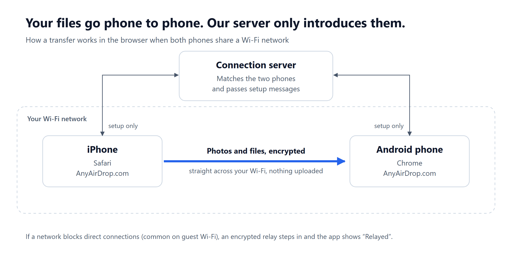
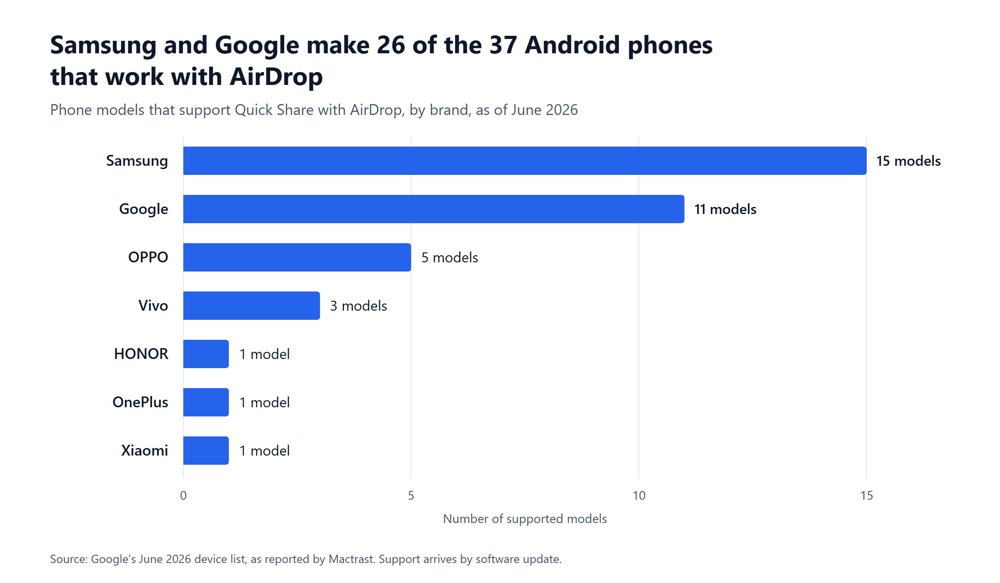

import TransferTool from "@/components/TransferTool.astro";
import TestedBox from "@/components/TestedBox.astro";

{/*
PUBLISH CHECKLIST (delete this block when done)
1. Fill the TestedBox and the timed-results table with real test data. Never estimate.
2. Replace every SCREENSHOT comment with a real screenshot from the shipped tool.
3. Re-check the Quick Share supported-phone list against Google and Samsung on publish day.
4. Verify on real phones: Quick Share and AirDrop work without a shared Wi-Fi network;
   "Save as Video" for Live Photos; where Downloads land on Pixel and Galaxy;
   the Quick Settings path to Quick Share visibility on Pixel and on Galaxy (One UI);
   whether some phones need a separate "share with Apple devices" switch;
   "Copy iCloud Link" in the iPhone Photos share sheet; cross-platform speed vs our own timings.
5. Confirm the AnyAirDrop steps match the shipped UI (device names, Accept prompt, QR pairing).
6. Set author, reviewer, publishDate and updatedDate. Set draft: false.
*/}

If your Android phone is a recent Pixel or Galaxy, you can now AirDrop to it directly: it shows up in the iPhone's share sheet like any Apple device. For every other Android phone, the fastest way is a browser-based tool over your Wi-Fi, with nothing to install on either phone.

**Short answer:** On a supported Android phone (Pixel 8a, Pixel 9 and Pixel 10 phones, Galaxy S24 and newer flagships, and some OPPO, Vivo, OnePlus, Xiaomi and HONOR models as of June 2026), set Quick Share to *Everyone for 10 minutes* and send from the iPhone's AirDrop menu. On any other phone, open AnyAirDrop.com on both devices and send over Wi-Fi.

<TransferTool />

This guide walks through all five methods that actually work, shows which one fits your situation, and explains how to keep your photos and videos at full quality on the way.

<TestedBox
  devices={["TODO: iPhone model and iOS version", "TODO: Pixel model and Android version", "TODO: Galaxy model and One UI version", "TODO: budget Android model and version"]}
  network="TODO: router model and Wi-Fi standard"
  files="TODO: e.g. 50 HEIC photos, one 1 GB 4K video, one 20 MB PDF"
  date="TODO"
/>

## Which method should you use?

Pick the row that matches your phones and what you're sending. Each method has its own section below.

| Method | Works with | Install anything? | Best for |
| --- | --- | --- | --- |
| [AnyAirDrop in the browser](#method-1-send-from-iphone-to-android-in-the-browser) | Any iPhone, any Android | No | Quick sends on the same Wi-Fi, large videos, older phones |
| [Quick Share's AirDrop support](#method-2-use-quick-shares-airdrop-support) | iPhone plus a supported Android phone | No | Owners of recent Pixel, Galaxy and other flagship phones |
| [LocalSend](#method-3-localsend-free-open-source-app) | Any iPhone, any Android | Yes, on both phones | Regular transfers, or places with no internet at all |
| [iCloud link](#method-4-share-an-icloud-link) | Any phone with a browser | No | Sending photos to someone who isn't next to you |
| [Google Photos](#method-5-google-photos-for-your-whole-library) | Any iPhone, any Android | Yes, on the iPhone | Moving your whole photo library to Android |

## Can you AirDrop to Android?

Yes, but only recently, and not on every phone.

AirDrop is Apple's own feature. It finds nearby devices over Bluetooth, then sends the file over a direct Wi-Fi link between the two devices. Apple never released it for other platforms. Android's equivalent, Quick Share (formerly Nearby Share), used its own protocol, so for years an iPhone and an Android phone sitting side by side simply couldn't see each other.

Bluetooth was never a way around this. iPhones don't support sending files to non-Apple devices over Bluetooth, so the "pair them and send" trick that works between two Android phones fails with an iPhone.

That changed on 20 November 2025, when Google [made Quick Share work with AirDrop](https://techcrunch.com/2025/11/20/androids-quick-share-now-works-with-iphones-airdrop-starting-with-the-pixel-10-lineup/), starting with the Pixel 10. Samsung added the same support to the Galaxy S26 on [23 March 2026](https://heise.de/-11220599), and by [June 2026](https://www.mactrast.com/2026/06/as-promised-google-expands-airdrop-support-to-additional-android-phones/amp/) it covered older Galaxy flagships, the Pixel 9 family and phones from several other brands.

So today there are two very different situations:

- **Your Android phone is on the supported list.** Use Quick Share's AirDrop support (Method 2). It's built in and needs no app.
- **Your Android phone isn't on the list.** That includes most budget phones and anything more than a couple of years old. Use the browser method (Method 1), LocalSend (Method 3) or a cloud link (Methods 4 and 5).

## Method 1: Send from iPhone to Android in the browser

This works on every iPhone and every Android phone with a modern browser. Nothing gets installed and there's no account.

*Disclosure: AnyAirDrop is our tool, so weigh this recommendation accordingly. Where another method is genuinely better, we say so.*

**How it works:** both browsers connect to each other directly over your Wi-Fi, using a standard browser technology called WebRTC. Our server only introduces the two devices. The file itself travels straight from phone to phone, encrypted, and never gets uploaded anywhere. There's no file size limit.

### Steps: iPhone to Android

1. **Connect both phones to the same Wi-Fi network.** A home or office network works best. Guest and hotel networks often block devices from seeing each other (see [Troubleshooting](#troubleshooting)).
2. **On the Android phone,** open Chrome or Samsung Internet and go to **AnyAirDrop.com**. The phone gets a random friendly name, such as "Blue Otter."
3. **On the iPhone,** open Safari and go to **AnyAirDrop.com**. Within a few seconds the Android phone appears on screen under its name.
4. **Tap the Android phone's name,** then choose **Photo Library** to send photos and videos, or **Choose Files** for documents and anything in the Files app. You can select many items at once.
5. **On the Android phone, tap Accept.** The files download at Wi-Fi speed and save to the **Downloads** folder.

{/* SCREENSHOT 1: both phones on AnyAirDrop.com, each showing the other device's name. */}
{/* SCREENSHOT 2: iPhone picker with several photos selected. */}
{/* SCREENSHOT 3: Android Accept prompt showing file count and total size. */}
{/* SCREENSHOT 4: Android Downloads folder in Files by Google with the received photos. */}

If the Android phone doesn't appear in step 3, tap **Pair with code** on one phone and scan the QR code with the other. Pairing connects the two phones even when the network keeps them apart. The status badge then tells you whether the transfer runs directly over your Wi-Fi or through our relay.

### Steps: Android to iPhone

The same page works in the other direction. Open AnyAirDrop.com on both phones, tap the iPhone's name on the Android phone, pick your files, and tap **Accept** on the iPhone. Photos can go straight into the Photos app; documents go to Files. Our [Android to iPhone guide](/android-to-iphone/) covers where everything lands.

### Tips for large videos

- Keep both screens on and the browser in front until the transfer finishes. Phones pause background tabs to save battery, which can stall a long transfer.
- Plug both phones in for multi-gigabyte files, and turn off Low Power Mode on the iPhone.
- Stay on the same Wi-Fi band if you can. A phone that drops from 5 GHz to 2.4 GHz will slow down noticeably.

## Method 2: Use Quick Share's AirDrop support

If your Android phone supports it, this is the most seamless option: the Android phone appears right in the iPhone's AirDrop sheet, and the iPhone appears in Android's Quick Share sheet.

### Supported phones

As of June 2026, these phones support Quick Share with AirDrop, according to [Google's announcement as reported by Mactrast](https://www.mactrast.com/2026/06/as-promised-google-expands-airdrop-support-to-additional-android-phones/amp/):

| Brand | Models |
| --- | --- |
| Google | Pixel 10, 10 Pro, 10 Pro XL, 10 Pro Fold, 10a · Pixel 9, 9 Pro, 9 Pro XL, 9 Pro Fold, 9a · Pixel 8a |
| Samsung | Galaxy S26, S26+, S26 Ultra · S25, S25+, S25 Ultra, S25 Edge · S24, S24+, S24 Ultra · Z Flip7, Z Fold7, Z Flip6, Z Fold6 · Z TriFold |
| OPPO | Find X9, X9 Pro, X9 Ultra, X9s · Find N6 |
| Vivo | X300, X300 Pro, X300 Ultra |
| OnePlus | OnePlus 15 |
| Xiaomi | Xiaomi 17T Pro |
| HONOR | Magic V6 |

The list keeps growing, and support arrives through software updates. Before you start, install every pending system update on the Android phone. Our [Quick Share and AirDrop guide](/blog/quick-share-airdrop/) keeps a dated list of every supported model.

### Steps: iPhone to a supported Android phone

1. **Turn on Wi-Fi and Bluetooth on both phones.** Unlock both screens and keep them within a few metres of each other.
2. **On the Android phone, make it visible.** Swipe down twice to open Quick Settings, touch and hold **Quick Share**, and set who can share with you to **Everyone for 10 minutes**. Some phones also show a separate option for sharing with Apple devices; turn it on.
3. **On the iPhone, open the photo or file and tap Share,** then **AirDrop**. The Android phone appears alongside nearby Apple devices.
4. **Tap the Android phone,** then tap **Accept** on the Android phone when the request appears.

{/* SCREENSHOT 5: Android Quick Share visibility set to Everyone for 10 minutes. */}
{/* SCREENSHOT 6: iPhone AirDrop sheet showing the Android phone. */}

### Steps: supported Android phone to iPhone

1. **On the iPhone,** open Control Center, touch and hold the connectivity controls, tap **AirDrop**, and choose **Everyone for 10 Minutes**. You can also set this in Settings, General, AirDrop.
2. **On the Android phone,** open the photo or file, tap **Share**, then **Quick Share**, and pick the iPhone.
3. **On the iPhone, tap Accept.**

After ten minutes, the iPhone switches back on its own. On iOS 16.2 and later it returns to Contacts Only if you're signed in to an Apple Account, [according to Apple](https://support.apple.com/en-us/119857). That's a sensible privacy default, so you don't need to change it back yourself.

### What to know before you rely on it

- **Only recent phones.** The supported list skews heavily toward 2024 to 2026 flagships. Most budget and mid-range Android phones aren't on it.
- **The receiving side must be visible to everyone, briefly.** Both Google's and Apple's instructions use the ten-minute "everyone" setting on the receiving phone.
- **Early reports say it's slower than iPhone-to-iPhone AirDrop.** For photos and short clips you won't notice; for a long 4K video, the browser method or LocalSend may finish sooner. {/* TODO: confirm with our own timed test. */}

## Method 3: LocalSend (free, open-source app)

[LocalSend](https://github.com/localsend/localsend) is a free, open-source app for Android, iPhone, Windows, macOS and Linux. It sends files between devices on the same local network, and it works with no internet connection at all.

1. Install LocalSend on both phones from Google Play and the App Store.
2. Connect both phones to the same Wi-Fi network, or connect one phone to the other's mobile hotspot.
3. Open LocalSend on both phones. On the iPhone, tap **Send**, pick your files, then tap the Android phone's name.
4. Tap **Accept** on the Android phone.

**Choose LocalSend when** you move files between the same devices every week, or when there's no internet connection, for example on a train with one phone acting as a hotspot. **Skip it when** you're helping someone once: asking them to install an app is usually the slowest part of the whole job.

## Method 4: Share an iCloud link

If the person with the Android phone isn't next to you, an iCloud link is the simplest option. It needs iCloud Photos turned on on your iPhone.

1. In Photos, select the photos and videos you want to send.
2. Tap **Share**, then **Copy iCloud Link**.
3. Send the link by text, WhatsApp or email. The recipient opens it in any browser on Android and downloads the originals.

iCloud links [expire automatically after 30 days](https://support.apple.com/guide/icloud/mm93a9b98683). Because the files upload to iCloud and download again, this is much slower than a direct Wi-Fi transfer for large videos, and it uses your internet data on both ends.

## Method 5: Google Photos for your whole library

If you're moving your photo library to Android for good, or you want new iPhone photos to keep appearing on your Android phone, use Google Photos.

1. Install Google Photos on the iPhone and sign in with the same Google account you use on the Android phone.
2. Turn on **Backup** and choose **Original quality** if you want full-resolution files.
3. Wait for the backup to finish. Your photos then appear in Google Photos on the Android phone.

Backups count against your Google account storage, which is shared across Gmail, Drive and Photos. For a full phone switch, use the transfer tool your new phone offers during setup, such as Samsung Smart Switch on Galaxy phones or the copy-data step when you set up a Pixel.

## What doesn't work (or works badly)

- **Bluetooth.** As covered above, iPhones won't send files to Android phones over Bluetooth.
- **Messaging apps for photos and video.** WhatsApp, Messenger and most other chat apps compress photos and videos by default to save data. The picture looks fine on a phone screen but loses detail when you zoom, crop or print. Some apps offer an HD or "send as document" option; use it if a chat app is your only choice.
- **Email.** Most email services cap attachments at around 20 to 25 MB, which is a few photos or a few seconds of 4K video.

## Speed and quality compared

| Method | Keeps original quality | Size limit | Needs internet |
| --- | --- | --- | --- |
| AnyAirDrop (browser) | Yes | None | Only to connect the two devices |
| Quick Share with AirDrop | Yes | None stated | No {/* TODO: verify on real phones */} |
| LocalSend | Yes | None | No |
| iCloud link | Yes | Your iCloud storage | Yes, upload and download |
| Google Photos (Original quality) | Yes | Your Google storage | Yes, upload and download |
| Messaging apps (default settings) | No, compressed | Varies by app | Yes |

We timed each direct method with the same files on the same network. {/* TODO: insert the timed-results table and the speed chart (images/speed-test.png) from the real test. Columns: method, 50 HEIC photos, 1 GB 4K video, notes. Do not publish this section without real numbers. */}

## How to keep photos and videos at full quality

### HEIC photos

iPhones save photos as HEIC (a High Efficiency format) by default. Android has supported HEIC since [Android 10](https://source.android.com/docs/core/camera/heif), so most phones in use today open these files without trouble. Older phones may show an error or a blank thumbnail.

You have two easy fixes if the Android phone can't open them:

- When you share through AirDrop, Messages or email, [Apple says](https://support.apple.com/en-us/116944) the iPhone may automatically send a more compatible format, such as JPEG, if the receiving device doesn't support the newer one.
- To have the iPhone shoot JPEG from now on, go to **Settings, Camera, Formats** and choose **Most Compatible**. Files get larger, but every device opens them.

### Live Photos

Android has no Live Photo format, so the receiving phone shows a still image. To keep the motion, open the Live Photo on the iPhone, tap **Share**, then **Save as Video**, and send the new video instead.

### Videos

iPhones record HEVC video by default, which recent Android phones play fine. If an older phone stutters or plays only sound, switch the iPhone to **Most Compatible** (above) before recording, or play the clip in an app like VLC, which handles HEVC itself.

### Date and location

Direct transfers (Methods 1, 2 and 3) send the original file, so the date taken and the location stay intact, and Google Photos sorts the photos correctly. Chat apps often strip this information.

## Troubleshooting

**The Android phone doesn't appear in the browser.** Check that both phones are on the same Wi-Fi network, not one on Wi-Fi and one on mobile data. Turn off any VPN on either phone. Guest, hotel and campus networks often isolate devices from each other; use **Pair with code** instead.

**The Android phone doesn't appear in the iPhone's AirDrop sheet.** Confirm the model is on the supported list and fully updated. Set Quick Share to **Everyone for 10 minutes** again, since it switches back after ten minutes. Make sure Wi-Fi and Bluetooth are on, both screens are unlocked, and the phones are close together.

**The transfer stops partway.** Keep the browser open and the screen on until it finishes. On the iPhone, temporarily set Auto-Lock to a longer time in **Settings, Display & Brightness**, and turn off Low Power Mode.

**You can't find the files on Android.** Browser downloads go to the **Downloads** folder. Open the Files app (Files by Google on most phones, My Files on Galaxy) and tap **Downloads**. Google Photos also shows them under the device folders in your Library.

**The photos won't open.** See [HEIC photos](#heic-photos) above.

For problems between Apple devices, see our guide to [fixing AirDrop when it's not working](/blog/airdrop-not-working/).

## FAQ

### Can you AirDrop from an iPhone to an Android phone?

Yes. Supported Android phones, including recent Pixel and Galaxy models, appear in the iPhone's AirDrop sheet once Quick Share is set to *Everyone for 10 minutes*. For any other Android phone, use a browser tool like AnyAirDrop or an app like LocalSend.

### Can an iPhone AirDrop to a Samsung phone?

Yes, if it's a supported Galaxy model: the Galaxy S24, S25 and S26 series, plus the recent Z Flip, Z Fold and Z TriFold phones, as of June 2026. Older Galaxy phones can use the browser method. Our [Samsung AirDrop guide](/blog/airdrop-on-samsung/) has the full settings.

### Is there an AirDrop app for Android?

There's no official AirDrop app for Android from Apple. Quick Share is built into Android and now works with AirDrop on supported phones. On other phones, LocalSend is a good free app, and browser tools like AnyAirDrop need no app at all.

### Can I AirDrop from Android to an iPhone?

Yes, the same methods work in reverse. With Quick Share, set the iPhone to *Everyone for 10 Minutes* first. See our [Android to iPhone guide](/android-to-iphone/) for every option.

### Can I send files from iPhone to Android without Wi-Fi?

Yes. LocalSend works over one phone's mobile hotspot with no internet connection. Quick Share with AirDrop connects the phones directly, but needs Wi-Fi and Bluetooth switched on. The browser method needs an internet connection to introduce the two phones.

### Is it safe to accept files from an iPhone on Android?

With all the direct methods here, nothing arrives until you tap **Accept**, and the transfer is encrypted. The usual rule applies: only accept files you expected from people you know, and decline anything from a device name you don't recognise.

## The bottom line

If you have a recent Pixel, Galaxy or other supported flagship, Quick Share's AirDrop support is the most natural option and it's already on your phone. For every other Android phone, and for big videos, open AnyAirDrop.com on both devices and send over your Wi-Fi in seconds. Use LocalSend when there's no internet, and an iCloud link when the other person is somewhere else.

**Related guides:** [Send files from Android to iPhone](/android-to-iphone/) · [AirDrop on Samsung Galaxy](/blog/airdrop-on-samsung/) · [Quick Share now works with AirDrop](/blog/quick-share-airdrop/) · [Transfer photos from iPhone to Android without losing quality](/blog/transfer-photos-iphone-to-android/) · [The best AirDrop alternatives](/blog/airdrop-alternatives/)

## Sources

- Apple: [Use AirDrop on your iPhone](https://support.apple.com/en-us/119857) · [Using HEIF or HEVC media on Apple devices](https://support.apple.com/en-us/116944) · [Share photos with iCloud Links](https://support.apple.com/guide/icloud/mm93a9b98683)
- Android Open Source Project: [HEIF imaging](https://source.android.com/docs/core/camera/heif)
- TechCrunch: [Android's Quick Share now works with iPhone's AirDrop, starting with the Pixel 10](https://techcrunch.com/2025/11/20/androids-quick-share-now-works-with-iphones-airdrop-starting-with-the-pixel-10-lineup/), 20 November 2025
- heise online: [Samsung brings AirDrop support to the Galaxy S26](https://heise.de/-11220599), 23 March 2026
- Mactrast: [Google expands AirDrop support to more Android phones](https://www.mactrast.com/2026/06/as-promised-google-expands-airdrop-support-to-additional-android-phones/amp/), June 2026
- LocalSend: [project page on GitHub](https://github.com/localsend/localsend)

*AirDrop is a trademark of Apple Inc. AnyAirDrop is not affiliated with or endorsed by Apple. Other product names are trademarks of their respective owners.*

## Changelog

- TODO publish date: First published.
