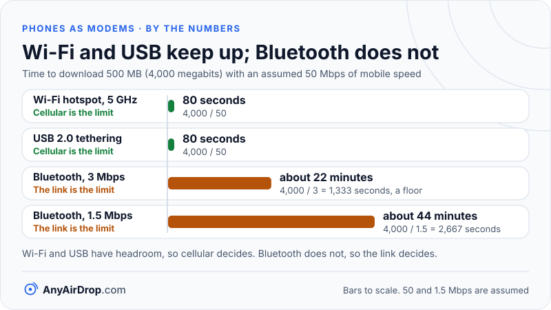

Android can share its mobile data with another device in three ways: as a Wi-Fi hotspot, over a USB cable (USB tethering) or over Bluetooth (Bluetooth tethering). All three give the other device a network connection that exits through the phone's cellular modem. They differ in how fast the link between the phone and the other device can be, how much battery they use and how much setup they need.

**Short answer:** Wi-Fi hotspot is the flexible default and can serve several devices, USB tethering is the steadiest and can charge the phone at the same time, and Bluetooth tethering is the slowest but usually the gentlest on power. In most cases the cellular connection is the real limit, so the best choice is the one whose own ceiling is comfortably above your mobile speed and that suits the device you are connecting.

## What all three have in common

Whichever link you choose, the phone behaves as a small router. As [Android's tethering documentation](https://source.android.com/docs/core/ota/modular-system/tethering) puts it, the same module shares the device's internet connection with clients over Wi-Fi, USB, Bluetooth or Ethernet, using NAT and DHCP for IPv4. We walk through those steps in [how a phone hotspot works](/blog/how-phone-hotspot-works/). The only thing that changes between methods is the physical link between the phone and the client.

That leaves a chain with three stages: the internet to the tower, the tower to the phone (cellular), and the phone to your laptop (the tethering link). The speed you get is set by the slowest stage. Most of the time that is the cellular stage, which is why a fast link between phone and laptop does not make the internet faster. [Why phone hotspots are slow](/blog/why-phone-hotspots-are-slow/) covers how to tell which stage is the bottleneck.

## How each method works

**Wi-Fi hotspot.** The phone's Wi-Fi chip becomes an access point and broadcasts a network. Other devices join with a password. Google's help page says the phone can share its mobile data with up to 10 other devices this way. The link is shared radio airtime, so more devices means smaller slices, as explained in [how Wi-Fi works](/blog/how-wifi-works/).

**USB tethering.** The phone is connected to the computer with a cable, and the computer treats the phone as a USB network adapter. Depending on the phone and software version, the phone presents itself using one of several USB networking protocols, and most computers recognize it with built-in or readily available drivers. Google's help page states that Macs can't tether with Android by USB, so on that combination you would use Wi-Fi instead. The computer receives its address from the phone over the cable, just as it would over Wi-Fi.

**Bluetooth tethering.** The phone and the other device are first paired. Then the other device sets up a network connection over Bluetooth, and Bluetooth tethering is switched on in the phone's hotspot settings. The Bluetooth SIG calls this the [Personal Area Networking (PAN) profile](https://www.bluetooth.com/specifications/specs/personal-area-networking-profile-1-0/), which describes how Bluetooth devices form an ad-hoc network or reach another network through an access point. Because it uses Bluetooth Classic, it inherits that radio's limits.

## The speed ceilings

Each link has a theoretical ceiling, and each real-world result is well below it.

| Method | Theoretical ceiling | What limits it in practice |
| --- | --- | --- |
| Wi-Fi hotspot (2.4 GHz) | Link rates in the low hundreds of Mbps on newer Wi-Fi generations | Crowded band, shared airtime, phone antenna, distance |
| Wi-Fi hotspot (5 GHz) | Link rates from several hundred Mbps up, depending on generation and channel width | Distance, walls, the number of connected devices |
| USB tethering (USB 2.0 port or cable) | 480 Mbps signaling rate | Protocol overhead, phone and computer drivers |
| USB tethering (USB 3.x) | 5 Gbps and up | Almost never the bottleneck compared with cellular |
| Bluetooth tethering | 1, 2 or 3 Mbps over the air for Bluetooth Classic, according to the [Bluetooth SIG](https://www.bluetooth.com/learn-about-bluetooth/tech-overview/) | Overhead and the low base rate |

Wi-Fi numbers depend on the phone and the band it picked, and "link rate" is not what you actually get, as [Wi-Fi link speed vs real speed](/blog/wifi-link-speed-vs-real-speed/) explains. For Bluetooth, the three figures are the over-the-air rates for basic rate, EDR (Enhanced Data Rate) with two-bit modulation and EDR with three-bit modulation. Real throughput is lower once headers, retransmissions and the phone's own processing are counted, so assume the usable rate is a fraction of the label.

### A worked example: the slowest link sets the pace

Suppose your cellular connection delivers 50 Mbps, a figure chosen only for illustration. You want to download a file of 500 megabytes, which is 500 x 8 = 4,000 megabits. How long does each tethering link take?

| Tethering link | Link ceiling (on paper) | Effective limit | Time for 4,000 megabits |
| --- | --- | --- | --- |
| Wi-Fi hotspot, 5 GHz | Far above 50 Mbps | 50 Mbps (cellular) | 4,000 / 50 = 80 seconds |
| USB 2.0 tethering | 480 Mbps | 50 Mbps (cellular) | 80 seconds |
| Bluetooth at the 3 Mbps over-the-air rate | 3 Mbps | 3 Mbps (the link) | 4,000 / 3 = about 1,333 seconds, roughly 22 minutes |
| Bluetooth, if usable throughput were 1.5 Mbps (an assumed figure) | 1.5 Mbps | 1.5 Mbps | 4,000 / 1.5 = about 2,667 seconds, roughly 44 minutes |

The 3 Mbps row is a floor on the time, not a typical result, because the over-the-air rate is never fully available to your data. The calculation shows the rule: the effective speed is the minimum of the stages. Wi-Fi and USB both have headroom, so cellular decides. Bluetooth does not, so the link decides, even though your phone has plenty of mobile speed to spare. If your mobile connection were a gigabit, the same logic would put Wi-Fi in charge instead.

*The cellular link caps Wi-Fi and USB at the same time, while Bluetooth's own low rate becomes the limit.*

## Battery, heat and power

The cellular modem is the main power cost in all three cases, since it is working hard to move traffic. Beyond that:

- **Wi-Fi hotspot** adds the most. The Wi-Fi radio acts as an access point and must stay awake to hear clients, and the phone also processes the traffic. Expect noticeable battery drain and warmth. Google's help page advises keeping devices plugged in while tethering, turning tethering off when you finish and, if your phone offers it, enabling the setting that switches the hotspot off automatically when nothing is connected.
- **USB tethering** is easier on the battery because the cable can supply power. A laptop port may supply less than the phone is using, so the phone does not always gain charge, but it drains more slowly than with a wireless hotspot. The exact behavior depends on the port and cable.
- **Bluetooth tethering** uses the least radio power for the link itself, which is its main advantage. The modem still draws what it draws.

Heat matters beyond comfort. When phones get hot, they reduce performance to protect themselves, and that can cut speed on a long session.

## Latency and stability

Latency is the delay before data starts to flow. A Wi-Fi hop adds some milliseconds and varies more than a cable, since it competes with other nearby networks. A wire has none of that sharing and tends to give the steadiest results. Bluetooth is generally the slowest to respond, because of its low data rate. All three add less delay than the trip across the cellular network and the internet, so for web browsing the difference is small. It matters more for video calls and games, where USB or a clean 5 GHz hotspot is the better bet.

Stability follows the same order. A cable does not drop out because someone microwaves lunch, while a Wi-Fi hotspot can slow down or lose clients when the 2.4 GHz band is busy, as described in [Wi-Fi bands compared](/blog/wifi-bands-2-4-5-6-ghz/).

## Setup and compatibility

The menu names for these settings differ by manufacturer and Android version, so the labels below describe where to look rather than quote exact wording.

- **Wi-Fi hotspot.** Look for a hotspot or tethering section in network settings or in the quick settings panel. Set a name and a strong password. Other devices find the network in their normal Wi-Fi list.
- **USB tethering.** Connect a data-capable cable, then look for a USB tethering toggle in the same hotspot and tethering area. It usually becomes available only once a computer is connected. Not every cable carries data, so a charge-only cable will not work.
- **Bluetooth tethering.** Pair the phone with the other device, enable Bluetooth tethering on the phone, and then, on the other device, connect to the phone as a network source. The second step is the one people forget.

Carrier policy can also apply to any of the three. Google's page says some carriers restrict tethering or bill extra for it, so check your plan.

## Which should you choose?

| Situation | Good choice | Reason |
| --- | --- | --- |
| Several devices need internet at once | Wi-Fi hotspot | The only method that serves multiple devices easily |
| One laptop, long session, low battery | USB tethering | Steady, wired and kinder to power |
| Wi-Fi band is crowded or blocked | USB tethering | Not affected by radio interference |
| Mac laptop | Wi-Fi hotspot | Google says USB tethering with Android does not work on Macs |
| A tiny sensor or older device with no Wi-Fi | Bluetooth tethering | Low power, adequate for light traffic |
| Maximum speed on a fast 5G connection | USB 3 cable or 5 GHz hotspot | Bluetooth would become the bottleneck |

## Which tethering mode helps when you only want to move files

The three methods turn the phone and the other device into a tiny two-node or multi-node network, so each one also gives you a local link, but they are not equally useful for moving files between your own devices.

A Wi-Fi hotspot gives you a local network where a phone and a laptop can exchange files at Wi-Fi speed without using mobile data, as long as the devices can reach each other. That is described in [transferring files over a hotspot without internet](/blog/transfer-files-over-a-hotspot-without-internet/). On most phones, USB tethering and file-transfer mode are separate choices in the USB settings, so when you want to copy files over the cable, you usually switch the mode instead of relying on tethering. Bluetooth tethering is the least useful for file transfer, since 1 to 3 Mbps over the air makes large files slow; see [Bluetooth file transfer explained](/blog/bluetooth-file-transfer-explained/) for why it is built for small items.

When the goal is moving files between a phone and a PC and you already share a Wi-Fi network, using that network directly is faster than tethering, because tethering adds the phone as a middleman. [Transferring files between a PC and a phone over Wi-Fi](/blog/transfer-files-between-pc-and-phone-over-wifi/) covers the options.

## Common questions

### Is USB tethering faster than a Wi-Fi hotspot?

Not always. The cable has a higher ceiling and is steadier, but if your mobile connection is the limit, both give the same internet speed. USB is usually better for stability and battery, and a clean 5 GHz hotspot can match it for raw speed.

### Does Bluetooth tethering use less data?

No. Data use depends on what the connected device downloads, not on the link. Bluetooth is slower, so you will transfer less per minute, but every byte still counts against your mobile plan.

### Why does USB tethering not work on my Mac?

Google's help page says Macs can't tether with Android by USB. A Wi-Fi hotspot works with Macs, and some third-party software offers workarounds that vary in reliability.

### Can I use two methods at once?

Often yes, but it depends on the phone and software version, since the settings are separate toggles on many devices. Running more than one raises battery use and heat, and there is rarely a reason to, because one method is usually enough.

### Do all three methods work without a SIM or mobile data?

No. Tethering shares the phone's cellular internet connection, so it needs mobile data to be useful for the internet. Some phones can also share the phone's Wi-Fi connection through the hotspot, but that depends on the model.

## Key takeaways

- All three methods use the phone as a router; only the link between phone and client differs.
- The effective speed is the slowest of the stages, which is usually the cellular connection, so a faster tethering link does not speed up a slow signal.
- Bluetooth Classic tops out at 1 to 3 Mbps over the air, so it becomes the bottleneck on any decent mobile connection.
- USB is the steadiest and easiest on the battery, but Google says it does not work with Macs.
- Wi-Fi hotspot is the most flexible and the only method that serves several devices easily, at the cost of power and shared airtime.
- Menu names and carrier rules vary, so check your phone and plan.

## Sources

- Google Android Help: [Share a mobile connection by hotspot or tethering on Android](https://support.google.com/android/answer/9059108)
- Android Open Source Project: [Tethering module](https://source.android.com/docs/core/ota/modular-system/tethering)
- Bluetooth SIG: [Bluetooth technology overview](https://www.bluetooth.com/learn-about-bluetooth/tech-overview/)
- Bluetooth SIG: [Personal Area Networking Profile 1.0](https://www.bluetooth.com/specifications/specs/personal-area-networking-profile-1-0/)
