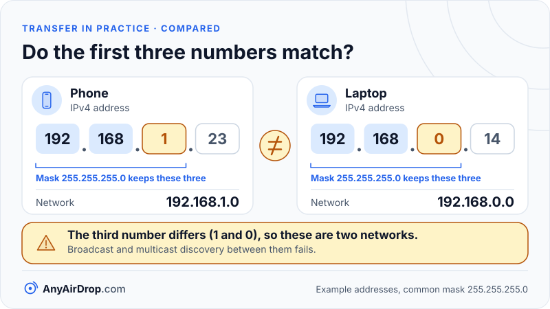

When two devices on the same Wi-Fi do not see each other, the cause is almost always one of a short list: they are not on the same network, a permission or setting is off, something is redirecting or filtering their traffic, or a second router splits them into separate networks. Checking them in a sensible order finds the fault faster than restarting everything.

**Short answer:** a local transfer needs two things: the devices must be able to discover each other, and they must be able to connect. Discovery relies on small broadcast or multicast messages that only travel inside one local network, so anything that puts the devices on different networks, blocks those messages, or stops the app from using the network will hide them. Start with the network, then permissions, then VPNs, isolation and firewalls.

## What "finding each other" requires

Discovery usually works in one of two ways. In the first, each device announces itself to the local network with a multicast message, and others listen. The standard for this is Multicast DNS (mDNS), defined in [RFC 6762](https://www.rfc-editor.org/rfc/rfc6762): queries are sent to the multicast address 224.0.0.251 (or FF02::FB for IPv6) on UDP port 5353. Names under `.local` are, as the RFC puts it, meaningful only on the link where they originate, and mDNS traffic is not forwarded by routers. [Our mDNS guide](/blog/mdns-bonjour-device-discovery/) goes deeper.

In the second, both devices contact a meeting-point server on the internet, which introduces them, as web-based tools do ([WebRTC data channels explained](/blog/webrtc-data-channels-explained/)). They then try to connect directly using the process in [STUN, TURN and ICE explained](/blog/stun-turn-ice-explained/). Here the internet is needed for the introduction, but the connection itself still has to be possible.

Either way, a failure is one of three things: the devices are on different networks, something blocks the discovery messages, or something blocks the connection. The checks below follow that logic.

## Check 1: are both devices on the same network?

This is the most common cause, and it hides in plain sight. "On Wi-Fi" is not the same as "on the same network".

- **Guest networks.** Many routers offer a separate guest network. It may have a similar name, and it is often deliberately cut off from the main network. If one device is on "Home" and another on "Home-Guest", they cannot see each other. See [client isolation and guest networks](/blog/client-isolation-guest-networks-and-device-visibility/).
- **Mobile data.** A phone can show a Wi-Fi icon while the app uses cellular data, for example when the Wi-Fi network has no internet access and the phone switches. This depends on the phone and its settings. Try turning mobile data off briefly to see whether the phone is really using the Wi-Fi.
- **2.4 GHz and 5 GHz.** Most home routers broadcast both bands from one box. If they share a name, the router steers your device to a band. If they have separate names such as "Home" and "Home-5G", the question is whether both land on the same network. Usually they do: the two bands come from the same router and share the same local network, so a phone on 5 GHz and a laptop on 2.4 GHz can see each other. The exceptions are setups with extra access points, mesh nodes or extenders that create their own network. [Bands](/blog/wifi-bands-2-4-5-6-ghz/) and [mesh and extenders](/blog/mesh-wifi-vs-extenders-vs-powerline/) explain the differences.
- **A hotspot.** A phone acting as a hotspot is its own network. A laptop joined to it can reach the phone, but not a device that is joined to your home router.

Why it matters: discovery messages are link-local. They never leave the network they started on, so two devices on different networks are invisible to each other no matter how close they are.

## Check 2: radios, power saving and permissions

### Wi-Fi, Bluetooth and airplane mode

Airplane mode turns off radios, and after switching it off you may need to confirm that Wi-Fi and Bluetooth are each on again. Some nearby-sharing systems use Bluetooth to announce a device, even when the data moves over Wi-Fi. For example, [Google's Quick Share for Windows requirements](https://support.google.com/android/answer/13801258?hl=en) list Bluetooth on both devices, both on the same network, and the devices within about 5 meters (16 feet).

### Power saving

Battery-saving modes can limit background network activity, and a phone that is asleep may stop listening for discovery messages. What each mode does varies by manufacturer and software version. If a device is only discoverable when its screen is on, try keeping it awake and the app in the foreground.

### App permissions

Modern phones ask the user for permission before an app can look for nearby devices.

- **Android.** Android 12 added a "Nearby devices" permission group, and Android 13 added the `NEARBY_WIFI_DEVICES` permission to it, which [Android's developer documentation](https://developer.android.com/develop/connectivity/wifi/wifi-permissions) describes for apps that manage Wi-Fi connections to nearby devices. The system asks for the group's permissions in a single dialog. On versions before Android 13, those apps needed location permission instead, which is why a nearby-sharing app may still ask for location. The exact wording differs between phone makers, so look in the app's permission screen for entries about nearby devices or location.
- **iPhone.** Since iOS 14, an app must ask permission to find and connect to devices on your local network. [Apple's support page](https://support.apple.com/en-us/102229) says you can allow or revoke this for each app under Settings, in Privacy & Security, then Local Network. If you tapped Don't Allow once, the app cannot browse your local network, and the fix is in that list, not in the app.

## Check 3: is a VPN running?

A VPN (virtual private network) sends your traffic through an encrypted tunnel to a server elsewhere. While it is active, your device may treat all addresses, including your local ones, as reachable only through the tunnel. Local discovery messages may not leave the device, and the other device's local address may not be reachable at all. Some VPN apps include a setting to allow access to the local network, with names that vary. The simplest test is to pause the VPN on both devices, transfer, and turn it back on.

## Check 4: is client isolation on?

Client isolation (also called AP isolation) is a router setting that stops devices on the same Wi-Fi from talking to each other, while still letting each reach the internet. It is a protection, often on by default for guest networks and public hotspots. If your devices are on the right network and still invisible, this is the likely cause. Fix it by turning the option off for your private network, or by joining the non-isolated network. Do not turn it off on a shared or public network, where the protection is the point.

## Check 5: does the firewall allow it?

A firewall decides which incoming connections a device accepts. On Windows, the rules depend on the network profile. A Public profile hides the PC and blocks most incoming connections, while a Private profile permits sharing and discovery. [Microsoft's file sharing guide](https://support.microsoft.com/en-us/windows/experience/connectivity-networking/file-sharing-over-a-network-in-windows) advises setting a Wi-Fi network to Private for sharing, and Microsoft's [nearby sharing page](https://support.microsoft.com/en-us/windows/experience/connectivity-networking/fix-problems-with-nearby-sharing-in-windows) states that nearby sharing works only on a Private network. If Windows asked whether to allow an app through the firewall and you declined, the app can be re-allowed in the firewall settings. Do this only for networks you trust.

## Check 6: is multicast being filtered?

Some routers and access points handle multicast poorly. They may treat it as unwanted traffic, drop it on Wi-Fi to save airtime, or only deliver it to devices that asked for it. In that case, devices on the same network and subnet can still fail to discover each other by mDNS, although a direct connection by address would work. The same filtering can hurt browser-based tools: a browser may hide its local address behind a `.local` name, which the other device can resolve only if mDNS gets through ([STUN, TURN and ICE explained](/blog/stun-turn-ice-explained/) covers this). The setting names vary by brand and are often found under wireless or multicast options. If you suspect this, a good test is to connect both devices to a phone hotspot or a different router and see whether they appear. If they do, the first router is filtering something.

## Check 7: two routers and double NAT

A home with two routers in a row, often because an ISP gateway and a personal router were both left in routing mode, ends up with *double NAT*: two layers of address translation, and two separate local networks. Devices plugged into the inner router are on a different network from those on the outer one.

Here is how to tell. Look at each device's IPv4 address in its Wi-Fi details. With the common subnet mask 255.255.255.0, two devices are on the same network only if the first three numbers match.

- Phone: 192.168.1.23 and mask 255.255.255.0 gives network 192.168.1.0.
- Laptop: 192.168.0.14 and mask 255.255.255.0 gives network 192.168.0.0.

The mask keeps only the part of each address that identifies the network, here the first three numbers. The results differ (the third number is 1 on one device and 0 on the other), so these are two networks, and broadcast and multicast discovery between them fails. The usual cure is to put one router into access point or bridge mode, or to connect all devices to the same one. [Modem vs router vs access point](/blog/modem-vs-router-vs-access-point/) explains the roles, and [how a router works](/blog/how-a-router-works-nat-dhcp-dns/) covers NAT.

*Devices behind two routers in a row end up on different networks, and discovery messages never leave the network they start on.*

## Check 8: IPv6 and captive portals

**IPv6.** Devices usually have both an IPv4 and an IPv6 address on the same network. IPv6 local discovery uses its own multicast address (FF02::FB for mDNS). If a network filters IPv6 multicast, or an app only supports one of the two, discovery may work for some devices and not others. This is uncommon on home networks, but it can explain why one pair of devices works and another does not.

**Captive portals.** Hotel, airport and cafe Wi-Fi often shows a sign-in page before granting access. [RFC 8910](https://www.rfc-editor.org/rfc/rfc8910) explains that a captive portal highly restricts what you can do on the network until you satisfy its conditions. Until you sign in, devices may be limited to the portal, and public networks of this kind frequently isolate clients as well. A personal hotspot or a travel router is often easier than fighting a captive network.

## Ways around discovery when the checks do not fix it

If you work through the checks and still cannot connect, you have options that skip discovery. A pairing code or QR code tells the other device exactly which session to join, so nothing depends on broadcast messages. Typing the other device's IP address directly (where a tool allows it) skips multicast too. A phone's hotspot gives both devices one clean network without isolation. And a USB cable needs no network at all ([PC and phone methods compared](/blog/transfer-files-between-pc-and-phone-over-wifi/)).

AnyAirDrop.com is our own tool: devices on the same Wi-Fi find each other automatically, or you can pair with a 6-digit code or QR code. If a direct connection is impossible, an encrypted relay is used and the page says so. That fallback is a safety net, not a fix for a blocked local network, so it is still worth finding out why the devices could not connect directly.

## Common questions

### Why can't my phone see my laptop on the same Wi-Fi?

Most often they are on different networks (a guest network or a second router), client isolation is on, or a permission is off. Check the network names and IP addresses first, then the app's local network or nearby devices permission.

### Does 2.4 GHz vs 5 GHz matter for local transfers?

Usually not for discovery, since both bands from one router belong to the same local network. It matters for speed and range. The exception is when the bands are separate networks or served by different devices, such as an extender.

### Do both devices have to be on the same router?

They need to be on the same local network. Normally that means the same router, or access points and mesh nodes that extend it as one network. Two routers in a chain make two networks.

### Why does it work at home but not at work or in a hotel?

Offices and public networks commonly enable client isolation, restrict multicast, or require sign-in, to protect other users. That is intentional, and the answer is usually a personal hotspot or a cable.

### Should I turn off my firewall to test?

It is safer not to. Instead, set your network profile to Private if you trust the network, and allow the specific app. Turning a firewall off entirely exposes the device to every other device on the network.

## Key takeaways

- Discovery messages stay inside one local network, so devices on different networks never see each other.
- Check in order: same network, permissions and radios, VPN, client isolation, firewall, then multicast filtering and double NAT.
- Guest networks, VPNs and extra routers are the most common hidden causes.
- Compare the first three numbers of each device's IPv4 address; with a typical mask they must match.
- When discovery cannot be fixed, a pairing code, a hotspot or a cable bypasses it.

## Sources

- IETF: [RFC 6762, Multicast DNS](https://www.rfc-editor.org/rfc/rfc6762)
- IETF: [RFC 8910, Captive-Portal Identification in DHCP and Router Advertisements](https://www.rfc-editor.org/rfc/rfc8910)
- Apple Support: [If an app would like to connect to devices on your local network](https://support.apple.com/en-us/102229)
- Android Developers: [Wi-Fi permissions](https://developer.android.com/develop/connectivity/wifi/wifi-permissions)
- Microsoft Support: [File sharing over a network in Windows](https://support.microsoft.com/en-us/windows/experience/connectivity-networking/file-sharing-over-a-network-in-windows)
- Microsoft Support: [Fix problems with nearby sharing in Windows](https://support.microsoft.com/en-us/windows/experience/connectivity-networking/fix-problems-with-nearby-sharing-in-windows)
- Google: [Share files between Android and Windows with Quick Share](https://support.google.com/android/answer/13801258?hl=en)
