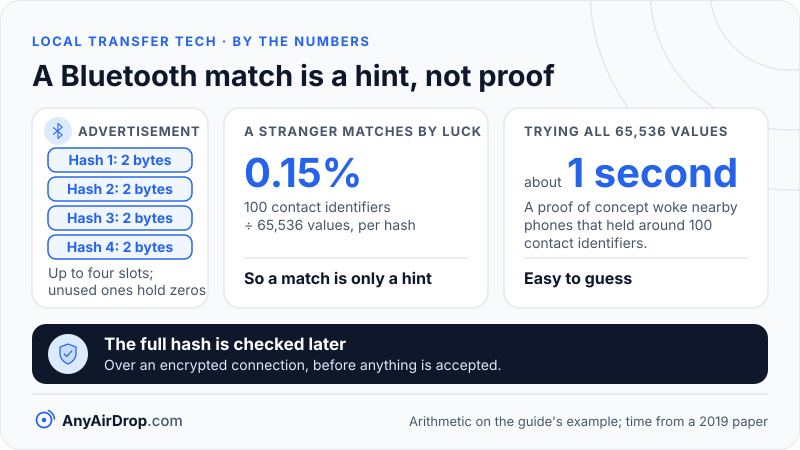

Apple's AirDrop is a three-stage conversation between two Apple devices. A Bluetooth Low Energy broadcast wakes the receiver, a private Wi-Fi link called AWDL (Apple Wireless Direct Link) carries the traffic, and a short exchange of encrypted web requests decides who the devices are, whether the receiver agrees, and where the file goes. No router and no internet connection take part.

**Short answer:** Bluetooth is used only to say "someone nearby wants to share", Wi-Fi does the actual moving of data, and TLS (Transport Layer Security, the same encryption used by secure websites) protects the conversation. In the default Contacts Only mode, devices also prove to each other, using signed Apple certificates, that they are people in each other's address books.

## What you see and what happens underneath

On the screen, AirDrop looks like one gesture: you tap Share, pick a person, and they tap Accept. Under that gesture there are four separate problems to solve, and each uses a different technology:

1. **Finding out that someone is nearby**, without keeping a power-hungry Wi-Fi radio switched on all the time. This is Bluetooth Low Energy's job.
2. **Creating a fast link between two devices** that may not be on the same Wi-Fi network, or on any network. This is AWDL.
3. **Working out who is who**, so a stranger cannot pretend to be your contact. This uses certificates, hashes and TLS.
4. **Getting consent and moving the file**, using plain HTTP requests inside the encrypted session.

The protocol is proprietary, and Apple documents its security properties in its [Platform Security guide](https://support.apple.com/guide/security/airdrop-security-sec2261183f4/web) but not every wire-level detail. The most complete public description of the wire format comes from academic reverse engineering, chiefly a 2019 paper presented at the [USENIX Security Symposium](https://www.usenix.org/conference/usenixsecurity19/presentation/stute) by researchers at TU Darmstadt and Northeastern University, and the open source [OpenDrop](https://github.com/seemoo-lab/opendrop) project that grew out of it. Everything below about message formats comes from that work and describes the behavior it observed in 2019. Apple can change details between software versions, and has added features since, such as the AirDrop codes described later.

## Step 1: the Bluetooth advertisement

When you open the share sheet, the sending device starts broadcasting small Bluetooth Low Energy advertisements. These are not a connection: they are one-way announcements that any receiver in range can overhear, in the same way a shop doorbell can be heard by anyone inside. Meanwhile, receivers that have AirDrop switched on regularly scan for these announcements.

The advertisement does not contain your name, phone number or email address. The researchers found that it carries up to four *contact hashes*. Each one is the first two bytes of a SHA-2 digest (a one-way scrambling function) of one of the contact identifiers registered to the sender's Apple Account, such as an email address or a phone number. Unused slots are filled with zeros.

### Why the hashes are so short

Two bytes is 16 bits, which allows only 65,536 distinct values. A value that coarse reveals very little about you, and the arithmetic shows how little. Suppose a receiver has 100 contact identifiers in its address book. A random stranger's two-byte hash will match at least one of them with a probability of about 100 ÷ 65,536, or roughly 0.15 percent (this is per hash, and an advertisement can carry up to four). So a match is only a hint, never proof.

The flip side is that two bytes are easy to guess. The USENIX paper points out that an attacker can try all 65,536 values, and reports a proof of concept that woke up nearby phones in about a second when they held around 100 contact identifiers. The full hash is checked later, over an encrypted connection, before anything is accepted.

*The advertisement is built to reveal very little, so the real identity check happens later, over an encrypted connection.*

## Step 2: the receiver wakes its AWDL interface

What a receiver does next depends on its setting:

- In **Contacts Only** mode, the receiver compares the hashes with the hashes of the identifiers in its own address book. If at least one matches, it activates AWDL. If none match, it stays silent, and the sender never learns the device exists.
- In **Everyone** mode, the receiver activates AWDL after seeing an AirDrop advertisement, with no comparison.
- With receiving off, it ignores the advertisement.

Apple's support documentation describes the Everyone choice as lasting [10 minutes](https://support.apple.com/en-us/119857), after which the device returns to Contacts Only if you are signed in with an Apple Account. The 2019 research also found that a device generally needs to be unlocked to be discoverable.

AWDL is a Wi-Fi mode, not a Bluetooth one. It is an ad hoc extension of the 802.11 standard, so the phone's ordinary Wi-Fi chip can talk directly to another Apple device on a shared channel, with no access point. Its channel-hopping design lets a device stay connected to your router and still talk to a nearby device. The mechanism is covered in detail in [Wi-Fi Direct, Wi-Fi Aware and AWDL explained](/blog/wifi-direct-wifi-aware-awdl-explained/).

## Step 3: finding the service and saying who you are

Once both devices are on the AWDL link, the sender looks for the AirDrop service with ordinary local-network discovery: multicast DNS and DNS-SD, the same technique that lets a laptop find a printer. A receiver's answer is a short record naming a host and a port. In the example flow the researchers published, the service ran on port 8770 of a host with a name like `Janes-iPhone.local`, and the address was an IPv6 link-local one that works only on that single link. [How mDNS and Bonjour work](/blog/mdns-bonjour-device-discovery/) walks through the same pattern with a sample exchange.

Then the sender opens a TLS connection and sends an HTTPS request, `POST /Discover`, that carries its *record data*. This is a blob signed by Apple that contains a UUID (a unique identifier tied to the device's certificate) and the full SHA-2 hashes of its contact identifiers. The receiver checks three things:

- the signature chains back to Apple's root certificate;
- the identifier matches the certificate used for this TLS session, which stops someone replaying a copied blob;
- at least one hash in the blob matches an entry in its own address book.

If all three pass, the receiver replies with its own record data, and the sender can show the person's name and contact photo. If they fail, or in Everyone mode where the sender may not be in the receiver's contacts, the connection is treated as *unauthenticated*: the receiver can still appear, but with only its device name and a generic icon. Apple's security guide describes the same split in the share sheet: verified contacts appear with a name and photo, and unverified devices appear under their device name with a silhouette icon.

## Step 4: Ask, accept, Upload

When you tap a person, the sender opens another TLS connection and sends `POST /Ask`. This request carries metadata about what is coming, plus a small preview thumbnail. The receiver's screen shows that preview with an Accept and a Decline button. The request stays open until the person answers.

Only if they accept does the sender send `POST /Upload`, whose body is the file itself. The receiver responds with a success code, and the TLS session is closed. With several recipients, the process repeats for each one. The exception is a transfer between two of your own devices signed in to the same Apple Account: Apple's [Mac help page](https://support.apple.com/guide/mac-help/use-airdrop-to-send-items-to-nearby-devices-mh35868/mac) says the item is then accepted and saved automatically.

Two practical consequences follow from this order. First, when the sender is another person, the file is not sent until the receiver agrees, so a stranger cannot push a file onto your phone. Second, what arrives unasked is only metadata and a thumbnail, so the preview is the one piece of content you can be shown before you decide.

## Contacts Only versus Everyone, on the wire

| | Contacts Only | Everyone (10 minutes) |
| --- | --- | --- |
| Receiver reacts to a Bluetooth advertisement | Only if a hash matches its address book | Any AirDrop advertisement |
| Who appears on the sender's screen | Verified contacts, with name and photo | Anyone nearby, often by device name only |
| Authentication | Signed record data and certificates both ways | Used when both sides can provide it; otherwise the connection is unauthenticated |
| Receiver must accept (sender is another person) | Yes | Yes |

The crucial point in the last row is that neither mode skips the consent step for a transfer from another person. Everyone mode widens who can be *seen*, not who can *send you data without asking*.

Apple's current documentation adds one more layer. On iOS 26.2, iPadOS 26.2, macOS 26.2 or later, a sender who is not in your contacts must enter an AirDrop code that the receiver reads out, and the two can then share for 30 days without a new code. The 2019 research predates this, so check Apple's pages for the software you run.

## Interoperability with Android's Quick Share

In November 2025, Google announced that Quick Share on Pixel 10 phones can exchange files with iPhones, iPads and Macs through Apple's AirDrop. [TechCrunch's report](https://techcrunch.com/2025/11/20/androids-quick-share-now-works-with-iphones-airdrop-starting-with-the-pixel-10-lineup/) of 20 November 2025 says it works when the Apple device is set to Everyone for 10 minutes, and that Google described the connection as direct and peer-to-peer, with no server in the middle. Google said it hoped to work with Apple on supporting Contacts Only later.

Later reports describe a wider rollout. [heise](https://heise.de/-11220599) reports that Google added the feature to the Pixel 9 series (not the Pixel 9a) and that Samsung's rollout on Galaxy S26 phones starts on 23 March 2026, and [Android Authority](https://www.androidauthority.com/samsung-galaxy-s26-airdrop-quick-share-wider-rollout-3651747/) says the iPhone must be set to Everyone for 10 minutes there too.

What is established is limited to that. TechCrunch says Google's post does not describe how the two companies worked together, and its report includes no response from Apple. Whether the Android side uses AWDL, a standardized radio mode, or another link is not something we can state. If you want the Android side of the story, see [how Quick Share works](/blog/how-quick-share-works/). Support is tied to specific phones and this area is still changing, so check the current Google and Apple documentation for your devices.

## Why AirDrop bypasses your router, and what to use on mixed devices

Apple's AirDrop is quick between Apple devices mostly because of what it avoids. Your home router is not a relay, so the file crosses the air once instead of going up to the access point and back down, as explained in [how Wi-Fi works](/blog/how-wifi-works/). The router's client isolation setting, which blocks devices on a network from seeing each other, does not affect AirDrop either, because the traffic never touches that network. The cost is the requirement that both ends run Apple software and have Bluetooth and Wi-Fi switched on, that they stay within about 30 feet (10 meters) according to Apple's Mac help page, and that any Personal Hotspot connection be turned off, as Apple's support page advises.

For a phone and a laptop that are not both Apple devices, none of this applies, and you need a method that works across platforms: a shared Wi-Fi network with a browser-based tool, a cable, or cloud storage. AnyAirDrop.com is our own tool that takes the browser approach: both devices open the page on the same Wi-Fi network and the file goes device to device, encrypted. The trade-offs between those options are covered in [local transfer vs cloud upload](/blog/local-transfer-vs-cloud-upload/).

## Common questions

### Does AirDrop use Wi-Fi or Bluetooth?

Both, for different jobs. Bluetooth Low Energy announces the sender and tells nearby devices to wake up. The file travels over a direct Wi-Fi link called AWDL. Apple's own support page asks for both Wi-Fi and Bluetooth to be switched on on both devices.

### Does AirDrop need the internet?

Not for a nearby transfer. Apple's security documentation says the transfer uses Wi-Fi directly between devices without an internet connection or access point. The 2019 research found that devices fetch their signed record data from Apple once and reuse it, so that lookup is not part of each transfer. Apple's Mac help page adds that if you leave Bluetooth or Wi-Fi range after a transfer has started, it continues over the internet.

### Is AirDrop encrypted?

Yes. The documentation states the connection between devices is encrypted with TLS, and the sender and receiver exchange iCloud identity certificates over it. Researchers have found weaknesses around the edges, including tracking and a downgrade from authenticated to unauthenticated connections, so encryption is one layer rather than a guarantee against every attack.

### Why can't my device see another one in AirDrop?

Usually one of the steps above did not complete. The common causes are that the receiver's setting is Contacts Only and the sender is not in its contacts, the receiver's screen is locked, Wi-Fi or Bluetooth is off on one side, or Personal Hotspot is active. Because Contacts Only matching compares hashes of email addresses and phone numbers, a contact card that lacks the identifier the other person's Apple Account uses can also stop the match. Our [troubleshooting guide](/blog/devices-cant-find-each-other-troubleshooting/) covers the general approach.

### Can AirDrop work with Windows or Android?

Not by itself. It is Apple's feature and runs on Apple operating systems. The announced exception is the Quick Share arrangement on certain Android phones described above, which depends on the Apple device being set to Everyone for 10 minutes.

## Key takeaways

- Apple's AirDrop combines three technologies: Bluetooth Low Energy for discovery, AWDL (a direct Wi-Fi mode) for transport, and TLS for protection.
- The Bluetooth advertisement carries only two-byte slices of hashed contact identifiers, which reveal little but also cannot prove identity on their own.
- Identity is checked later over TLS, using Apple-signed record data and certificates.
- When the sender is another person, the receiver must accept before the file is uploaded, in both Contacts Only and Everyone modes. Between your own devices on one Apple Account, Apple says items are accepted automatically.
- Because the Wi-Fi link is direct, a router and an internet connection are not needed.
- Android interoperability announced in November 2025 is limited to certain phones and Everyone mode, and its inner workings have not been described in detail.

## Sources

- Apple: [AirDrop security, Apple Platform Security](https://support.apple.com/guide/security/airdrop-security-sec2261183f4/web)
- Apple Support: [Use AirDrop on your iPhone or iPad](https://support.apple.com/en-us/119857)
- Apple Support: [Use AirDrop to send items to nearby Apple devices (Mac)](https://support.apple.com/guide/mac-help/use-airdrop-to-send-items-to-nearby-devices-mh35868/mac)
- USENIX Security 2019: [A Billion Open Interfaces for Eve and Mallory: MitM, DoS, and Tracking Attacks on iOS and macOS Through Apple Wireless Direct Link](https://www.usenix.org/conference/usenixsecurity19/presentation/stute)
- Secure Mobile Networking Lab: [OpenDrop, an open AirDrop implementation](https://github.com/seemoo-lab/opendrop)
- TechCrunch: [Android's Quick Share now works with iPhones' AirDrop, starting with the Pixel 10 lineup](https://techcrunch.com/2025/11/20/androids-quick-share-now-works-with-iphones-airdrop-starting-with-the-pixel-10-lineup/)
- heise: [Quick Share: Samsung brings AirDrop support for Galaxy S26 series](https://heise.de/-11220599)
- Android Authority: [Samsung Galaxy S26 AirDrop over Quick Share, wider rollout](https://www.androidauthority.com/samsung-galaxy-s26-airdrop-quick-share-wider-rollout-3651747/)
