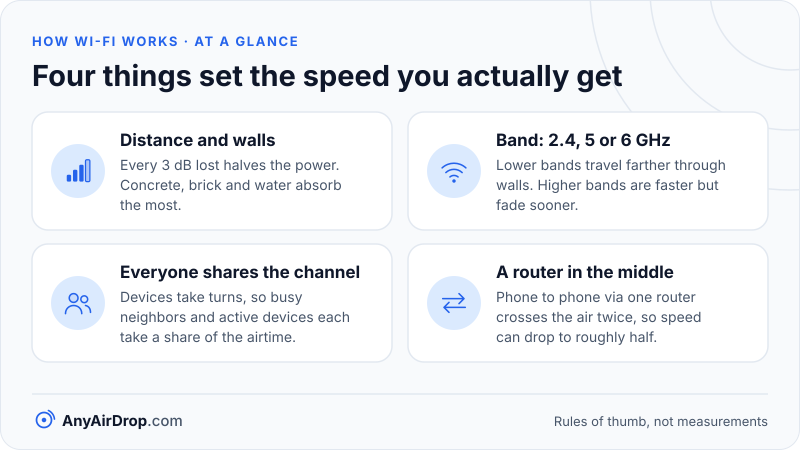

Wi-Fi is a way of sending ordinary network traffic through the air as radio waves instead of through a cable. Your phone converts data into a radio signal, the router picks it up, converts it back into data, and passes it along a cable to the rest of the network. Everything else about Wi-Fi, from speeds to range to why it slows down in a crowded flat, follows from that one idea.

**Short answer:** a Wi-Fi network is a radio channel shared by every device on it. Devices take turns transmitting on that channel, the router (technically an *access point*) coordinates them, and the router connects the radio side to the wired side. In ordinary Wi-Fi only one device transmits on a channel at any instant, which is why speed drops as more devices become active.

## What "Wi-Fi" names

"Wi-Fi" is a trademark of the [Wi-Fi Alliance](https://www.wi-fi.org/), an industry group that certifies products. The technology underneath is a family of standards from the IEEE called [802.11](https://www.ieee802.org/11/). When someone says "Wi-Fi 6", they mean products built to the 802.11ax amendment of that standard. Our guide to [Wi-Fi standards from 802.11b to Wi-Fi 7](/blog/wifi-standards-explained/) lists every generation.

The standard covers only the bottom two layers of networking: the radio itself (the *physical layer*) and the rules for taking turns on it (the *medium access control* layer). Everything above that, including IP addresses, web pages and file transfers, is the same as on a wired network. This is why a browser or a file-transfer tool does not care whether it runs over Wi-Fi or Ethernet.

## Step 1: data becomes a radio wave

A radio wave carries information by changing in a controlled way. Wi-Fi changes three properties of the wave: its *amplitude* (how strong it is), its *phase* (where in its cycle it starts), or both together. Each distinct combination of amplitude and phase is called a *symbol*, and each symbol stands for a group of bits.

The most common scheme is *quadrature amplitude modulation*, or QAM. A "64-QAM" signal has 64 possible symbols and so carries 6 bits at a time. A "1024-QAM" signal, which Wi-Fi 6 introduced, has 1,024 symbols and carries 10 bits at a time. More symbols means more data per transmission, but the symbols sit closer together, so a little noise can make the receiver mistake one for another. That is why the fastest modulations only work when you are close to the router and the signal is clean.

### Many small signals instead of one big one

Wi-Fi does not send one wide signal. Since 802.11a in 1999 it has used *orthogonal frequency-division multiplexing* (OFDM), which splits a channel into many narrow *subcarriers* and sends a slice of the data on each. A 20 MHz channel in Wi-Fi 6 is divided into 256 subcarriers, each 78.125 kHz wide, of which 234 carry data (the rest are pilot tones, guard tones and a null at the center). Each symbol lasts 12.8 µs, which is 1 ÷ 78.125 kHz (the same symbol time appears in [Cisco's Wi-Fi 6 white paper](https://www.cisco.com/c/en/us/products/collateral/wireless/white-paper-c11-740788.html)). This approach copes well with echoes: radio waves bounce off walls and furniture and arrive at slightly different times, and narrow, slow subcarriers are far less confused by that than one fast, wide signal.

## Step 2: the radio spectrum is shared

Wi-Fi uses license-exempt bands, which means anyone can use them without a license as long as the equipment meets power limits. Three bands are in use today:

| Band | Frequency range | Typical character |
| --- | --- | --- |
| 2.4 GHz | 2.400 to 2.4835 GHz | Longest range, slowest, most crowded |
| 5 GHz | roughly 5.15 to 5.85 GHz | Faster, shorter range, more room |
| 6 GHz | 5.925 to 7.125 GHz where permitted | Fastest, shortest range, cleanest |

The bands are divided into *channels*. Two networks on the same channel in the same place must share it, even if they belong to different households. That is why the flat above you can slow your connection down. [Wi-Fi bands compared](/blog/wifi-bands-2-4-5-6-ghz/) and [Wi-Fi channels and channel width](/blog/wifi-channels-and-channel-width/) explain how to pick a quieter slice.

## Step 3: taking turns on the channel

Because everyone on a channel shares it, Wi-Fi needs a rule for who speaks when. The rule is called *carrier-sense multiple access with collision avoidance*, or CSMA/CA, and it works like polite conversation:

1. A device that wants to send first **listens**. If the channel is busy, it waits.
2. When the channel goes quiet, it waits a short, **random** extra delay. The randomness stops two waiting devices from starting at the same instant.
3. It transmits one *frame* (a packet of data with a header).
4. The receiver replies with a short **acknowledgement**. If the sender does not hear one, it assumes the frame was lost and tries again, with a longer random wait.

Two consequences matter in everyday use:

- **Wi-Fi is half-duplex.** On one channel, a device either transmits or receives, never both at once. A cable can carry traffic in both directions simultaneously; the air cannot.
- **Overhead is large.** Listening, waiting, headers and acknowledgements take time. That is the main reason real transfer speeds are well below the number on the router box, a gap we work out step by step in [Wi-Fi link speed vs real speed](/blog/wifi-link-speed-vs-real-speed/).

Newer standards add refinements, such as letting an access point serve several devices within one transmission (OFDMA) and sending different streams to different devices at once (MU-MIMO). Those are covered in [MIMO, OFDMA and beamforming explained](/blog/mimo-ofdma-beamforming-explained/). The basic principle of shared airtime stays the same.

## How signal strength sets the speed

Signal strength is reported in *dBm*, a logarithmic scale where numbers closer to zero are stronger. A reading of -40 dBm is a very strong signal (your phone next to the router), and -80 dBm is a weak one. Every 3 dB drop roughly halves the power (3.01 dB, to be exact), so the difference between -50 and -70 dBm is 20 dB, a factor of 10^(20/10) = 100 in power, not a modest step.

Strength matters because it decides which modulation your device can use. Close to the router, the signal is clean enough for dense symbols such as 1024-QAM. As the signal weakens, the radio falls back to simpler symbols that survive more noise, and the *link rate* drops in steps. A device at the edge of coverage might negotiate a tenth of the speed it gets in the same room as the router, and because it needs more airtime for every byte, it also slows down the other devices on that channel.

A widely quoted set of rules of thumb, from [MetaGeek's Wi-Fi training material](https://www.oscium.com/training/wifi-signal-strength-basics/), puts the minimum for voice calls and streaming video at about -67 dBm, for reliable web and email at about -70 dBm, and for basic connectivity at about -80 dBm, where delivery may be unreliable. MetaGeek itself calls these suggestions only. They are guidelines, not standards, and they vary with the noise around you. Most phones and laptops show signal as bars, but an operating system's technical or diagnostic view will often show the exact dBm figure.

## Step 4: joining a network

When you tap a network name, several things happen in a fraction of a second.

1. **Discovery.** The access point broadcasts a small *beacon* frame, by default about ten times a second (every 102.4 ms). It contains the network name (the SSID), the channels and speeds it supports and its security mode. Your phone also sends *probe requests* to ask nearby networks to identify themselves.
2. **Authentication and association.** Your device picks the access point, and the two agree to treat each other as members of the same network. On modern networks, the real security step follows.
3. **The four-way handshake.** Using the password (or, with WPA3, a safer exchange based on it), both sides prove they know the key and derive fresh encryption keys for this session. The password itself is never sent through the air. [WPA2 and WPA3 are explained here](/blog/wifi-security-wpa2-wpa3-explained/).
4. **An address.** Once connected at the radio level, your device asks the router for an IP address using DHCP, covered in [how a router works](/blog/how-a-router-works-nat-dhcp-dns/).

From then on, every frame between your device and the router is encrypted with the session keys.

## Step 5: the router bridges air and cable

The part of your router that talks Wi-Fi is the *access point*. It receives radio frames, strips off the radio layer and forwards the contents, usually onto an Ethernet connection toward the rest of the network. Going the other way, it takes traffic from the cable and wraps it in radio frames for your device.

Most home routers combine several jobs in one box: access point, switch for the Ethernet sockets, a router that connects your home network to the internet, and often the modem itself. [Modem vs router vs access point](/blog/modem-vs-router-vs-access-point/) separates them.

## Why a router in the middle costs a local transfer airtime

Because the router is in the middle, two phones on the same Wi-Fi network usually do not talk to each other directly over the air. The data goes from the sender to the access point, and then from the access point to the receiver. Each of those hops uses airtime on the same channel, so a transfer between two Wi-Fi devices on the same router can run at roughly half of the speed that one device could reach by downloading from the wired side. A laptop connected by Ethernet cable on one end, or a direct device-to-device link such as Wi-Fi Direct, avoids that penalty. We explain direct links in [Wi-Fi Direct, Wi-Fi Aware and AWDL](/blog/wifi-direct-wifi-aware-awdl-explained/).

It also explains why moving a big video between two devices on your own Wi-Fi is often much faster than uploading it to the internet and downloading it again. The data never leaves your building, so it is limited by your Wi-Fi rather than by your internet plan's upload speed. See [local transfer vs cloud upload](/blog/local-transfer-vs-cloud-upload/).

*The four things that most often decide how fast your Wi-Fi feels.*

## Common questions

### Does Wi-Fi need the internet?

No. Wi-Fi only connects your device to a local network. A router with no internet connection still lets devices on it reach each other, and many local file-transfer methods work that way. A Wi-Fi network *with* internet access has a router that is also connected to a modem or fiber line.

### Is Wi-Fi the same as the internet?

No. The internet is the global network of networks. Wi-Fi is one way of reaching a local network, which may or may not be connected to it.

### Why does Wi-Fi get slower with more devices?

Every active device competes for the same channel. Idle devices cost very little, but several devices streaming or downloading at once each get a share of the available airtime. Newer standards divide that airtime more efficiently, but they cannot create more of it.

### Is Wi-Fi radiation harmful?

Wi-Fi uses low-power, non-ionizing radio waves. The [World Health Organization's overview of electromagnetic fields](https://www.who.int/news-room/questions-and-answers/item/radiation-electromagnetic-fields), which covers radiofrequency fields in general rather than Wi-Fi by name, says that no adverse health effects from low-level, long-term exposure to such fields have been confirmed, while research continues.

### Why does Wi-Fi get weaker through walls?

Radio waves lose strength as they travel, and materials absorb or reflect them. Dense materials such as concrete, brick, metal and water (including fish tanks and human bodies) absorb more than drywall or wood. Higher frequencies lose more, which is why 5 GHz and 6 GHz reach less far through walls than 2.4 GHz.

## Key takeaways

- Wi-Fi is the IEEE 802.11 radio standard for carrying ordinary network traffic through the air.
- Devices share each channel and take turns, so usually only one transmits at a time, and the more of them are busy, the less each gets.
- Overhead (waiting, headers, acknowledgements) means real speeds are always well below the advertised link rate.
- The access point is the bridge between the radio network and the wired network; it is usually built into your router.
- Two devices on the same Wi-Fi network normally exchange data through the router, not directly.

## Sources

- IEEE 802.11 Working Group: [Project overview and timelines](https://www.ieee802.org/11/)
- Wi-Fi Alliance: [Discover Wi-Fi](https://www.wi-fi.org/)
- World Health Organization: [Radiation: Electromagnetic fields](https://www.who.int/news-room/questions-and-answers/item/radiation-electromagnetic-fields)
- MetaGeek and Oscium: [Wi-Fi Signal Strength Basics](https://www.oscium.com/training/wifi-signal-strength-basics/)
- Cisco: [IEEE 802.11ax: The Sixth Generation of Wi-Fi White Paper](https://www.cisco.com/c/en/us/products/collateral/wireless/white-paper-c11-740788.html)
