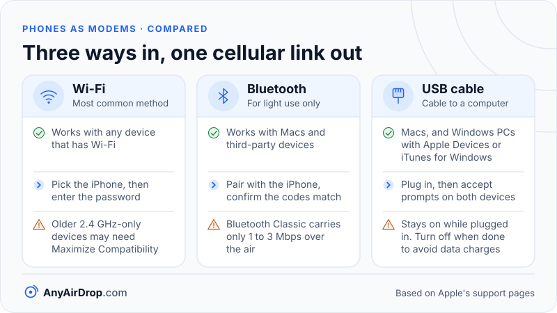

Personal Hotspot is the iPhone feature that shares the phone's cellular connection with other devices. The iPhone creates a Wi-Fi network, or accepts a Bluetooth or USB connection, and passes the other device's internet traffic through its own cellular modem. As Apple describes it, Personal Hotspot uses the cellular data connection to create a temporary Wi-Fi network, which helps when you are not in range of a trusted Wi-Fi network.

**Short answer:** Personal Hotspot turns the iPhone into a small router with one internet source, its cellular connection. You can connect over Wi-Fi, Bluetooth or a USB cable. A setting called Maximize Compatibility switches the Wi-Fi side to the 2.4 GHz band so older devices can join, at some cost in performance. Instant Hotspot lets your own Apple devices, or those in your Family Sharing group, connect without entering the hotspot's Wi-Fi password. Your carrier plan decides whether the feature is available, and Apple says the number of devices that can join depends on your carrier and iPhone model.

This article sticks to what Apple documents and flags where Apple does not publish details.

## What Personal Hotspot does

Underneath, Personal Hotspot performs the same job as any phone hotspot, which [how a phone hotspot works](/blog/how-phone-hotspot-works/) walks through step by step. The iPhone's cellular modem (the [baseband](/blog/what-is-a-phone-modem-baseband/)) is the internet side. The iPhone then hands out private addresses to connected devices, forwards their DNS lookups and rewrites their traffic using network address translation (NAT), so many devices share the phone's single cellular address.

Apple does not publish the internals of this router. As commonly reported, connected devices receive addresses in the 172.20.10.x block, with the iPhone itself as the gateway. Treat that as an observation, not a promise, because Apple does not document it or guarantee that it stays the same.

Apple's support page lists a few requirements:

- Your carrier must support Personal Hotspot, and additional fees may apply.
- If the option is dimmed, check that Cellular Data is turned on in the Cellular settings.
- The hotspot name matches the device name, and you can change it in the device's name setting.
- You can set a Wi-Fi password of at least eight characters, using only ASCII characters (basic English letters, digits and common symbols).

## Three ways to connect

**Wi-Fi.** You turn on the "Allow Others to Join" switch in Personal Hotspot settings. The other device then picks the iPhone from its Wi-Fi list and enters the password. This is the most common method and works with any device that has Wi-Fi.

**Bluetooth.** After turning on Allow Others to Join, you pair the other device with the iPhone through Bluetooth, confirm that the pairing codes match, and the computer uses the iPhone as its network. Apple notes that Bluetooth connections work with Macs and third-party devices. The [Android tethering comparison](/blog/android-hotspot-usb-bluetooth-tethering-compared/) explains why the 1 to 3 Mbps over-the-air rate of Bluetooth Classic makes it a link for light use only.

**USB.** You connect the iPhone to a computer with a cable and accept any prompts on both devices. Apple says Windows PCs need the latest version of Apple Devices or iTunes for Windows, and that Macs can also connect over Thunderbolt or USB cables. The hotspot remains active as long as the cable is connected, so Apple advises turning it off when you are done, to avoid data charges.

Each method gives the connected device a network connection that exits through the iPhone's cellular link. The three links differ in speed, power use and stability exactly as they do on Android.

*Whichever link you pick, the traffic leaves through the iPhone's cellular connection and counts against your plan.*

## Maximize Compatibility and the Wi-Fi band

Wi-Fi works in several bands, and each has trade-offs that are explained in [Wi-Fi bands compared](/blog/wifi-bands-2-4-5-6-ghz/). The 2.4 GHz band reaches farther and works with almost all Wi-Fi devices. The 5 GHz band has more room for wide channels and is usually faster, but some older devices (and many small gadgets, such as e-readers or cameras) support only 2.4 GHz.

Apple's [platform support guide](https://support.apple.com/guide/platform-support/troubleshoot-personal-hotspot-connections-sup025284ac0/web) says that on supported devices you can turn on Maximize Compatibility in the Personal Hotspot settings "to use 2.4 GHz connections", which helps older devices connect, and it warns that this may reduce performance and security. Apple's [Personal Hotspot troubleshooting article](https://support.apple.com/en-us/119837) lists the iPhone 12 and later (and certain iPad models) as having the setting, and it likewise warns that internet performance and Wi-Fi security might be reduced. Neither page spells out the band the hotspot uses when the setting is off. As commonly reported, supported iPhones then offer the faster 5 GHz band, which is why older devices sometimes cannot see the network until the setting is turned on.

### A worked example: why 2.4 GHz can cap your speed

On paper, the difference between the bands comes from channel width and modulation. Using values from the Wi-Fi standards, here is a single-stream link in each band. These are illustrations of the arithmetic, not measurements of any iPhone, since Apple does not state which Wi-Fi generation or channel width the hotspot uses.

**2.4 GHz, 20 MHz channel, Wi-Fi 4 (802.11n), one stream:**

1. A 20 MHz channel carries 52 data subcarriers.
2. With 64-QAM (6 bits per symbol) and a coding rate of 5/6, each symbol time carries 52 x 6 x 5/6 = 260 bits.
3. With a short guard interval, one symbol lasts 3.6 microseconds.
4. 260 bits / 3.6 microseconds = about **72 Mbps**.

**5 GHz, 80 MHz channel, Wi-Fi 5 (802.11ac), one stream:**

1. An 80 MHz channel carries 234 data subcarriers.
2. With 256-QAM (8 bits per symbol) and a coding rate of 5/6, each symbol carries 234 x 8 x 5/6 = 1,560 bits.
3. The symbol time is again 3.6 microseconds.
4. 1,560 bits / 3.6 microseconds = about **433 Mbps**.

The 5 GHz link has a ceiling about six times higher. That matters when your cellular connection is fast. If your mobile connection can deliver 150 Mbps, the 2.4 GHz link at roughly 72 Mbps on paper (and less in practice, after the overhead explained in [Wi-Fi link speed vs real speed](/blog/wifi-link-speed-vs-real-speed/)) becomes the bottleneck. If your mobile connection delivers 20 Mbps, both bands have headroom and Maximize Compatibility costs you little. The rule from the tethering comparison applies again: the slowest stage in the chain sets the speed.

The practical advice is to leave Maximize Compatibility off unless a particular device cannot find the network, and to turn it off again afterwards.

## Instant Hotspot and Family Sharing

Instant Hotspot is part of Apple's Continuity features. According to [Apple's Instant Hotspot page](https://support.apple.com/en-us/109321), you can connect to the Personal Hotspot of your own iPhone or iPad from another Apple device without entering its Wi-Fi password, as long as each device is signed in with the same Apple Account, the devices are near each other and both have Wi-Fi and Bluetooth turned on. On a Mac or iPad, the iPhone appears in the Wi-Fi menu like any nearby network.

Apple does not publish the protocol. Its requirement that Bluetooth be on, for a connection that carries data over Wi-Fi, suggests that Bluetooth handles nearby discovery and the hand-off of connection details while Wi-Fi carries the traffic. Treat that as an inference, not a specification.

Family Sharing extends the same convenience to other people in your family group. Apple's page describes two settings for each family member: the device can join your hotspot automatically when needed, or you are asked to approve each attempt. The wording differs by iOS version, so check the Personal Hotspot settings on your own phone.

## Limits that come from the plan and the phone

Several limits apply no matter how you connect.

- **Carrier support and fees.** Apple says Personal Hotspot requires a carrier that supports it, and additional fees may apply. Plans can also limit hotspot data separately or treat it differently from the phone's own data. Those rules are set by carriers and vary, so your plan documents are the authority.
- **Number of devices.** Apple says the number of devices that can join at once depends on your carrier and iPhone model.
- **Idle disconnects.** Apple states that third-party devices automatically disconnect after 90 seconds without network traffic. If a game console or e-reader keeps dropping, an idle gap can be the reason.
- **Features that need Wi-Fi.** Apple notes that some apps and features may not work over a hotspot, for example iCloud backup and uploading photos to iCloud Photo Library.
- **Battery and heat.** The cellular modem, the Wi-Fi radio and the processor all work at once, so the phone drains faster and warms up. Heat can lead the phone to reduce performance. See [why phone hotspots are slow](/blog/why-phone-hotspots-are-slow/).

## Why Personal Hotspot is built for internet access, not file transfers

Personal Hotspot exists to give other devices an internet connection. In a 2017 reply on the [Apple Developer Forums](https://developer.apple.com/forums/thread/79141), an engineer from Apple's Developer Technical Support team wrote that Personal Hotspot was designed solely as a way to connect client devices to the internet, so it does not guarantee the connectivity a developer would need to discover other devices on its network. A later reply in the thread adds that connectivity between apps on the iPhone and apps on the hotspot network is not guaranteed either: it worked at the time, but it is not an essential part of the product and could be blocked later. The replies are old, and Apple's current support pages do not address the point either way, so treat it as a caution rather than a rule. It still means Personal Hotspot is not a dependable foundation for local transfers, even though the devices technically share a small network.

For moving files between your own Apple devices, Apple has a purpose-built feature, AirDrop, which sets up its own direct wireless link between the devices and does not use the hotspot at all; see [how AirDrop works](/blog/how-airdrop-works/). For a mix of devices, such as an iPhone and a Windows PC on the same Wi-Fi network, a browser-based or app-based method over that shared network is the usual route, covered in [transferring files between a PC and a phone over Wi-Fi](/blog/transfer-files-between-pc-and-phone-over-wifi/).

If a hotspot is the only network available, the devices can still talk to each other in many cases, as long as nothing blocks client-to-client traffic. That scenario is discussed in [transferring files over a hotspot without internet](/blog/transfer-files-over-a-hotspot-without-internet/). Also keep in mind that sending a large file to the cloud over a hotspot spends cellular data twice, once for the upload on one device and once for the download on the other; a local transfer spends none. [Local transfer vs cloud upload](/blog/local-transfer-vs-cloud-upload/) compares the two.

## Common questions

### Why is Personal Hotspot dimmed or missing?

The most common causes are that Cellular Data is off or that your carrier or plan does not support Personal Hotspot. Apple says to check the Cellular settings first, then contact your carrier. Software updates and a restart also resolve some cases.

### Should I turn on Maximize Compatibility?

Only if a device cannot see or join the hotspot. It makes the hotspot use 2.4 GHz, which older devices support, but Apple warns that it may reduce performance and security. Turn it off again once you are done.

### Does Personal Hotspot use my cellular data?

Yes. Everything connected devices do goes through the iPhone's cellular connection and counts against your plan, whichever method they use. Streaming video, updates and cloud backups can use a lot, so some people turn off automatic updates on the connected device.

### Can an iPhone use Personal Hotspot while connected to Wi-Fi?

Apple's pages do not say. They describe Personal Hotspot as using the iPhone's cellular data connection, and nothing there covers re-sharing a Wi-Fi connection. If your goal is to extend a Wi-Fi network, a router or [extender](/blog/mesh-wifi-vs-extenders-vs-powerline/) is the proper tool.

### Why does my Windows PC not see the iPhone over USB?

Apple says Windows PCs need the latest Apple Devices app or iTunes for Windows. After installing it, connect the cable, enter the passcode on the iPhone if asked, accept any trust or hotspot prompts and make sure Allow Others to Join is on.

## Key takeaways

- Personal Hotspot makes the iPhone a small router that shares its cellular connection over Wi-Fi, Bluetooth or USB.
- Maximize Compatibility makes the hotspot use 2.4 GHz for older devices; Apple warns it may reduce performance and security.
- On paper, a single-stream 5 GHz link at 80 MHz reaches about 433 Mbps versus about 72 Mbps for 2.4 GHz at 20 MHz, so the band can cap speed on a fast cellular link.
- Instant Hotspot lets devices on the same Apple Account, or family members you allow, connect without the hotspot's Wi-Fi password when Wi-Fi and Bluetooth are on and the devices are near each other.
- Carrier support, plan rules and device limits are set outside the phone, and Apple says the device count depends on your carrier and model.
- A hotspot is built for internet access, not local transfers, so use AirDrop or a shared Wi-Fi network for moving files between your own devices.

## Sources

- Apple Support: [Personal Hotspot on iPhone and iPad](https://support.apple.com/en-us/111785)
- Apple Support: [Troubleshoot Personal Hotspot connections on iPhone and iPad](https://support.apple.com/guide/platform-support/troubleshoot-personal-hotspot-connections-sup025284ac0/web)
- Apple Support: [If Personal Hotspot is not working on your iPhone or iPad](https://support.apple.com/en-us/119837)
- Apple Support: [Use Instant Hotspot, Auto-Join Hotspot, or Family Sharing to connect to your Personal Hotspot](https://support.apple.com/en-us/109321)
- Apple Developer Forums: [How to list all devices connected to your hotspot?](https://developer.apple.com/forums/thread/79141)
