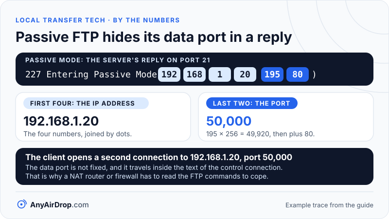

SMB, NFS, FTP, SFTP, HTTP and WebDAV are all ways for one computer to read or write files on another over a network. They differ in what they were built for: SMB and NFS make a remote folder look like a local drive, FTP and SFTP move files in explicit uploads and downloads, and HTTP and WebDAV reuse the web. Most of the practical differences come down to ports, encryption, sign-in and how a client finds the server.

**Short answer:** for Windows and macOS shared folders on a home or office network, use SMB version 2 or 3. For Linux and Unix machines, NFS is common. For moving files to a server you control, SFTP is the safe choice, and plain FTP is the one to avoid on untrusted networks because it sends passwords unencrypted. A plain HTTP server is the simplest option for a one-way download, and WebDAV turns HTTP into a full file protocol.

## Two styles of file sharing

Before the protocols, one distinction explains a lot. There are two styles:

- **Remote file systems.** SMB and NFS let your computer *mount* a remote folder, so apps open, edit and save files as if the folder were on a local disk. The protocol handles locking, permissions and partial reads and writes. This suits shared work folders and media libraries.
- **File transfer protocols.** FTP, FTPS and SFTP copy whole files up or down on request. Nothing stays mounted. This suits publishing files to a server or fetching a backup.

HTTP and WebDAV sit between the two: HTTP serves files for download, and WebDAV adds the operations needed to browse, create folders, move and lock files, so some systems can mount a WebDAV share as a drive.

All of them run over TCP/IP, so the physical link, Wi-Fi or Ethernet, does not change the protocol, though it changes the speed (see [Wi-Fi vs Ethernet for local transfers](/blog/wifi-vs-ethernet-for-local-transfers/)).

## SMB: the Windows and macOS default

SMB (Server Message Block) is the protocol behind Windows file and printer sharing and is also used by macOS, many NAS devices, and the open source Samba server on Linux. It normally uses TCP port 445.

Versions matter a great deal. [Microsoft's documentation](https://learn.microsoft.com/en-us/windows-server/storage/file-server/troubleshoot/detect-enable-and-disable-smbv1-v2-v3) says SMBv2 arrived with Windows Vista and Windows Server 2008, SMBv3 with Windows 8 and Windows Server 2012, and that SMBv1 has significant security vulnerabilities and Microsoft strongly encourages not using it. SMBv1 is not installed by default in any edition of Windows 11 or in Windows Server 2019 and later. The same page notes that in Windows 11 version 24H2 and Windows Server 2025 SMB signing is required by default, which can stop connections to workgroup computers, guest-authenticated shares or third-party servers that do not support signing. It recommends fixing the other device rather than weakening the setting.

SMB 3 can encrypt traffic end to end. Microsoft's [SMB security page](https://learn.microsoft.com/en-us/windows-server/storage/file-server/smb-security) says AES-128-GCM is negotiated by default with SMB 3.1.1, with AES-256 suites in newer Windows. Encryption can be enabled per share or for a whole server, and it has a performance cost compared with unencrypted traffic.

- **Discovery:** Windows, macOS and Linux each use their own discovery mechanisms, and what you see in a network list varies by version and settings. Apple and Linux systems commonly advertise shares with [mDNS](/blog/mdns-bonjour-device-discovery/). You can always connect by typing the server's name or IP address.
- **Sign-in:** user accounts on the server, with passwords checked using Kerberos or NTLM. Guest access exists but is increasingly restricted.
- **Good at:** shared drives, large files, many small files, permission control, and working inside Windows and macOS.
- **Weak at:** crossing the internet over TCP port 445 without a VPN, and any setup that leaves old SMB1 compatibility switched on.

## NFS: Unix and Linux file sharing

NFS (Network File System) is the long-standing way of sharing folders between Linux and Unix machines. [RFC 7530](https://www.rfc-editor.org/rfc/rfc7530) describes NFS version 4 as a distributed file system protocol that folds file locking and the mount protocol into the core, and recommends port 2049 as the default, so clients do not need extra helper services to find it. That makes it easier to pass through a firewall than NFSv3, which relied on several auxiliary services.

Security is where NFS needs attention. The RFC requires support for the Kerberos mechanism for stronger security, but a weaker flavor called AUTH_SYS, which trusts the user and group numbers the client claims, is also defined, and the RFC notes it has no mutual authentication. Home NFS shares are often restricted by client IP address, which suits a trusted home network and not an open one.

- **Discovery:** none built in. You normally enter the server and export path.
- **Good at:** Linux-to-Linux sharing, media servers, and servers mounting shared storage.
- **Weak at:** mixed Windows and phone environments, where SMB or HTTP is easier.

## FTP and FTPS: old, simple and unencrypted

FTP (File Transfer Protocol) is defined in [RFC 959](https://www.rfc-editor.org/rfc/rfc959) and predates the modern internet. It uses two connections: a control connection on port 21 for commands, and a separate data connection for each file transfer or directory listing. The control port is 21 and, in the original *active* mode, the server connects back to the client from port 20.

Most clients now use *passive* mode, in which the client asks the server to listen on a port and then connects to it. The server's reply encodes its address and port as six numbers, for example:

```
Client:  USER alice
Client:  PASS example-password
Client:  PASV
Server:  227 Entering Passive Mode (192,168,1,20,195,80)
```

The first four numbers are the IP address, 192.168.1.20. The last two give the port as (first × 256) + second: 195 × 256 = 49,920, and 49,920 + 80 = 50,000. So the client opens a second connection to 192.168.1.20 on port 50,000 for the data. That is why firewalls and NAT routers have so much trouble with FTP: the data port is not fixed, and the address and port are carried inside the text of the control connection rather than in packet headers, so a NAT router or firewall has to read the FTP commands to cope.


*Six numbers in one text reply carry both the address and the port, so there is no fixed data port to open in advance.*

The user name and password in that trace travel as plain text on the control connection. Anyone able to capture traffic on the same network can read them.

**FTPS** (FTP over TLS) fixes that. [RFC 4217](https://www.rfc-editor.org/rfc/rfc4217) describes the explicit form: the session starts on port 21, the client sends the AUTH TLS command, and the connection upgrades to TLS. It protects the control connection, and the client must additionally request protection for data connections. The extra data ports still complicate firewalls.

- **Discovery:** none; you enter an address.
- **Good at:** compatibility with old devices and software, scripted uploads to a server.
- **Weak at:** security and firewalls in its plain form. Avoid plain FTP over untrusted networks, and over any network if an encrypted option is available.

## SFTP: file transfer inside an SSH connection

SFTP (SSH File Transfer Protocol) is not FTP with encryption added. It is a different protocol that runs inside an SSH (Secure Shell) connection, usually on TCP port 22. [RFC 4251](https://www.rfc-editor.org/rfc/rfc4251) describes SSH as providing secure remote login and other secure network services over an insecure network, with a transport layer that gives server authentication, confidentiality and integrity, a user authentication layer, and a connection layer that multiplexes channels. SFTP is one of the services carried on those channels.

This brings several advantages: one port, encryption by default, and sign-in by password or by a key pair. SSH also checks the server's *host key*, which lets a client detect if it is talking to an impostor, provided the key is verified the first time. The RFC warns that skipping verification leaves the connection open to active man-in-the-middle attacks.

- **Discovery:** none built in; some systems can advertise it via mDNS.
- **Good at:** secure uploads and downloads, automation, and anything crossing less trusted networks.
- **Weak at:** it is not a mounted drive by default, and a phone usually needs an app that speaks it.

## HTTP and HTTPS: the web as a file server

HTTP is the protocol of the web. As [MDN explains](https://developer.mozilla.org/en-US/docs/Web/HTTP/Overview), a client sends a request and a server returns a response, over TCP or over a TLS-encrypted TCP connection. Any device with a browser can download from an HTTP server, which is why small "share this folder" tools are often just a mini web server. The usual ports are 80 for plain HTTP and 443 for HTTPS, though quick local servers often use another port.

Plain HTTP has no encryption and usually no sign-in, so it is best kept to a trusted network and temporary use. HTTPS adds TLS encryption and server identity checks, but a local server rarely has a certificate a browser trusts, which is why you may see a warning.

- **Discovery:** none; you type an address or scan a QR code.
- **Good at:** one-way downloads to any device with a browser, with nothing to install on the receiving side.
- **Weak at:** uploads, folder sync, and large transfers that need resuming, unless the software adds them.

## WebDAV: HTTP with file operations

WebDAV extends HTTP so it can manage files. According to [RFC 4918](https://www.rfc-editor.org/rfc/rfc4918), it adds methods and headers for properties, collections (folders), copying and moving, and locking. A collection can be created with MKCOL, listed with PROPFIND, and so on. Because it is built on HTTP, it uses the same ports and can be protected with HTTPS, and it passes through most firewalls without trouble.

- **Discovery:** none built in; some systems advertise it via mDNS.
- **Good at:** access through HTTP-friendly networks, and apps that can mount it as a drive.
- **Weak at:** uneven client support, so behavior varies between systems.

## The comparison

| Protocol | Usual port | Encryption | Sign-in | Typical use |
| --- | --- | --- | --- | --- |
| SMB 3 | TCP 445 | Optional, per share or server (AES-GCM/CCM) | Accounts, Kerberos or NTLM | Shared folders on Windows and macOS, NAS |
| NFS v4 | TCP 2049 | Depends on security flavor (Kerberos options) | Client IP or Kerberos | Linux and Unix shared storage |
| FTP | TCP 21 plus data ports | None | Plain-text password | Legacy uploads and downloads |
| FTPS | TCP 21 plus data ports (explicit) | TLS, when negotiated | Password with TLS | FTP with encryption |
| SFTP | TCP 22 | Always (SSH) | Password or key | Secure uploads, automation |
| HTTP / HTTPS | TCP 80 / 443 or custom | None / TLS | Often none | Download links, small servers |
| WebDAV | Same as HTTP / HTTPS | With HTTPS only | HTTP authentication | Mountable web folders |

Port numbers in this table are the well-known defaults, and any service can be set to a different one.

## Security cautions

- **Turn off SMBv1.** Microsoft's guidance is that SMBv1 has significant security vulnerabilities and should not be used. If an old device insists on it, update or replace the device rather than re-enabling it.
- **Do not use plain FTP or plain HTTP across networks you do not control.** Anyone able to capture traffic on the path, for example on an open or shared Wi-Fi network, may read it, including passwords in FTP.
- **Do not expose these services directly to the internet.** SMB and NFS in particular are designed for trusted local networks. If you need remote access, use a VPN or an encrypted protocol such as SFTP.
- **Avoid guest or anonymous access** to shares that hold anything private.
- **Check host keys and certificates.** SFTP and HTTPS protect you only if you confirm you are talking to the right server.

## Why a file server is overkill for one photo

For a quick one-off transfer between your own phone and laptop, running a file server is a lot of setup: you need an address, a port, an account and a client app on the other side. These protocols are better suited to a permanent shared folder, a NAS or a server, where the setup is done once. For a laptop and a desktop that need a shared folder, SMB is the natural fit, as [sharing files between Windows PCs over a LAN](/blog/share-files-between-windows-pcs-over-lan/) explains. For moving a photo from phone to PC today, a method that needs no server on either side is simpler; see [transferring files between a PC and a phone over Wi-Fi](/blog/transfer-files-between-pc-and-phone-over-wifi/). AnyAirDrop.com is our own tool in that category, running in the browser with no server for you to set up. If you are weighing local routes against uploading to a service, [local transfer vs cloud upload](/blog/local-transfer-vs-cloud-upload/) compares them.

## Common questions

### What is the difference between FTP and SFTP?

FTP is an old protocol that sends commands and passwords unencrypted and uses extra data ports. SFTP is a separate protocol that runs inside an encrypted SSH connection on a single port, normally 22. Despite the similar names, they are not compatible.

### Is SMB safe to use?

Modern SMB (versions 2 and 3) is reasonable on a trusted local network, and SMB 3 can encrypt traffic. SMB1 is the problem version and should be disabled. Do not expose SMB directly to the internet.

### Which port does SMB use?

TCP port 445 in current versions. Older systems also used NetBIOS ports, which is part of why legacy sharing was messier.

### Can my phone use these protocols?

Often yes, through a file manager or file-transfer app that supports them. Support varies by app and operating system, and the built-in file apps differ in what they offer, so check what yours supports.

### Which protocol is fastest?

There is no single answer. On the same network the link, disk speed and software dominate: a Wi-Fi link limits all of them, as [Wi-Fi link speed vs real speed](/blog/wifi-link-speed-vs-real-speed/) explains. Encryption adds some CPU cost, and protocols with many small round trips, such as listing thousands of small files, can feel slower than the raw bandwidth suggests.

## Key takeaways

- SMB and NFS mount remote folders as drives; FTP, FTPS and SFTP copy files on request; HTTP and WebDAV reuse web technology.
- SMB 2 and 3 are the right choice for Windows and macOS sharing, and SMB1 should be off.
- Plain FTP and plain HTTP send data, and in FTP's case passwords, unencrypted; use SFTP or HTTPS on networks you do not control.
- FTP's passive mode hides its data port in a reply: (195 × 256) + 80 = port 50,000 in the example above.
- Most of these services have no built-in discovery, so you type an address, or the platform advertises them with mDNS.
- None of them belongs on the open internet without a VPN or strong encryption and authentication.

## Sources

- IETF: [RFC 959, File Transfer Protocol](https://www.rfc-editor.org/rfc/rfc959)
- IETF: [RFC 4217, Securing FTP with TLS](https://www.rfc-editor.org/rfc/rfc4217)
- IETF: [RFC 4251, The Secure Shell (SSH) Protocol Architecture](https://www.rfc-editor.org/rfc/rfc4251)
- IETF: [RFC 7530, NFS Version 4 Protocol](https://www.rfc-editor.org/rfc/rfc7530)
- IETF: [RFC 4918, HTTP Extensions for WebDAV](https://www.rfc-editor.org/rfc/rfc4918)
- Microsoft Learn: [Detect, enable, and disable SMBv1, SMBv2, and SMBv3 in Windows](https://learn.microsoft.com/en-us/windows-server/storage/file-server/troubleshoot/detect-enable-and-disable-smbv1-v2-v3)
- Microsoft Learn: [SMB security enhancements](https://learn.microsoft.com/en-us/windows-server/storage/file-server/smb-security)
- MDN Web Docs: [An overview of HTTP](https://developer.mozilla.org/en-US/docs/Web/HTTP/Overview)
