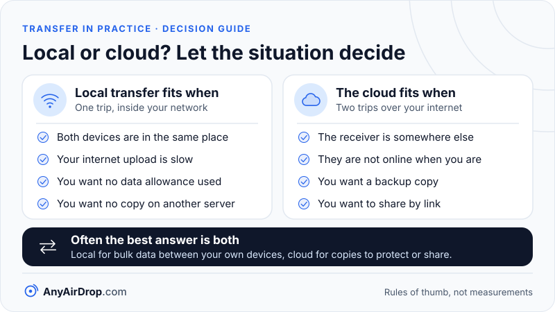

A file sent over your local network makes one trip, from one device to the other, without leaving the building. A file sent through a cloud service makes two trips over your internet connection: up to a server, then back down to the receiver. Which one is quicker, cheaper or more private follows from that difference in path, and so does the answer to when the cloud is the better choice.

**Short answer:** for devices in the same room, a direct local transfer is usually faster because it is limited by your Wi-Fi or cable and not by your internet upload speed, which on many home connections is the slowest part. It also uses none of your data allowance and leaves no copy on someone else's server. The cloud wins when the receiver is far away, is not online at the same time, or when you want a backup or a link that expires.

## The two paths, step by step

Take a photo album on a phone that you want on a laptop.

**Local path.** The phone sends the data to your router over Wi-Fi, and the router passes it on to the laptop, by Wi-Fi or cable. Nothing goes to the internet. A direct connection between browsers or apps, such as the WebRTC approach in [WebRTC data channels explained](/blog/webrtc-data-channels-explained/), is set up with a brief introduction through a server, but the file itself stays on the local network. Why it can stay local is explained in [STUN, TURN and ICE](/blog/stun-turn-ice-explained/).

**Cloud path.** The phone uploads the album through your router and your internet provider to a data center. The service stores it. The laptop then downloads it through the same provider. The file crosses your internet connection twice and rests on a server in between.

Two consequences follow. First, the cloud path is limited by your *upload* speed on the way up and your *download* speed on the way down, and many home internet plans give far less upload than download. Second, the cloud path can only finish once the whole file reaches the server, unless the service supports starting a download while the upload is still going.

## A worked example (hypothetical numbers)

The numbers below are **assumptions chosen to show the arithmetic**. They are not measurements of any real network, service or device. Your own results will differ, and the point is how to calculate them.

**Assumptions:**

- File size: 1 GB (one gigabyte, 1,000,000,000 bytes).
- Internet upload speed: 20 Mbps (megabits per second).
- Internet download speed: 200 Mbps.
- Real local transfer speed: 300 Mbps. "Real" means what a transfer achieves on the local link, which is lower than the link rate printed on a router ([why link speed and real speed differ](/blog/wifi-link-speed-vs-real-speed/)).

### Step 1: convert bytes to bits

Network speeds are quoted in bits, file sizes in bytes, and a byte is 8 bits ([NIST](https://physics.nist.gov/cuu/Units/binary.html) states this, along with the difference between decimal MB and binary MiB). So:

1 GB = 1,000,000,000 bytes × 8 = 8,000,000,000 bits = 8,000 megabits.

Forgetting the factor of 8 is the most common mistake: a 100 Mbps connection moves at most 12.5 megabytes per second, not 100.

### Step 2: divide by the speed

- **Local:** 8,000 megabits ÷ 300 Mbps ≈ 26.7 seconds.
- **Cloud upload:** 8,000 ÷ 20 = 400 seconds.
- **Cloud download:** 8,000 ÷ 200 = 40 seconds.

### Step 3: add the stages

Cloud total, if the download starts after the upload finishes: 400 + 40 = 440 seconds, or 7 minutes 20 seconds. Local: about 27 seconds. Under these assumptions the cloud path takes about 16.5 times as long (440 ÷ 26.7 ≈ 16.5), and almost all of the difference is the 20 Mbps upload.

### What changes the answer

Try the same arithmetic with different, equally hypothetical inputs:

| Scenario (hypothetical) | Local | Cloud (upload + download) |
| --- | --- | --- |
| 300 Mbps local, 20 up / 200 down | 26.7 s | 400 + 40 = 440 s |
| 300 Mbps local, 100 up / 200 down | 26.7 s | 80 + 40 = 120 s |
| 300 Mbps local, 1,000 up / 1,000 down | 26.7 s | 8 + 8 = 16 s |
| 50 Mbps local (weak Wi-Fi), 100 up / 200 down | 160 s | 80 + 40 = 120 s |

The third and fourth rows matter. If your internet connection is very fast and symmetric, or your local link is slow, the cloud can finish first. The path that wins is the one whose slowest stage is faster. That is why generic advice such as "local is always faster" is incomplete, and why the arithmetic is worth doing. The simplified model also ignores overhead, server processing, congestion and speed limits on the service's side, and both directions of a Wi-Fi transfer sharing airtime ([how Wi-Fi works](/blog/how-wifi-works/)).

## Privacy and control

A local transfer exposes the file to the two devices and, in transit, to the local network, where encryption keeps it unreadable. [RFC 8831](https://www.rfc-editor.org/rfc/rfc8831) says WebRTC data channels provide confidentiality, source authentication and integrity. After the transfer, no third-party server holds a copy. The caveat is that if a direct connection fails and traffic goes through a relay, the file passes through a server, encrypted but no longer purely local. [Safety and encryption of local transfers](/blog/is-local-file-transfer-safe-encryption-explained/) covers the details.

A cloud upload creates a copy on servers run by the provider. What that means depends on the service: its security practices, who can access the stored data, how long it keeps deleted files, and whether the encryption is end to end or lets the provider read the contents. Those are the provider's published terms to read, not something this article can summarize for every service. The practical point is the same: with a cloud route, a copy exists somewhere else until it is deleted, and you rely on the provider's rules.

## Data caps and cost

Some home and mobile internet plans count data. A cloud transfer of a 1 GB file uses roughly 1 GB of upload on the sender's connection and 1 GB of download on the receiver's, about 2 GB in total when both are on the same plan. A local transfer between devices on your own network does not pass through your internet connection, so it does not count against an internet data allowance (check your plan, since terms differ).

Cloud services often have free storage up to a limit and paid tiers above it. We do not quote prices, because they change; the structural point is that a local transfer has no storage cost, while the cloud has a limit you may hit.

## Offline use

A local transfer can work with no internet at all, if the tools involved do not need the internet to start. Some browser-based tools load a web page and make a small introduction through a server, so they need internet to begin even though the file stays local; others, such as file shares on your router's network, do not. A cloud transfer always needs the internet on both ends. If your connection is down or capped, a local route may be your only fast option. A phone's own hotspot can also create a network for two devices, as in [transferring files over a hotspot without internet](/blog/transfer-files-over-a-hotspot-without-internet/).

## When the cloud is the right answer

Local transfer has one big limit: both devices must be reachable from each other at the same time. The cloud is better when:

- **The receiver is somewhere else.** A relative in another country cannot join your Wi-Fi. A cloud link or an email attachment can reach them.
- **They are not online when you are.** The cloud decouples the two ends in time. You upload at midnight; they download at breakfast.
- **You want a backup.** A copy on another service survives the loss of your phone or laptop. A local copy on a second device in the same house does not protect against fire or theft.
- **You want to share by link.** Many services let you create a link, send it to several people and set it to expire or require a sign-in. Features differ by service and plan.
- **Several people need it.** One upload with many downloads is simpler than many separate local sessions.

## A hybrid approach

The two are not rivals. A sensible split is:

1. Use a **local transfer** to move bulk data between your own devices, such as phone photos to a PC, since it is fast and free of data caps.
2. Use **cloud storage** for the copies you want protected or shared with others, uploading from whichever device has the best connection, ideally a wired PC.
3. For people who are nearby, skip the cloud entirely. For people who are not, upload once and share the link.

## Why local is the sensible default inside one home

For your own phone, tablet and computer in one home, the local route is usually the better default: faster when your upload is slow, free of data allowance, and private. It becomes worse only when the local link is weak, when a device cannot be on the same network, or when you also want an off-site copy. Our guide to [PC and phone transfer methods](/blog/transfer-files-between-pc-and-phone-over-wifi/) lists the options on both sides.

*Local and cloud routes answer different situations, and many homes use both: local for bulk data, cloud for copies to protect or share.*

AnyAirDrop.com is our own tool for the local route: files go from device to device in the browser and are not uploaded to the site's server, with an encrypted relay used only if a direct connection is impossible, and the page says so.

## Common questions

### Is it faster to send a file over Wi-Fi or upload it to the cloud?

It depends on the slowest stage of each path. When your internet upload is slower than your local network, which is common on home connections, the local route is usually faster, as the worked example shows. When your upload is very fast and your Wi-Fi is weak, the cloud can win.

### Does a local transfer use my internet data?

A transfer that stays on your local network does not pass through your internet connection, so it does not count against an internet data allowance. If a relay is used because a direct connection failed, some traffic goes over the internet. Setup messages are also sent over the internet, but they are tiny compared with the file.

### Is cloud storage safe for private files?

It can be, depending on the provider and your settings, but a copy of the file is stored on their servers. If privacy is the main concern, read the provider's terms, use strong account security, and consider whether a direct transfer avoids the question.

### Why is my upload speed so much slower than my download?

Many consumer internet plans are built that way, partly because the access technology (cable and DSL, for example) splits its capacity unevenly, and partly because most households download far more than they upload. Your plan's advertised numbers show both, and a speed test can show what you get. Some connections, such as many fiber plans, offer matching upload and download speeds.

### Can I use both local transfer and the cloud?

Yes, and it is often the best arrangement: transfer locally for speed and privacy, and keep a cloud copy for backup or for sharing with people outside your home.

## Key takeaways

- A local transfer makes one trip inside your network; a cloud transfer uploads and downloads, crossing your internet connection twice.
- Convert before dividing: file size in bytes times 8 gives bits, then divide by speed in bits per second.
- In the hypothetical example, 1 GB took about 27 seconds locally and 440 seconds through the cloud, mostly because of the 20 Mbps upload. These are illustrations, not measurements.
- The faster path is the one with the faster slowest stage; a very fast internet link and weak Wi-Fi can reverse the result.
- The cloud is the right tool for remote recipients, delayed delivery, backups and expiring links; a hybrid approach uses both.

## Sources

- NIST: [Prefixes for binary multiples](https://physics.nist.gov/cuu/Units/binary.html)
- IETF: [RFC 8831, WebRTC Data Channels](https://www.rfc-editor.org/rfc/rfc8831)
