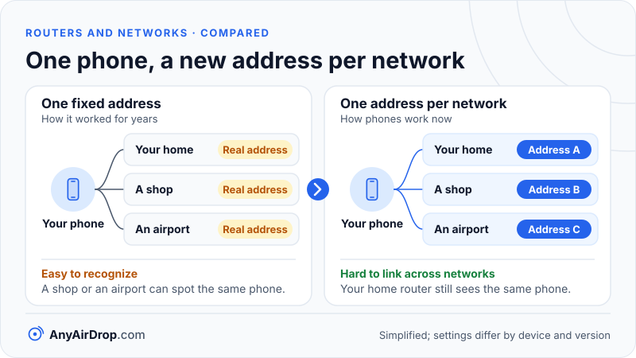

A MAC address is a 48-bit identifier that a network adapter uses to say who it is on the local network. Your router uses it to deliver frames to the right device, and for years it was a fixed number burned into the hardware. Phones and computers now invent a different, random one for each Wi-Fi network, so the same phone can appear as several different devices, or as a brand-new one, depending on where it connects.

**Short answer:** a MAC (media access control) address is six bytes, written like `a6:3f:19:4c:2e:7b`. The first three bytes identify the manufacturer and the last three the individual adapter, unless the address is randomized, which a single flag bit in the first byte announces. Random addresses protect your privacy but break anything that identifies a device by its MAC: DHCP reservations, MAC filters, parental controls and "new device" alerts.

## What a MAC address is

Every network adapter, whether Wi-Fi, Ethernet or Bluetooth, has a hardware address at the *data link layer*, the lowest level where devices talk to their neighbors. On Wi-Fi and Ethernet it is a 48-bit number, shown as six pairs of hexadecimal digits separated by colons or dashes. Two adapters on the same network must not share one, because frames are delivered by it.

The IEEE, the standards body behind both Ethernet and Wi-Fi, runs the system that keeps them unique. An organization buys a 24-bit prefix called an OUI (organizationally unique identifier), registered by the [IEEE Registration Authority](https://standards.ieee.org/products-programs/regauth/oui/). The organization then adds 24 bits of its own to create each individual address, which allows about 16 million addresses per prefix, and buys another prefix when it runs out. This produces the familiar structure:

- **First three bytes:** the OUI, which names the manufacturer (or, more exactly, the company that registered the block).
- **Last three bytes:** the device part, assigned by that manufacturer so that no two adapters it builds are the same.

Public lookup tables map an OUI to a company name, which is how network tools often display "made by" labels next to unknown devices.

### Two flag bits in the first byte

Two bits of the very first byte have special meanings, and they matter for everything that follows. Numbering from the least significant bit:

- **Bit 0, individual or group.** Zero means the frame is for one device (unicast). One means a group (multicast or broadcast). The broadcast address ff:ff:ff:ff:ff:ff has every bit set.
- **Bit 1, universal or local.** Zero means the address came from the manufacturer's registered block (universally administered). One means it was assigned locally, for example by software. A randomized address always has this bit set.

Take the example `a6:3f:19:4c:2e:7b`. The first byte, a6, is 1010 0110 in binary. Bit 1 is 1, so it is locally administered, and bit 0 is 0, so it is unicast. Now look at the second hex digit of the first byte: that is the low four bits, 0110 here, which is 6. Any byte ending in binary x x 1 0 gives a second digit of 2, 6, a or e. That produces a handy rule of thumb: **if the second digit of a MAC address is 2, 6, A or E, the address is locally administered, and on a phone or laptop that almost always means it is randomized.** (Virtual machines and other software can set the same bit.) Compare `3c:22:7e:51:9a:04` (an illustrative address): 3c is 0011 1100, bit 1 is 0, so it would be a factory-assigned address.

## What a MAC address is used for

IP addresses say which network and which device you want; MAC addresses do the last step of delivery. On a local network, a frame carries a source and a destination MAC address, and a switch or access point uses the destination to decide where to send it.

The bridge between the two is ARP, the Address Resolution Protocol ([RFC 826](https://www.rfc-editor.org/rfc/rfc826)). Suppose your laptop (192.168.1.23) wants to send data to a phone at 192.168.1.40. The subnet test in [private IP addresses and local networks](/blog/private-ip-addresses-and-local-networks/) says it is local, but the laptop does not know the phone's MAC address. So:

1. The laptop broadcasts an ARP request to ff:ff:ff:ff:ff:ff: "who has 192.168.1.40? Tell 192.168.1.23."
2. Every device on the network receives it. Only the phone, whose address matches, answers, sending the reply directly to the laptop's MAC with its own hardware address.
3. The laptop saves the pair in its ARP cache for a while and addresses frames to that MAC from then on.

You can see the cache on most computers by running `arp -a` in a terminal.

When traffic leaves the local network, the destination IP address stays the same all the way, but the MAC addresses change at every hop. The laptop addresses the frame to the router's MAC. The router strips that off and builds a new frame with its own MAC as the source and the next device's as the destination. MAC addresses are never visible beyond the local network, so websites never see yours.

Wi-Fi encrypts the contents of your traffic, but the sender and receiver addresses in each frame's header have to remain readable so that devices know whom a frame is for. Anyone in radio range can see the MAC addresses of nearby devices, even on a network they have not joined.

## Why devices now randomize their MAC

A fixed MAC address is a permanent identifier. A phone that sends its real address to every network it ever probes can be recognized by a shop, an airport or a stranger with a cheap radio receiver, even without joining anything. Microsoft's support page raises exactly this concern for Windows: places such as shopping malls could use a device's unique address to track movement through the area.

The fix is to use a made-up address in place of the real one. All three major platforms do it, with different names and details that change between versions:

- **iPhone, iPad and Mac.** Apple calls the feature Private Wi-Fi Address, and a device uses a different address for each network. Apple's [support page on it](https://support.apple.com/en-us/102509) says that in recent versions (iOS 18 and macOS Sequoia 15 and later) you can choose Off, Fixed or Rotating. A rotating address changes every two weeks. Networks with WPA2 or stronger security default to Fixed, and networks with weak or no security default to Rotating. Forgetting a network normally discards the address used with it. The setting lives in the Wi-Fi details for each network; the exact wording varies by software version.
- **Android.** According to the [Android documentation](https://source.android.com/docs/core/connect/wifi-mac-randomization-behavior), devices running Android 10 or higher use a randomized address by default. The default is *persistent*: the address is generated from the network's profile (such as its name and security type), so it stays the same for that network until the phone is factory reset, even if you forget and re-add the network. Starting with Android 12, *non-persistent* randomization, which picks a new address for each connection, is used in specific cases, and it can be switched on for all networks through developer options. It is not the default. Phone makers may label things differently.
- **Windows.** Windows offers a setting called random hardware addresses, which you can turn on for all networks or for a single known network, as [Microsoft's support page](https://support.microsoft.com/en-us/windows/how-to-use-random-hardware-addresses-in-windows-ac58de34-35fc-31ff-c650-823fc48eb1bc) explains. It depends on the Wi-Fi hardware supporting it, so it is not available on every computer.

In the default mode on all three platforms, the address is generated per network, not per connection (Apple's Rotating option and Android's non-persistent mode are the exceptions). That keeps home networks working (your router sees the same device every day) while preventing different networks from correlating one phone's visits. Wired Ethernet generally keeps the real address.

*Per-network addresses keep your home network working while stopping different places from matching one phone's visits.*

## Practical effects of random addresses

The router sees only the address a device chooses to present. Anything built on that address needs attention.

**DHCP reservations.** A reservation (also called a static lease or address binding) tells the router to always give a particular MAC the same IP address. If your phone's MAC changes, the reservation no longer matches and the phone gets an ordinary address. With a fixed private address the problem is mild: reserve the private address once, using the one shown in the phone's Wi-Fi details. With a rotating address, a reservation cannot work, so turn the feature off for your own home network on that device.

**MAC filtering.** Some routers let you list the MAC addresses allowed on the network. Random addresses mean the phone needs its private address added instead of the factory one, and a rotating address will lock itself out when it changes. MAC filtering is also a weak defense, since the allowed addresses can be read from the air and copied. A strong Wi-Fi password and modern security (see [WPA2 and WPA3](/blog/wifi-security-wpa2-wpa3-explained/)) are far more effective.

**Parental controls and time limits.** Many routers tie schedules and filters to a device, and identify it by MAC. A device that changes address after a router reset, a "forget network" or a rotation looks like a new device with no rules applied. Using fixed addresses, or assigning rules by a more stable method where the router offers it, avoids the gap.

**"New device" alerts.** Routers and apps that announce unknown devices will announce the same phone again every time its address changes. A burst of alerts after a software update or after forgetting a network is usually this, not an intruder. Check the device's name and its address pattern before worrying: a locally administered address from a phone you own is expected.

**Hostnames and IP addresses.** A new MAC usually gets a new DHCP lease, which can mean a new IP address. A bookmark or script pointing at an old address then fails. Use device names where possible.

**Captive portals and campus networks.** Some public and campus networks remember that you have already logged in by MAC address. Random addresses can make them ask again. A university network that registers your computer by hardware address may need the feature turned off for that network only.

A sensible approach is to leave randomization on for public networks. On your own home network, switch it off, or to a fixed address where the option exists, only if a feature you rely on needs a stable identifier.

## Why a changing MAC address does not stop a local file transfer

Local file transfer between two of your devices does not depend on the real MAC address at all. What counts is that they are on the same network and can find one another, and that happens at the IP layer, usually through multicast messages such as mDNS ([mDNS and Bonjour](/blog/mdns-bonjour-device-discovery/)). Random MAC addresses neither help nor harm that. A phone sending a photo to a laptop uses ARP to find the laptop's current MAC address, whatever it happens to be this week.

Where randomization does bite is stability. If you keep a fixed IP address or a reservation for a laptop that you use as a transfer target, and its MAC address changes, the target moves to a new address and anything that remembered the old one fails. If a transfer tool cannot find your other device after a router reset or a network re-join, try the usual checks in [devices can't find each other](/blog/devices-cant-find-each-other-troubleshooting/). Tools that pair devices with a short code or a QR scan sidestep addresses entirely. AnyAirDrop.com, our own tool, offers both alongside automatic discovery.

## Common questions

### Can someone find my location from my MAC address?

Not from the address alone. A MAC address is only visible to devices within radio range, or on the same local network, and it is not used on the wider internet. The risk is that someone who sees the same address in several places could recognize your device, and random addresses are designed to prevent exactly that.

### How do I find my phone's MAC address?

Open the Wi-Fi details for the network you are connected to, or the About or Status screen in settings, and look for a field labeled something like Wi-Fi address, private address or MAC address. The wording and location vary by phone and software version. Note that the address shown may be the private one for the current network rather than the hardware address.

### Can I change my MAC address?

Randomization does it automatically on modern phones and many computers, and some systems let you set one by hand. Changing it is legitimate for privacy or testing on your own devices, but using someone else's address to get around a restriction on a network you do not own can break its rules.

### Does turning off Private Wi-Fi Address make me less safe?

On a network you trust, such as your own, the privacy difference is small. On public networks it matters more, because every venue that sees your real address can recognize you later. Most people are best served by leaving it on everywhere and turning it off only where something needs a stable address.

### Why does my router list the same phone twice?

Most likely because the phone changed its address, for example after a rotation, a reset, or forgetting the network and rejoining. The old entry stays in the list until the router clears it. If one of the entries has a second digit of 2, 6, A or E, it is probably a randomized address.

## Key takeaways

- A MAC address is a 48-bit hardware identifier: the first three bytes identify the manufacturer's block, the last three the individual adapter.
- ARP lets devices turn a local IP address into a MAC address, and MAC addresses change at each hop while IP addresses stay the same.
- A randomized MAC sets the locally administered bit, which makes the second hex digit 2, 6, A or E in a normal unicast address.
- iOS, Android and Windows all offer per-network random addresses, with settings and defaults that differ by version and manufacturer.
- Anything built on MAC identification, such as reservations, filters, parental controls and new-device alerts, may need to be adjusted when a device randomizes.

## Sources

- IEEE Standards Association: [Registration Authority, OUI (MA-L)](https://standards.ieee.org/products-programs/regauth/oui/)
- IETF: [RFC 826, An Ethernet Address Resolution Protocol](https://www.rfc-editor.org/rfc/rfc826)
- Apple Support: [Private Wi-Fi Address on Apple devices](https://support.apple.com/en-us/102509)
- Android Open Source Project: [Wi-Fi MAC randomization behavior](https://source.android.com/docs/core/connect/wifi-mac-randomization-behavior)
- Microsoft Support: [Random hardware addresses in Windows](https://support.microsoft.com/en-us/windows/how-to-use-random-hardware-addresses-in-windows-ac58de34-35fc-31ff-c650-823fc48eb1bc)
