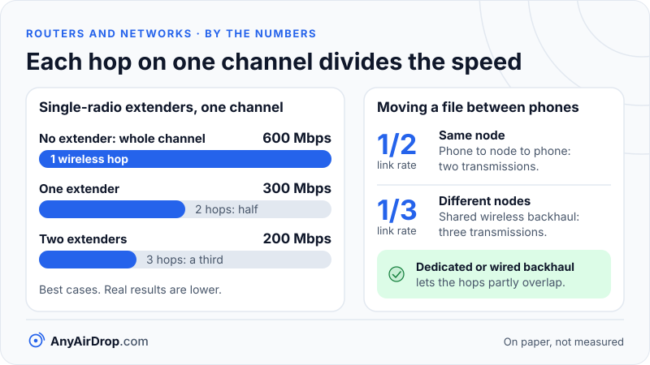

When one router cannot cover a whole home, you add a second box, and the speed you get in the far room depends mostly on one thing: how that second box is connected back to the router. A cable gives full speed. Wi-Fi on the same channel gives roughly half. A radio reserved for the job sits in between, and the wiring in your walls can do a reasonable job, depending on its age and noise. The marketing names (extender, mesh, powerline) matter less than that link.

**Short answer:** the connection between the router and the helper box is called *backhaul*. A wireless extender that uses a single radio must receive and retransmit every frame on the same channel, so it can pass on at most about half of the link rate. Mesh systems reduce the loss with a dedicated backhaul radio or a cable, access points on Ethernet avoid it entirely, and powerline uses the electrical wiring, whose quality sets the limit.

## Backhaul and fronthaul

Any multi-box Wi-Fi setup has two kinds of links:

- **Fronthaul:** the Wi-Fi link between a box and the phones, laptops and other client devices.
- **Backhaul:** the link between the boxes, carrying everyone's traffic back to the router and on to the internet.

A client's speed is limited by whichever of these is slower, and also by how much they interfere with each other. Because the backhaul carries the traffic of *every* device attached to that box, it is the hidden bottleneck in most coverage complaints.

## Why a single-radio extender loses about half

Wi-Fi, as explained in [how Wi-Fi works](/blog/how-wifi-works/), is half-duplex and shared. On one channel, only one device can transmit at a time. A repeater-style extender with a single radio is connected to the router on one channel and serves your phone on the same channel, since it has only one radio and the band is the same.

Follow one packet from your phone to the internet:

1. The phone transmits to the extender. The channel is busy for the duration of that frame.
2. The extender receives it, and then transmits the same frame to the router. The channel is busy again for the same duration, because the extender cannot send and receive at once and the router is on the same channel.
3. The router sends it onward on its cable.

The same data occupied the channel twice. On paper, if the channel can carry a total of 600 Mbps of useful data, the phone gets at most 300 Mbps of it. Cisco's configuration guide for its older repeater access points describes the same effect: a repeater must receive and then retransmit each packet on the same channel, so [throughput is cut in half](https://www.cisco.com/en/US/docs/wireless/access_point/350/configuration/guide/ap35ch12_ps458_TSD_Products_Configuration_Guide_Chapter.html). Put a second extender behind the first on the same channel and, if all the devices can hear one another, the best case falls to a third (200 Mbps). The general rule is that throughput is divided by the number of wireless hops sharing a channel. These are best cases: real overheads, poor signal between the extender and the router, and other networks on the same channel make it worse. The point is that no extender can overcome the airtime arithmetic.

Two practical consequences follow. First, an extender placed at the edge of the router's coverage helps little, because its link back to the router is already weak and slow, and the weakest hop sets the pace. It belongs somewhere the router's signal is still strong. Second, some dual-band extenders avoid the halving by using one band to talk to the router and the other to talk to clients. That keeps the airtime separate, at the cost of using a band (often 2.4 GHz) that is slower on the client side. See [Wi-Fi bands compared](/blog/wifi-bands-2-4-5-6-ghz/) for what that means.

## What a mesh system does differently

A mesh system is a set of nodes designed to work as one network. Compared with a basic extender, three things change.

**A dedicated backhaul.** Tri-band mesh nodes have an extra radio, commonly on a 5 GHz or 6 GHz channel, reserved for talking to other nodes. Clients use the other radios. Because the backhaul and fronthaul do not share a channel, the halving disappears, though the backhaul link itself is still limited by distance, walls and its own channel width. Dual-band mesh systems without a spare radio may share a band for both jobs and lose speed in the same way an extender does, so the number of bands and what each is used for is worth checking in the product's documentation.

**A wired backhaul option.** Most mesh systems can use an Ethernet cable between nodes instead, and when they do, the backhaul stops being a wireless concern altogether. This is the best arrangement a mesh can have, whenever running a cable is practical.

**One name and coordinated management.** All nodes broadcast the same network name, share the same password and are managed together, with a controller choosing channels and deciding which node serves which device. Mesh systems from different brands use proprietary methods, but the Wi-Fi Alliance also runs a certification called [Wi-Fi EasyMesh](https://www.wi-fi.org/discover-wi-fi/wi-fi-easymesh) that takes a standards-based approach to networks with multiple access points, supports mixing access points from multiple vendors, and can guide devices to the best access point.

### Roaming: how a device moves between nodes

Your phone, not the network, decides when to leave one node for another. A device tends to stay on a weak, far node even when a closer one is available, a behavior called *sticky clients*. Three amendments to the Wi-Fi standard, usually named by their letters, help:

| Name | What it does |
| --- | --- |
| 802.11k | Access points give a device a *neighbor report* listing nearby access points, so it scans fewer channels before moving |
| 802.11v | An access point can send a transition suggestion, asking the device to move to a better node |
| 802.11r | *Fast BSS Transition* sets up the security keys ahead of the move, so the handoff takes fewer messages |

Microsoft's driver documentation on [fast roaming](https://learn.microsoft.com/en-us/windows-hardware/drivers/network/fast-roaming-with-802-11k--802-11v--and-802-11r) describes each of these and stresses that both sides must support them: the device's Wi-Fi driver and the access points. These features have since been folded into the main 802.11 standard, but people still use the letters. They improve how quickly devices move, not how fast the links are, and they only work when both the nodes and the device support them. A phone may also ignore a suggestion, so a device that stays on the wrong node is not necessarily broken.

## Wired access points: the plain, best option

An *access point* connected to the router by an Ethernet cable is the simplest way to extend coverage, and the one that removes the problem entirely. The cable is full duplex and not shared with Wi-Fi, so every access point gets the full capacity of its own radio, and the cable runs at its own speed (see [Wi-Fi vs Ethernet](/blog/wifi-vs-ethernet-for-local-transfers/)). Many access points can be powered through the same cable using PoE (Power over Ethernet), so no nearby wall socket is needed.

The only drawback is the cable itself. If you cannot run one, the alternatives below are the compromise, and several mesh systems can later use a cable if you manage to add one. How a wired access point differs from a router and a switch is covered in [modem vs router vs access point](/blog/modem-vs-router-vs-access-point/).

## Powerline: using the electrical wiring

Powerline adapters come in pairs. One plugs into a wall socket near the router and connects to it with Ethernet, the other plugs in elsewhere and offers an Ethernet port (some also have Wi-Fi). The two exchange data over the building's electrical wiring, which carries it on radio-frequency signals well above the 50 or 60 Hz mains power.

Two families of standards are used:

- **HomePlug AV and AV2**, which interoperate with devices that follow the IEEE 1901 standard. AV uses frequencies of roughly 2 to 30 MHz, and AV2 extends that range and adds MIMO (using multiple conductors) to reach higher rates. Both split the band into many narrow carriers and adjust the modulation on each according to how clean it is (see [Wikipedia's HomePlug overview](https://en.wikipedia.org/wiki/HomePlug)).
- **G.hn**, an ITU-T family of standards starting with [G.9960](https://www.itu.int/rec/T-REC-G.9960), which can run over power lines, coaxial cable and telephone wiring. G.hn and HomePlug devices do not interoperate directly, so both ends of a link need to use the same family.

Powerline speeds on the box are the *physical-layer rate*, the raw signaling rate at the best moment. Real throughput is typically only a fraction of that and varies widely. Wikipedia's HomePlug article, for example, lists a peak physical rate of 200 Mbit/s for HomePlug AV but only about 80 Mbit/s at the MAC layer, which is closer to what your data actually receives. What limits throughput in practice:

- **Electrical noise.** Devices such as phone chargers, LED drivers, hair dryers, power supplies and motors inject noise on the wiring. The adapters tune around it, but noisy circuits give lower rates.
- **Filtered sockets.** Surge-protected power strips and many extension leads filter out radio-frequency signals, which kills the link. Plug adapters directly into a wall socket.
- **Wiring distance and circuits.** A long cable run, many junctions, or a different circuit or panel between the adapters reduces the rate. Some links work across circuits and some do not, which is difficult to predict in advance.
- **Shared medium.** All powerline adapters on the same wiring share it, in the same way Wi-Fi devices share a channel.

Powerline is often the practical choice when a cable cannot be run and a wireless link has a hard path, for example through thick masonry. It is sensible to treat the result as unpredictable until tried.

## A comparison

| Option | How the extra box connects | Main limit | Where it fits |
| --- | --- | --- | --- |
| Single-radio extender | Wi-Fi on the same channel | About half per wireless hop | A nearby dead spot with a strong signal to the router |
| Dual-band extender | Wi-Fi, ideally one band for each side | Often the slower band on the client side | Small homes needing cheap coverage |
| Mesh, wireless backhaul | Wi-Fi, ideally a dedicated radio | Backhaul distance and walls | Larger homes where cabling is impractical |
| Mesh or AP, wired backhaul | Ethernet cable | The Wi-Fi hop only | Anywhere a cable can be run |
| Powerline | Electrical wiring | Noise, circuits, filtering | Rooms that Wi-Fi cannot reach and cables cannot cross |

## Why two phones transfer faster on one node than across two

Multi-box systems change what happens when you move a file between two of your own devices, because the path may involve several hops.

Take two phones. If both are connected to the same node, the file goes phone to node to phone: two transmissions, as in an ordinary single-router network, so on paper about half of the link rate when both links run at the same speed. If they are connected to different nodes with a *shared-channel* wireless backhaul, the file goes phone to node, node to node, node to phone: three transmissions, all potentially competing for the same airtime. On paper that is about a third of the link rate. With a dedicated or wired backhaul, the node-to-node hop is off the client channels. The hops can then partly overlap, like a pipeline, and the transfer is limited more by the slowest link than by the sum of all three.

*On paper, every extra hop that shares a channel takes another slice of the same airtime.*

This is why a large file may transfer at one speed in the living room and noticeably slower between the attic and the basement, even though both devices show a strong signal. Moving one of the devices to the same node as the other, or cabling the nodes, often helps more than any setting.

Two other effects matter. Roaming between nodes is usually unnoticeable for ordinary browsing, but a device that switches nodes mid-transfer may pause briefly, and a phone that stays on a far node can look slow for no obvious reason. And some extenders and mesh nodes operate in *router mode* and create a second network with its own address range, so devices on different nodes cannot see each other at all, a case covered in [client isolation, guest networks and device visibility](/blog/client-isolation-guest-networks-and-device-visibility/). AnyAirDrop.com is our own tool, and as with any local transfer it works best when the two devices are on the same network and, if possible, on the same node.

## Common questions

### Is mesh Wi-Fi better than an extender?

Usually, yes, for larger homes, because a mesh is designed as one coordinated system with a better backhaul and managed roaming. A single-radio extender is cheaper, but on paper it halves the speed of its wireless hop. A mesh with a shared-channel backhaul can still lose speed, so the way the nodes connect matters more than the label.

### Does a mesh node need to connect to the router by cable?

No. Wireless backhaul is the default for most systems. A cable is optional but recommended where possible, since it removes the backhaul as a bottleneck.

### Do I need the same brand for all mesh nodes?

For proprietary systems, usually yes, because the controller and the backhaul protocol are the maker's own. Wi-Fi EasyMesh is designed to allow mixing certified products from different brands, though the exact feature set can vary.

### Does powerline work through any wiring?

Not always. It needs adapters on the same electrical system, ideally the same circuit, with no filtered sockets between them. Old wiring, noisy appliances, and separate circuits can make results unpredictable or poor.

### Why is my speed lower far from the router even with an extender?

Because the extender is probably placed where its own link to the router is weak. The extender can only pass on what it receives, and with a single radio it can halve that again. Placing it closer to the router, or using a wired access point, usually fixes the issue.

## Key takeaways

- Backhaul, the link between the router and the added box, is the main thing that determines the speed you get from it.
- A single-radio wireless extender receives and retransmits on the same channel, so it can pass on at most about half of the link rate per wireless hop.
- Mesh systems improve on this with a dedicated backhaul radio, a cable, and managed roaming through 802.11k, v and r.
- A wired access point gives full speed, and powerline is a practical fallback whose speed depends on wiring quality and electrical noise.
- Two devices on different nodes may share airtime on the backhaul, so the same node, or a cabled backhaul, gives the fastest local transfers.

## Sources

- Cisco: [Cisco Aironet Access Point Software Configuration Guide for VxWorks, "Setting Up a Repeater Access Point"](https://www.cisco.com/en/US/docs/wireless/access_point/350/configuration/guide/ap35ch12_ps458_TSD_Products_Configuration_Guide_Chapter.html)
- Wi-Fi Alliance: [Wi-Fi EasyMesh](https://www.wi-fi.org/discover-wi-fi/wi-fi-easymesh)
- Microsoft Learn: [Fast roaming with 802.11k, 802.11v and 802.11r](https://learn.microsoft.com/en-us/windows-hardware/drivers/network/fast-roaming-with-802-11k--802-11v--and-802-11r)
- ITU-T: [Recommendation G.9960, Unified high-speed wireline-based home networking transceivers](https://www.itu.int/rec/T-REC-G.9960)
- Wikipedia: [HomePlug](https://en.wikipedia.org/wiki/HomePlug)
