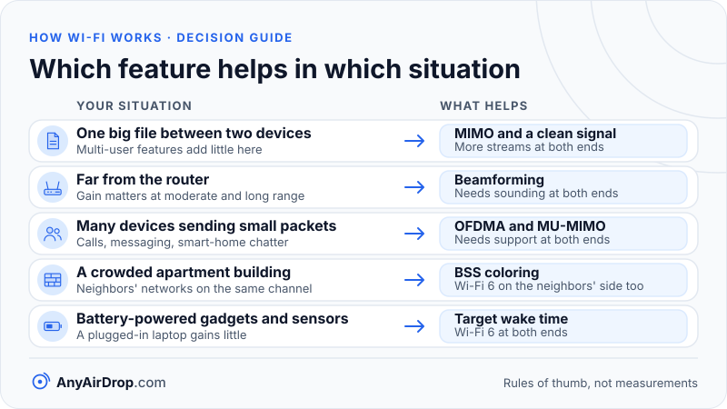

MIMO, MU-MIMO, OFDMA and beamforming are four different tricks that modern Wi-Fi uses to get more out of the same radio spectrum. MIMO sends several data streams at once using multiple antennas. MU-MIMO aims different streams at different devices. OFDMA splits a channel into slices so several devices can share one transmission. Beamforming steers the signal toward a device. Each helps in a different situation.

**Short answer:** MIMO and beamforming make a link between one router and one device faster or longer-reaching. MU-MIMO and OFDMA make a router better at serving many devices at once, mostly by cutting waste on small packets. Most of them need support at both ends, and a single large file transfer between two devices benefits mainly from MIMO and a clean signal, not from the multi-user features.

## Spatial streams and the "2x2" label

A *spatial stream* is an independent flow of data sent over the same frequencies at the same time. Several streams share one channel because they travel along different physical paths between different antennas.

Antenna layouts are written as *transmit × receive*, sometimes with the number of streams after a colon. A "2x2" device has two transmit and two receive antennas and can run two streams; a "4x4:4" router has four of each and four streams. The number of streams on a link is limited by the smaller side. A 4x4 router talking to a 2x2 phone can use two streams with that phone, not four. This is why [headline Wi-Fi speeds](/blog/wifi-standards-explained/) with 8 streams are theoretical for phones: most have two Wi-Fi antennas at most, and some have one.

## How MIMO works: using the echoes

MIMO (*multiple-input, multiple-output*) was introduced to mainstream Wi-Fi with 802.11n, or Wi-Fi 4. The trick runs against intuition: it needs reflections. If the signals from two transmit antennas followed identical paths, the receiver could not tell them apart. In a real room, the two signals bounce off walls and furniture and reach each receive antenna with different strengths and delays. That difference lets the receiver separate them.

### A worked 2x2 example

Let the transmitter send two numbers at once, x₁ = +1 from antenna 1 and x₂ = −1 from antenna 2. Each receive antenna hears a mixture. Suppose the room's paths give this *channel matrix*, where the entries are how strongly each transmit antenna reaches each receive antenna:

- Receive antenna A hears 0.9 × x₁ + 0.3 × x₂ = 0.9 × (+1) + 0.3 × (−1) = **+0.6**
- Receive antenna B hears 0.4 × x₁ + 0.8 × x₂ = 0.4 × (+1) + 0.8 × (−1) = **−0.4**

The receiver knows the matrix, because the transmitter sent known training symbols first, and solves two equations in two unknowns. The determinant is 0.9 × 0.8 − 0.3 × 0.4 = 0.72 − 0.12 = 0.60, and:

- x₁ = (0.8 × 0.6 − 0.3 × (−0.4)) ÷ 0.60 = (0.48 + 0.12) ÷ 0.60 = **+1**
- x₂ = (0.9 × (−0.4) − 0.4 × 0.6) ÷ 0.60 = (−0.36 − 0.24) ÷ 0.60 = **−1**

Both values are recovered, so two streams fit in the space of one.

Now imagine a clear line of sight where all paths look alike: the matrix entries become 0.9, 0.85, 0.85, 0.8. The determinant is 0.9 × 0.8 − 0.85 × 0.85 = 0.72 − 0.7225 = −0.0025, close to zero. Dividing by it multiplies any noise by a few hundred, so the receiver cannot separate the streams reliably and falls back to one. MIMO gains come from a messy environment, which is why an indoor router often does better than you would predict from a free-space picture. Wi-Fi also needs a strong enough signal: at low *signal-to-noise ratio* (the gap between signal and noise), extra streams do more harm than good, and the radio uses fewer of them.

Besides speed, extra antennas give *diversity*: if one path fades, another may not, which makes the link steadier.

## MU-MIMO: different streams for different devices

Ordinary MIMO, called *single-user MIMO* (SU-MIMO), sends all its streams to one device per transmission. *Multi-user MIMO* (MU-MIMO) lets the access point send streams to several devices in the same transmission, each stream steered at its target. The access point needs at least as many antennas as the total number of streams it sends.

- **Wi-Fi 5 (802.11ac)** added MU-MIMO for the *downlink* only (router to devices), for up to four devices at a time, in its later "wave 2" products.
- **Wi-Fi 6 (802.11ax)** added MU-MIMO for the *uplink* (devices to router), where the router receives from several devices at once, and raised the standard's limit to eight users. The [Wi-Fi Alliance's Wi-Fi 6 page](https://www.wi-fi.org/wi-fi-macphy) lists MU-MIMO among its features.

Honest limits: it helps only when several devices want data at the same moment, and the devices must be in places the router can separate with its beams. Setting it up costs airtime for measurement. Support at both ends is required, and many budget devices only support some modes.

## OFDMA: sharing one transmission

*Orthogonal frequency-division multiple access* (OFDMA) is a Wi-Fi 6 feature that is easy to confuse with OFDM, because the names are so close. OFDM is how one device spreads data over many subcarriers. OFDMA lets several devices use different groups of subcarriers *at the same time* in a single transmission.

A fair analogy is a delivery van. Before Wi-Fi 6, every trip served one customer, even if the parcel was a letter, and the van waited for its turn on the road each time. With OFDMA, one van makes a single trip with separate compartments for several customers. The road is the same, and the van drives at the same speed. What changes is that you stop wasting trips on small parcels. The analogy also shows the limit: for one customer with one huge delivery, the compartments change nothing.

The compartments are called *resource units* (RUs). In a Wi-Fi 6 channel they come in sizes of 26, 52, 106 and 242 subcarriers on a 20 MHz channel, and larger on wider channels. A 26-subcarrier unit is about 2 MHz wide, so a 20 MHz channel can hold up to nine users at once. For uplink traffic, the access point sends a *trigger frame* that assigns units to each device, and the devices reply together.

### A worked example: nine devices, tiny packets

Imagine nine devices each have a 100-byte packet to send (a sensor reading, a chat message, an acknowledgement). These numbers are illustrative and rounded, based on default timing values in the standard (the same 43 µs gap and random backoff used in [Wi-Fi link speed vs real speed](/blog/wifi-link-speed-vs-real-speed/)). The first case also ignores collisions between the nine devices, which would make it slower still.

**Without OFDMA**, each device contends for the channel on its own, which takes about 110 µs of waiting plus about 40 µs of preamble, then 8 µs of data, then a 16 µs gap and an acknowledgement of about 28 µs. That is roughly 200 µs per device and **about 1.8 ms** for nine.

**With OFDMA**, the access point wins the channel once (110 µs) and sends a trigger frame (60 µs). After a 16 µs gap, all nine devices transmit together, each on a 26-subcarrier unit. One unit carries 24 data subcarriers; at 16-QAM with coding rate 1/2 that is 24 × 4 × 0.5 = 48 bits per 13.6 µs symbol. A 100-byte packet (800 bits) needs 17 symbols, or 231 µs, plus a 50 µs preamble. A final gap and a combined acknowledgement take about 76 µs. The total is roughly **0.54 ms**, around a third of the time.

Each device's slice is slow, at about 3.5 Mbps, and that does not matter for tiny packets. It is also why OFDMA does not make a big download faster. That needs a wide slice and a fast rate. The saving appears when many small packets compete: video calls, messaging, smart-home chatter and acknowledgements.

## Beamforming and channel sounding

Normally a router radiates in all directions. *Beamforming* adjusts the timing (phase) of the signal from each antenna so the waves add up at the target device and partly cancel elsewhere.

The router needs to know the path to each device, so it runs *channel sounding*:

1. The router announces a sounding and sends a known test frame.
2. The device measures how the frame arrived at each of its antennas.
3. The device sends back a compact report describing the channel.
4. The router calculates the phase and strength to use on each antenna and applies it to later frames.

The gain follows from simple addition. With total transmit power fixed, an access point with N antennas that aligns its waves can, at best, deliver about N times the power at the device: 10 × log10(N) dB. Two antennas give 10 × log10(2) = 3.0 dB, four give 6.0 dB. A 3 dB gain means double the power at the receiver. Wi-Fi 4 defined several optional beamforming methods, and two devices that supported different ones could not beamform with each other, so the feature was often unused. Wi-Fi 5 specified a single method, sounding with a null data packet and compressed feedback, so products from different makers could work together.

Limits: the gain matters most at moderate and long range, where a higher modulation rate is within reach. Near the router the link is already at its top rate. Beamforming cannot get through a concrete wall that absorbs the signal, only use the signal more efficiently. It must be re-measured as you move, and sounding takes airtime.

## BSS coloring: telling neighbors apart

A *basic service set* (BSS) is a router and its connected devices. In dense buildings, your devices hear neighbors' transmissions on the same channel. Under the old rules, if a neighbor's frame arrives above about −82 dBm, your device defers and waits, even if the neighbor is far enough away that talking at the same time would not hurt either of you.

*BSS coloring*, added in Wi-Fi 6, puts a 6-bit number (a "color") in the preamble of every frame, as [Cisco's Wi-Fi 6 white paper](https://www.cisco.com/c/en/us/products/collateral/wireless/white-paper-c11-740788.html) describes. A device can tell from the first microseconds whether a frame comes from its own network or from an overlapping one. For an overlapping network's frame that is weaker than a raised threshold (the standard allows setting it between −82 and −62 dBm), the device may ignore it and transmit anyway at reduced power. This is called *spatial reuse*. Its effect depends on the layout and on how a vendor tunes the threshold, and it can increase retries if set too aggressively.

## Target wake time: sleeping on a schedule

In older power-save modes, a sleeping device wakes up on a schedule tied to the router's beacons, which by default arrive about every 102.4 ms, to check whether data is waiting. *Target wake time* (TWT) lets a device and the router agree on a schedule: wake at these moments, for this long. A sensor might wake once every few minutes. Besides saving battery, scheduling devices at different times reduces contention, as researchers describe in this [analysis of TWT scheduling](https://arxiv.org/abs/1804.07717). The gain is real for battery-powered and always-on gadgets and negligible for a laptop that is plugged in.

## Who needs to support what

| Feature | First in | What it helps | Needs |
| --- | --- | --- | --- |
| MIMO (spatial streams) | Wi-Fi 4 | One device's speed and steadiness | Multiple antennas at both ends |
| MU-MIMO (downlink) | Wi-Fi 5 | Serving several devices at once | Router with enough antennas, devices that support it |
| MU-MIMO (uplink) and OFDMA | Wi-Fi 6 | Busy networks, small packets | Wi-Fi 6 at both ends |
| Beamforming | Wi-Fi 4, standardized in Wi-Fi 5 | Range and speed at moderate distance | Router and device sounding support |
| BSS coloring | Wi-Fi 6 | Dense apartments | Wi-Fi 6 on the neighbors' side matters too |
| Target wake time | Wi-Fi 6 | Battery life, contention | Wi-Fi 6 at both ends |

An old device in the mix does not break these features for the others. It does not take part, and it keeps competing for airtime the old way.

*A single big transfer between two devices leans on MIMO and a clean signal, while the multi-user features pay off when many devices share the channel.*

## What these features do and do not do for a transfer between your own devices

A single big file moving from a phone to a laptop is the least favorable case for the multi-user features. There is only one sender and one receiver, so MU-MIMO has no second device to serve and OFDMA has no small packets to pack. What helps is the single-link part: more spatial streams on both ends, beamforming at distance, a clean wide channel and a good signal. A router upgrade often does less than a better position or fewer interfering neighbors. As [Wi-Fi link speed vs real speed](/blog/wifi-link-speed-vs-real-speed/) shows, the transfer also crosses the air twice through the router, and none of these features avoids that.

Where the multi-user features help is the rest of the household while your transfer runs: with OFDMA and BSS coloring, video calls and smart-home traffic lose less to a busy channel. If a transfer is repeatedly interrupted because the router is overloaded by many small devices, that is where a Wi-Fi 6 router makes a difference. A wired connection for one end removes a hop; see [Wi-Fi vs Ethernet for local transfers](/blog/wifi-vs-ethernet-for-local-transfers/). The width and placement of channels are covered in [Wi-Fi channels and channel width](/blog/wifi-channels-and-channel-width/), and the basics of airtime sharing are in [how Wi-Fi works](/blog/how-wifi-works/).

## Common questions

### What does 2x2 MIMO mean?

It means two transmit antennas and two receive antennas, which allows two spatial streams. A 2x2 device can send two independent data streams at once, doubling the rate of one stream under good conditions.

### Is OFDMA the same as OFDM?

No. OFDM is how a single device splits its data across many subcarriers. OFDMA is the Wi-Fi 6 addition that lets several devices use different groups of those subcarriers in the same transmission.

### Do I need MU-MIMO at home?

It matters only when several devices want data at the same instant, such as multiple streams in different rooms. A household with a few devices rarely sees a difference, and the device must support it too.

### Does beamforming follow me when I move?

The router measures the channel again from time to time, so the beam adjusts. How often it re-measures is up to the implementation, and a fast-moving device can outrun the measurements.

### Will Wi-Fi 6 speed up my older devices?

Not directly. An older device still uses the older rules. It may benefit indirectly, because Wi-Fi 6 devices finish their transmissions sooner and leave more airtime for everyone.

## Key takeaways

- A spatial stream is an independent data flow on the same frequencies; the link uses as many as the smaller antenna count allows.
- MIMO depends on reflections: in a messy indoor space it separates streams, in a clear line of sight it cannot.
- OFDMA is like one van with compartments for several customers: it cuts wasted trips for small packets and does not speed up one big delivery.
- Beamforming adds roughly 10 × log10(N) dB with N antennas and needs sounding at both ends.
- These features need support on both sides, and a single large transfer benefits mostly from MIMO and a clean signal.

## Sources

- Wi-Fi Alliance: [Wi-Fi (MAC/PHY) features](https://www.wi-fi.org/wi-fi-macphy)
- Nurchis and Bellalta (arXiv): [Target Wake Time: Scheduled access in IEEE 802.11ax WLANs](https://arxiv.org/abs/1804.07717)
- Cisco: [IEEE 802.11ax: The Sixth Generation of Wi-Fi White Paper](https://www.cisco.com/c/en/us/products/collateral/wireless/white-paper-c11-740788.html)
