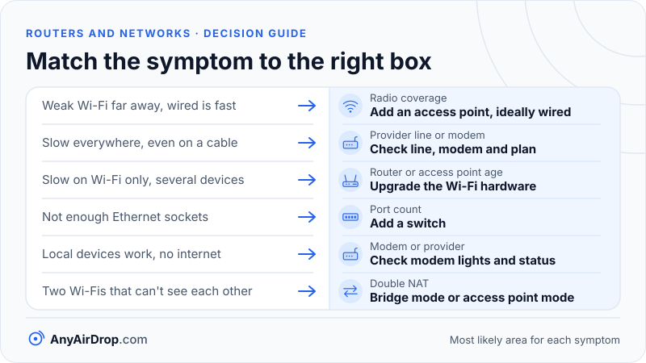

A modem connects your home to your internet provider's line, a router shares that one connection among all your devices, and an access point turns a cable connection into Wi-Fi. The names get mixed up because most homes have a single plastic box that does all three jobs. They are still three different jobs, and knowing which one a problem belongs to tells you which box to look at.

**Short answer:** the modem speaks the provider's language (cable, phone line or fiber), the router decides where traffic goes and gives every device an address, and the access point is the radio that lets phones and laptops join. A switch adds more Ethernet sockets. Your "Wi-Fi router" is usually all of these combined.

## The jobs, and what each box is called

Before looking at the hardware, it helps to separate the jobs. Each one answers a different question.

| Job | Question it answers | Connects | Typical sockets |
| --- | --- | --- | --- |
| Modem | How do I talk to my provider? | Provider line to Ethernet | Coax, phone jack or fiber in, one Ethernet out |
| Router | Where should this traffic go, and who is this device? | Your network to the internet | One WAN port, several LAN ports |
| Switch | Which port is this device on? | Wired devices to each other | Many Ethernet ports |
| Access point | How do wireless devices join the wired network? | Wi-Fi to Ethernet | One Ethernet port |

WAN stands for *wide area network*, meaning the outside world on the provider's side. LAN stands for *local area network*, meaning everything inside your home. A router is the box that sits on the border between them, which is why it has two kinds of sockets.

Each of the four jobs can be done by a dedicated box, and each can be folded into another. That flexibility is exactly why the vocabulary is confusing.

## The modem: translating the provider's line

*Modem* is short for modulator-demodulator. It converts between the signal on your provider's cable and ordinary Ethernet. What it has to speak depends entirely on how your home is connected:

- **Cable:** the line is coaxial, the same kind of cable used for TV. The standard is DOCSIS (Data Over Cable Service Interface Specification), maintained by [CableLabs](https://www.cablelabs.com/). Your cable modem talks to equipment at your provider's facility that is usually called a CMTS (cable modem termination system), and many homes on the same neighborhood line share that line's capacity.
- **DSL:** the line is the copper telephone wire. ADSL and VDSL2 are the common flavors, and the modem talks to equipment at the telephone exchange or a street cabinet. Speed falls as the copper gets longer.
- **Fiber:** a glass fiber carries light into your home and ends at a box called an ONT (optical network terminal). The box is usually called an ONT rather than a modem because it works with light instead of an electrical signal, but it does the same job, and many people call it a fiber modem. Common systems follow ITU-T standards such as [G.984 for GPON](https://www.itu.int/rec/T-REC-G.984.1) (gigabit-capable passive optical networks).
- **Fixed wireless and cellular home internet:** a radio unit receives the signal from a nearby tower and again presents Ethernet to the router.

The key point is that the modem is specific to the provider's technology. A cable modem cannot be plugged into a phone line, and a DSL modem cannot be plugged into a coax cable. Providers also tend to keep lists of modems they support, and some require the device to be registered with them before it works. The exact rules differ by provider, so check theirs before buying anything.

## The router: where your own network begins

A router has two sides. On the WAN side it gets an address from your provider. On the LAN side it creates your private network, gives each device an address with DHCP (Dynamic Host Configuration Protocol), tells devices where DNS (the internet's phone book) lives, and translates between your private addresses and the single address the outside world sees. That translation is called NAT, for *network address translation*.

Our walkthrough of [how a router works with NAT, DHCP and DNS](/blog/how-a-router-works-nat-dhcp-dns/) traces each of these steps in detail. For now, the useful fact is that the router is the device that makes "my home network" a separate thing from "the internet". It also usually acts as a basic firewall, because translated connections only let replies in, not strangers.

Devices on the LAN side of a router can normally reach one another without the traffic leaving the building. That matters later for file transfers.

## The switch and the access point

A **switch** is a box of Ethernet sockets. When a frame arrives on one port, the switch learns which device is behind it (by its hardware address, see [MAC addresses](/blog/mac-address-and-private-wifi-addresses/)) and forwards later frames only to that port. A switch does not hand out addresses or connect to your provider. It only extends the wired network. The "4 LAN ports" on a router are a small switch built in.

An **access point** (AP) does the same job for radio. It receives Wi-Fi frames from a phone, removes the radio wrapper and forwards the contents onto the wired network, then does the reverse for traffic coming back. [How Wi-Fi works](/blog/how-wifi-works/) describes the radio side. The important distinction is that a standalone access point does not run DHCP or NAT. It plugs into a LAN port of the router and joins its devices to the router's network. Everyone on the AP is on the same network as everyone on the router.

People sometimes call any Wi-Fi box a router. The test is simple: if it has a WAN or internet port and creates its own private network, it is acting as a router. If it only has LAN ports and extends the existing network, it is acting as an access point or switch, whatever the label says.

## Three common ways homes are wired

Almost every home fits one of these layouts, shown in the diagram at the top.

1. **One all-in-one gateway.** Your provider supplies a single box that contains the modem, router, switch and access point. Plug in the line, and devices join its Wi-Fi. This is the simplest and the most common. The industry word for such a box is *gateway*.
2. **A separate modem and a router.** The modem sits at the wall and the router, with its switch and Wi-Fi, plugs into the modem by an Ethernet cable. People choose this to upgrade the Wi-Fi without touching the line equipment, or because the provider's modem has no Wi-Fi at all.
3. **A router plus extra access points.** The router connects to the modem as before, and one or more access points connect back to it by Ethernet cable, each broadcasting the same network name. This is how offices cover a large building, and the cabled link is what makes it work well. Wireless alternatives, such as extenders and mesh systems, are compared in [mesh Wi-Fi vs extenders vs powerline](/blog/mesh-wifi-vs-extenders-vs-powerline/).

## Bridge mode and double NAT

The trouble starts when two routers end up chained. Suppose you buy a router and plug it into the provider's gateway, because the gateway's own Wi-Fi is weak. Both boxes now perform NAT, and your traffic is translated twice. That is called *double NAT*.

Here is a worked example of a single request from a laptop, using made-up but representative addresses:

1. The laptop (192.168.0.23) sends a packet from port 50123. Your own router (LAN side 192.168.0.1) rewrites the source to its WAN address, 192.168.1.64, port 50123 or a nearby number.
2. That address belongs to the provider's gateway, whose LAN side is 192.168.1.1. It sees a packet from 192.168.1.64 and rewrites it again to the one public address your provider assigned, for example 203.0.113.45 (a reserved example address), with another port.
3. Replies reverse both translations in order.

Browsing works fine. The cost shows up elsewhere:

- **Port forwarding must be set up twice**, once on each box, or inbound connections never arrive.
- **Games and video calls** may report a "strict" or "moderate" NAT type, because the outside world cannot reach you.
- **Two networks exist.** A phone on the gateway's Wi-Fi (192.168.1.x) and a laptop on your router's Wi-Fi (192.168.0.x) are on different networks and typically cannot find each other.
- **If both boxes use the same address range**, such as 192.168.1.x on both sides, the routing breaks entirely. Some routers detect this and change their own range.

There are two ways to remove double NAT. Put the gateway into *bridge mode* (some makers call it IP passthrough, modem mode or transparent mode), which switches off its router functions so your own router receives the public address directly. Or set your second box to *access point mode*, so it stops routing and extends the gateway's network instead. Turning off the gateway's Wi-Fi and using only your router's is a partial fix: it removes the second Wi-Fi name, but the translation still happens twice. The names and menu locations vary by manufacturer and software version, so look for these words in the router's documentation rather than expecting an exact label.

## Which box to replace or add

Matching the symptom to the right device saves money and frustration.

| Symptom | Most likely area | What to change |
| --- | --- | --- |
| Weak Wi-Fi in a far room, but a wired device there is fast | Radio coverage | Add an access point, ideally by Ethernet |
| Slow everywhere, including on a cable, and a speed test is far below your plan | Provider line or modem | Check the line, modem and plan with your provider |
| Wi-Fi is slow for several devices at once but wired is fine | Router or access point age | Replace or upgrade the Wi-Fi hardware |
| Not enough Ethernet sockets | Port count | Add a switch |
| Local devices work, but there is no internet | Modem or provider | Check the modem lights and the provider status |
| Two Wi-Fi networks, and devices on one cannot see the other | Double NAT | Bridge mode or access point mode |

Notice that two of those fixes do not involve a new router at all. Many "I need a better router" problems are really "I need an access point where I sit".

*Read each row left to right: the symptom you see, then the box or setting to check first.*

## Why the modem plays no part in a phone-to-laptop transfer

A file moving between two phones, or a phone and a laptop, on the same Wi-Fi network never reaches the modem. The packets travel from one device to the access point and on to the other device, all on the LAN side. That has three practical consequences.

First, your internet plan does not limit a local transfer. The modem could be unplugged and the transfer would run at the same speed, because the modem only handles traffic headed to the provider. Second, what matters is the speed of the Wi-Fi or cable between your devices, which depends on the access point and the radio conditions rather than the modem. Third, both devices must be on the *same network*. A guest network, a second router behind a gateway, or a separate access point operating as a router puts devices on different networks even when they look like the same Wi-Fi.

When you set up a double NAT layout and wonder why your devices stopped seeing each other, check which router each device joined. [Private IP addresses and local networks](/blog/private-ip-addresses-and-local-networks/) shows how to read an address to tell, and [client isolation and guest networks](/blog/client-isolation-guest-networks-and-device-visibility/) covers the other common cause. AnyAirDrop.com is our own tool, and it relies on this same fact: devices on the same Wi-Fi network find each other automatically, so the modem plays no part.

## Common questions

### Do I need both a modem and a router?

Yes, you need both functions, but not always as separate boxes. A gateway contains both. If your provider gives you a separate modem with no Wi-Fi, you need to add a router. If you have a single combined box, you already have both.

### Can I use a router without a modem?

You can, but only for a local network. Without a modem or ONT there is no way to reach the provider, so there is no internet. Devices on the router can still exchange files and talk to each other.

### Is a fiber ONT a modem?

It does a modem's job, but it is normally called an ONT, because it converts between light and Ethernet rather than between electrical signals on a wire and Ethernet. Many people and providers call it a fiber modem anyway. You still need a router after it.

### Is an access point the same as a range extender?

No. An access point connects to the router by cable and creates a full-speed Wi-Fi cell. A range extender connects to the router over Wi-Fi itself, which uses airtime twice and, if it has only one radio, can roughly halve the speed it delivers. See the comparison in [mesh Wi-Fi vs extenders vs powerline](/blog/mesh-wifi-vs-extenders-vs-powerline/).

### What is bridge mode?

Bridge mode turns off a device's routing and address translation so it passes traffic through unchanged. A gateway in bridge mode hands the public address to your own router, which avoids double NAT. After switching, check that your own router reaches the internet, because some providers' gateways handle login or management features differently in this mode.

## Key takeaways

- The modem talks to your provider and must match the provider's technology: cable, DSL, fiber or wireless.
- The router creates your private network, assigns addresses, translates them for the internet and acts as a basic firewall.
- An access point only joins Wi-Fi devices to an existing wired network. A switch only adds wired ports.
- Chaining a router behind a provider gateway causes double NAT; bridge mode or access point mode solves it.
- Local file transfers stay on the LAN side, so the modem and your internet plan do not limit them, but both devices must be on the same network.

## Sources

- CableLabs: [DOCSIS technology and specifications](https://www.cablelabs.com/)
- ITU-T: [Recommendation G.984.1, Gigabit-capable passive optical networks (GPON): General characteristics](https://www.itu.int/rec/T-REC-G.984.1)
- IETF: [RFC 3022, Traditional IP Network Address Translator](https://www.rfc-editor.org/rfc/rfc3022)
- IETF: [RFC 2131, Dynamic Host Configuration Protocol](https://www.rfc-editor.org/rfc/rfc2131)
