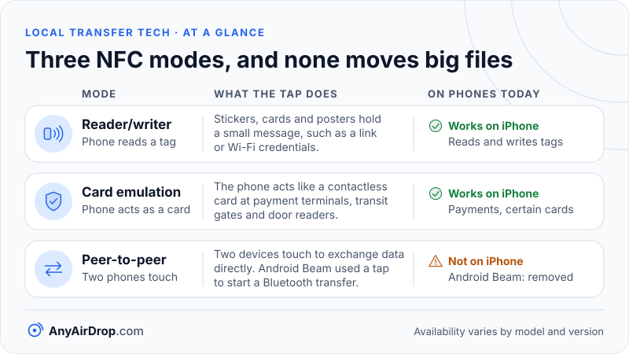

NFC (Near Field Communication) lets two devices exchange data when they are almost touching. A coil in your phone creates a magnetic field at 13.56 MHz, a second coil in a card, tag or phone picks it up, and the field itself carries the message. Because it works over only a few centimeters at modest speeds, NFC is used to start things, such as a payment, a pairing or a file transfer, rather than to move large files.

**Short answer:** NFC is a very short-range radio link based on magnetic induction, with peer-to-peer rates of 106 to 424 kilobits per second. That is fast enough for a link, a contact card or a Bluetooth pairing message, and far too slow for photos and videos. Phones therefore use a tap to introduce two devices and then switch to Bluetooth or Wi-Fi for the actual data.

## Magnetic coupling, not radio waves in the usual sense

Wi-Fi and Bluetooth send radio waves that travel away from the antenna. NFC works differently. The reader's antenna is a flat coil of wire, and when current flows through it at 13.56 MHz it creates an alternating magnetic field around the coil. A second coil placed inside that field has a voltage induced in it, in the same way a transformer passes energy between two windings. This is called *inductive coupling*.

The wavelength at 13.56 MHz shows why this counts as a "near field". Wavelength equals the speed of light divided by frequency: 299,792,458 m/s ÷ 13,560,000 Hz ≈ 22 meters. The devices are separated by a few centimeters, which is tiny compared with 22 meters, so the coils interact as the two halves of a transformer rather than as a transmitter and a distant receiver. The strength of a magnetic field around a coil falls off very steeply with distance (roughly with the cube of the distance), so the coupling is strong at a centimeter or two and essentially gone a short way beyond.

The distance numbers depend on who you ask and on the antennas involved. The [NFC Forum](https://nfc-forum.org/learn/nfc-technology/), the industry group behind the technology, gives a typical range of up to about 2 cm. [Android's developer documentation](https://developer.android.com/develop/connectivity/nfc) says a distance of 4 cm or less is typically required. Treat "a few centimeters, practically touching" as the working rule.

### Passive and active devices

A card or sticker does not need a battery. In *passive* mode the reader supplies the magnetic field, and the tag draws a little energy from it and replies by slightly altering how it loads the field, which the reader can detect. In *active* mode both devices generate their own fields and take turns, which both then need power for. A phone can play either role.

## Standards and speeds

NFC is built on older contactless standards. The NFC Forum lists compatibility with ISO/IEC 14443 Type A and B (the family used by many contactless cards and payment cards), ISO/IEC 15693, ISO/IEC 18092 and Japan's JIS X 6319-4 (the standard behind FeliCa). According to [Wikipedia's NFC article](https://en.wikipedia.org/wiki/Near-field_communication), ISO/IEC 18092, which covers peer-to-peer communication, supports data rates of 106, 212 or 424 kilobits per second (kbit/s). The same article's introduction gives a range of 106 to 848 kbit/s, and the NFC Forum's overview page quotes a data rate from 46 kbit/s up to 1.7 Mbit/s without saying which variants those figures belong to. Even the top of that range is a small fraction of what Wi-Fi provides, so this post uses the 106 to 424 kbit/s peer-to-peer rates for its arithmetic.

### A worked example: why not just send the photo by NFC?

Take a modest 3 MB photograph. That is 3 × 1,000,000 × 8 = 24,000,000 bits, or 24,000 kilobits.

- At 106 kbit/s: 24,000 ÷ 106 ≈ 226 seconds, nearly 4 minutes.
- At 424 kbit/s: 24,000 ÷ 424 ≈ 57 seconds.

Those are best-case times that ignore protocol overhead. And during all of that time the two phones would have to stay within about 4 cm of each other without moving. Contrast a small *handover message* of, say, 100 bytes: 800 bits ÷ 106,000 bit/s is about 7.5 milliseconds. A tap lasting a fraction of a second is plenty for that. NFC is designed around messages of that size.

## Three modes, as the NFC Forum describes them

The NFC Forum describes NFC devices as able to work in the following modes:

- **Reader/writer.** The phone reads or writes passive tags: stickers, cards and posters. The data on a tag is usually an *NDEF* (NFC Data Exchange Format) message, a small structure that can hold a link, a phone number, contact data, a Bluetooth pairing record or Wi-Fi network credentials. The NFC Forum defines five tag types that differ in their underlying protocol.
- **Card emulation.** The phone behaves like a contactless card so a payment terminal, transit gate or door reader can interact with it. On Android, host-based card emulation lets an app emulate a card without a dedicated secure element, as the Android documentation explains. For payments, sensitive credentials are normally held in protected hardware or replaced by tokens, so the terminal never sees your real card number.
- **Peer-to-peer.** Two devices touch to exchange data directly.

## From a tap to a faster link: handover

Because NFC is slow but instant, a very common design is to use it only for *connection handover*. The first phone sends a tiny NDEF message that says, in effect, "I can talk Bluetooth, and here is my address and the details you need." The second phone reads it, and the two devices then open a Bluetooth or Wi-Fi connection without any menus, passkeys or searching. NFC replaces the discovery and the pairing prompt, and a faster radio does the heavy lifting.

Tags use the same idea in one direction. A sticker can hold Wi-Fi credentials or a Bluetooth pairing record so your phone can join a network or pair a speaker after a single tap. Wikipedia's NFC article also notes that Samsung's S-Beam exchanged network addresses over NFC and then used Wi-Fi Direct for the transfer, which is the same pattern. For how the second stage works, see [Bluetooth file transfer explained](/blog/bluetooth-file-transfer-explained/) and [Wi-Fi Direct, Wi-Fi Aware and AWDL](/blog/wifi-direct-wifi-aware-awdl-explained/).

## Android Beam: the tap-to-send feature that went away

Android Beam is the clearest example of this design. It was introduced with Android 4.0 in 2011. Two phones were held back to back, you tapped the screen to send, and from Android 4.1 NFC was used to switch on Bluetooth on both phones and pair them for the larger transfer, as Wikipedia's [article on Android Beam](https://en.wikipedia.org/wiki/Android_Beam) summarizes. Google deprecated the Beam interfaces in Android 10 (API level 29), and the [`NfcAdapter` reference](https://developer.android.com/reference/android/nfc/NfcAdapter) now describes the feature as removed and suggests Bluetooth for file sharing. The Wikipedia article places the complete removal in Android 14. Google's later nearby-sharing feature, which became Quick Share (see [how Quick Share works](/blog/how-quick-share-works/)), uses Bluetooth Low Energy for discovery instead of a tap. Newer phones therefore may have NFC for payments and tags but no Beam feature.

## What iPhones can and cannot do with NFC

Apple's [Core NFC documentation](https://developer.apple.com/documentation/corenfc) describes what apps can do with the iPhone's NFC hardware:

- Read NFC tags of types 1 through 5 that hold NDEF data, and write data to writable tags.
- Work with protocol-specific tags such as ISO 7816, ISO 15693, FeliCa and MIFARE.
- Use a background tag reading feature so that scanning a tag does not require opening an app first.
- Apple also lists a card session class for ISO 7816 card emulation, and its [NFC and SE Platform](https://developer.apple.com/support/nfc-se-platform/) lets approved apps run secure contactless transactions such as in-store payments, car keys, transit, hotel keys and event tickets. The platform requires an agreement and an entitlement from Apple, and its availability varies by region and iOS version.

The documented session types in Core NFC are all about tags, cards and readers. The documentation does not describe a peer-to-peer mode or a file-push session, so an iPhone has no NFC equivalent of Android Beam that apps can use. Apple's own tap-based sharing features are described by Apple separately, and what they use under the hood is not covered here. Availability of specific features differs by iPhone model and iOS version, so check Apple's current documentation for your device.

*Tags and payments carry on, while the tap-to-send mode that Android Beam offered is gone.*

## Contactless payments, briefly

A contactless payment is NFC in card-emulation mode. The terminal acts as the reader, powers the field and sends a command; the phone or card answers with a transaction-specific code, using the ISO/IEC 14443 family of protocols at its lowest layers. The whole exchange is small data and takes a fraction of a second, which is why the short range is a feature: it is hard to tap by accident, and an attacker needs to be very close. Plain NFC without added cryptography is not protected against eavesdropping or tampering by itself, so payment and access systems add their own cryptographic protocols on top.

## NFC as a start gesture, and what stands in for it between a phone and a laptop

NFC is useful as a "start here" gesture, not as a pipe. If your phone and laptop both have NFC readers and support handover, a tap can pair a Bluetooth link, but you would still use Bluetooth or Wi-Fi to move the file, and as the arithmetic in [Bluetooth file transfer explained](/blog/bluetooth-file-transfer-explained/) shows, Bluetooth is itself slow for anything large. Many laptops have no NFC reader at all, and Apple's Core NFC documents no way for an app to push files over NFC, so a tap-to-send workflow rarely crosses platforms.

In practice, the common cross-device approach is to avoid pairing altogether: join the same Wi-Fi network and use a method that discovers devices there. AnyAirDrop.com is our own tool that works that way, with a QR code or six-digit code as the "touch" step, but the principle is the same as NFC handover: a tiny exchange to introduce the devices, then a fast link for the data. For the security side of local transfers, see [is local file transfer safe?](/blog/is-local-file-transfer-safe-encryption-explained/).

## Common questions

### How close do devices need to be for NFC?

A few centimeters. The NFC Forum cites a typical range of up to about 2 cm, and Android's documentation says 4 cm or less is typically required. Phone cases, metal and the position of the coil in each device all affect whether it works.

### How fast is NFC?

NFC's specified peer rates are 106, 212 and 424 kbit/s. That is hundreds to thousands of times slower than a decent Wi-Fi link, which is why NFC carries small messages only.

### Can NFC transfer photos or videos?

Not practically. A 3 MB photo would take about a minute at the best raw rate of 424 kbit/s, with no allowance for overhead, and the devices would have to stay touching throughout. Phones that support tap-to-share use the tap to start a Bluetooth or Wi-Fi connection instead.

### Does NFC work on iPhone?

Yes for reading and writing tags and for contactless payments and certain cards through Apple's frameworks, but not as a peer-to-peer file-transfer channel. Apple's Core NFC documentation lists tag reading, tag writing, and card-related sessions, and no peer-to-peer mode.

### Is NFC safe?

Its very short range limits casual eavesdropping, but range alone is not security: Wikipedia's NFC article notes that plain NFC is not protected against eavesdropping or data modification, so payment and access systems add their own cryptography. Do not tap unknown tags or stickers without checking what they will do, as a tag can contain a link or a pairing request.

## Key takeaways

- NFC works by magnetic induction at 13.56 MHz, a wavelength of about 22 meters, so devices interact as the two coils of a transformer at a few centimeters.
- Specified peer rates are 106, 212 and 424 kbit/s, so a 3 MB photo would take roughly one to four minutes at best, if it were attempted.
- NFC is used for tags, contactless payments and handover, where a tiny message starts a Bluetooth or Wi-Fi connection.
- Android Beam, which used NFC to set up Bluetooth transfers, was deprecated in Android 10 (API level 29) and is now documented as removed.
- iPhones can read and write tags and take part in payments, but the documented Core NFC sessions have no peer-to-peer file mode.

## Sources

- NFC Forum: [NFC technology](https://nfc-forum.org/learn/nfc-technology/)
- Android Developers: [Near field communication (NFC) overview](https://developer.android.com/develop/connectivity/nfc)
- Apple Developer: [Core NFC](https://developer.apple.com/documentation/corenfc)
- Apple Developer: [NFC & SE Platform](https://developer.apple.com/support/nfc-se-platform/)
- Android Developers: [NfcAdapter reference](https://developer.android.com/reference/android/nfc/NfcAdapter)
- Wikipedia: [Android Beam](https://en.wikipedia.org/wiki/Android_Beam)
- Wikipedia: [Near-field communication](https://en.wikipedia.org/wiki/Near-field_communication)
