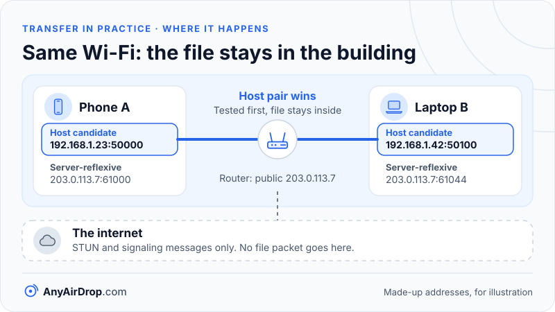

Most devices cannot be reached directly from the internet, because a home router hides them behind a single shared address. STUN, TURN and ICE are three connected tools that get around this: STUN tells a device how it looks from outside, TURN supplies a relay when nothing else works, and ICE tries every possible route in order and keeps the first one that succeeds.

**Short answer:** NAT (network address translation) lets many devices share one public address but blocks unsolicited incoming traffic. ICE (Interactive Connectivity Establishment) collects each device's candidate addresses, tests pairs of them in priority order, and picks the best working pair. Two devices on the same Wi-Fi normally pass the very first test, using their local addresses, and never send file data outside the building.

## Why NAT stands in the way

Every device on your home network has a private address, such as 192.168.1.23. Those addresses are only meaningful inside the building (see [private IP addresses and local networks](/blog/private-ip-addresses-and-local-networks/)). The router owns one public address and rewrites outgoing packets so they appear to come from it, a job described in [how a router works](/blog/how-a-router-works-nat-dhcp-dns/).

To make replies find their way back, the router keeps a table. When your phone sends a packet from its private port 50000 to some server, the router picks a public port, say 61000, and records "public 61000 means phone, private 50000". A reply to port 61000 gets translated back and delivered. A packet that arrives at the router with no matching entry has nobody to go to, so it is dropped.

That is the problem for direct connections. If two devices behind different routers each want to be the one that receives, neither router has an entry for the other, and each router discards the first incoming packet. Peer-to-peer software needs a way around this, and the trick is for both sides to send packets at each other at about the same time, so each router creates an entry that lets the other's packets through. That trick is called *hole punching*. To use it, each device must know three things: its own addresses, what its address looks like from outside, and the other device's equivalents.

## STUN: asking "what do you see?"

STUN (Session Traversal Utilities for NAT) answers the second question. It is defined in [RFC 8489](https://www.rfc-editor.org/rfc/rfc8489). The idea is simple. A device sends a small message called a *Binding request* to a STUN server on the public internet. The server looks at the source address and port on the packet it received, which is the router's public address and the port the router chose, and copies them into the reply, in an attribute called XOR-MAPPED-ADDRESS. The device now knows how it appears from outside. The standard calls that a *reflexive transport address*.

Two details are worth knowing:

- **STUN is a tool, not a complete solution.** RFC 8489 states that it is not a NAT traversal solution by itself. It is one building block inside a larger procedure such as ICE.
- **It is cheap to run.** A STUN server only answers tiny messages and relays nothing. The default port is 3478, and 5349 is used for STUN over TLS or DTLS.

## TURN: a relay for when direct fails

TURN (Traversal Using Relays around NAT) is defined in [RFC 8656](https://www.rfc-editor.org/rfc/rfc8656). When a direct path is impossible, a device asks a TURN server to create an *allocation*: a public address and port on the server that acts as a mailbox. The device then sends its packets to the TURN server, which forwards them to the other device, and vice versa. By default an allocation lasts 600 seconds unless the client refreshes it.

A relay always works, because both devices only need to reach the server, and they can do that with ordinary outgoing connections. The cost is that all of the traffic now passes through someone else's machine. The server operator pays for the bandwidth in both directions, and the data takes a detour that is usually slower than a direct route. RFC 8656 says as much: relaying is costly and should be used only when no direct path can be found. This is why TURN is the last resort, and why services that offer it often need to restrict who may use it.

A relay does not necessarily see your data. When it carries a WebRTC data channel, the content is encrypted end to end with DTLS keys that only the two devices hold, so the relay forwards packets it cannot read. [WebRTC data channels, explained](/blog/webrtc-data-channels-explained/) describes that layering.

## ICE: trying everything in order

ICE is the procedure that ties STUN and TURN together. It is defined in [RFC 8445](https://www.rfc-editor.org/rfc/rfc8445), and it works in four stages.

1. **Gather candidates.** A *candidate* is a possible address and port for reaching a device. There are four types:
   - **Host:** an address on the device's own network interface, such as 192.168.1.23:50000.
   - **Server-reflexive:** the public address and port the router assigned, learned from a STUN server.
   - **Relayed:** an address on a TURN server.
   - **Peer-reflexive:** an address discovered during testing, which neither side was told about beforehand. It appears when a router creates a new mapping while a test packet passes through it.
2. **Exchange candidates.** The two devices send their candidate lists to each other through a signaling server, because they cannot talk directly yet.
3. **Test pairs.** Each device pairs every local candidate with every remote candidate and sends STUN *connectivity checks* on those pairs, in priority order.
4. **Nominate.** One side is the *controlling agent*. When a pair works in both directions, it nominates that pair, and from then on, data uses it.

### How priority is calculated

Each candidate gets a priority number from a formula in RFC 8445, section 5.1.2.1:

priority = 2^24 × type preference + 2^8 × local preference + (256 − component ID)

The recommended type preferences (section 5.1.2.2) are 126 for host, 110 for peer-reflexive, 100 for server-reflexive and 0 for relayed. The local preference is a tiebreaker between multiple interfaces (for example Wi-Fi and Ethernet), and the component ID is 1 when all traffic shares a single component, as it does in a WebRTC connection. For a device with a single address, the RFC says the local preference should be 65,535, and the numbers then work out to:

- Host: 126 × 16,777,216 + 65,535 × 256 + 255 = 2,130,706,431
- Server-reflexive: 100 × 16,777,216 + 65,535 × 256 + 255 = 1,694,498,815
- Relayed: 0 + 65,535 × 256 + 255 = 16,777,215

Browsers choose their own local preference values, so the priorities in a browser's debugging output will not match these exact numbers, but the ordering of the types is the same.

A pair's priority is built from both candidates' numbers using 2^32 × MIN(G, D) + 2 × MAX(G, D) + (1 if G > D, else 0), where G and D are the two priorities (section 6.1.2.3). The MIN term dominates, so a pair is only as good as its worse half. A host candidate paired with a relayed candidate ranks near the bottom, which is the behavior you want: the order of tries is "direct local, then direct public, then relay."

## A worked trace: two devices on the same Wi-Fi

The following scenario uses made-up addresses to illustrate the steps. The public address is from a range reserved for documentation (203.0.113.0/24), not a real network.

Phone A is at 192.168.1.23 and laptop B is at 192.168.1.42. Both are connected to the same router, whose public address is 203.0.113.7.

1. **Gathering.** A collects a host candidate (192.168.1.23:50000). It asks a STUN server and learns a server-reflexive candidate (203.0.113.7:61000). If a TURN server is configured, it also gets a relayed candidate. B does the same and gets 192.168.1.42:50100 and 203.0.113.7:61044.
2. **Exchange.** Both lists travel through the signaling server.
3. **Ordering.** The best pair is host to host, because both of its candidates have the top priority of 2,130,706,431. Next comes server-reflexive to server-reflexive, and then pairs involving relays.
4. **First check.** A sends a STUN Binding request to 192.168.1.42:50100. Since that address is on the same subnet, the packet goes through the Wi-Fi access point and straight to B. B replies. Because B runs the same check in the other direction, both sides see a working path.
5. **Nomination.** The controlling side nominates the host pair. Lower-priority checks are dropped. File data now flows between 192.168.1.23 and 192.168.1.42 only.

At no point did a file packet reach the public internet. The router still did its normal job of passing frames between the two Wi-Fi devices (as in [how Wi-Fi works](/blog/how-wifi-works/)), but no address translation was involved. The reflexive pair would also have been a valid route, but it would depend on the router looping traffic back to itself, a feature called *hairpinning* that some routers handle poorly. ICE avoids the question by trying the host pair first.

*In the usual home case the first test succeeds, so the file passes from one device to the other through the router and never reaches the internet.*

### Why browsers often show a .local name instead of an address

A host candidate normally reveals your private IP address to every site that asks, which is a small privacy leak and a fingerprinting aid. [RFC 8828](https://www.rfc-editor.org/rfc/rfc8828), the IETF's document on WebRTC IP address handling, discusses the trade-off between disclosing private addresses and keeping direct connections working.

To close that leak, browsers can replace the address with a randomly generated name ending in `.local`. The technique is described in an [IETF Internet-Draft on mDNS ICE candidates](https://datatracker.ietf.org/doc/draft-ietf-mmusic-mdns-ice-candidates/). That draft has expired without becoming an RFC, so it is not a finished standard, but major browsers have implemented the idea. The peer resolves the name with multicast DNS (mDNS), the same local-discovery mechanism covered in [mDNS and Bonjour](/blog/mdns-bonjour-device-discovery/). On the same network, the name resolves and the host pair works. On a different network, the query gets no answer, so ICE falls through to the other candidates. A side effect is useful: resolving the name effectively asks, "are you on my network?"

The draft also warns about the cost. If a network disables mDNS, or the peer is too many network segments away, the name cannot be resolved, and ICE then falls back to NAT hairpinning if the router supports it, or to a TURN relay if not, with lower throughput and higher latency. That is one reason two devices on the same Wi-Fi sometimes still end up on a relay.

## The hard cases

### Symmetric NAT

Some routers use a different public port for each destination. A STUN server sees port 61000, but when the device talks to its peer, the router picks 61044. The reflexive address that was learned no longer applies, and the peer's packets to the old port are dropped.

[RFC 4787](https://www.rfc-editor.org/rfc/rfc4787) names this behavior *address-dependent* or *address-and-port-dependent mapping*, and prefers those precise terms over the older word "symmetric". Hole punching tends to fail when both devices are behind NATs like this. If only one side is, a peer-reflexive candidate can sometimes rescue the connection. If both are, the usual outcome is the relay.

### Carrier-grade NAT

Mobile networks and some home internet providers place a second NAT inside their own network. Your router's "public" address is then itself private, often from the block 100.64.0.0/10 that [RFC 6598](https://www.rfc-editor.org/rfc/rfc6598) reserves for this purpose. Two layers of translation give the traversal procedure fewer chances to succeed, and the outer layer is outside your control. Whether a connection works depends on the provider's NAT behavior, which varies, so this guide makes no promise about any particular network.

## What ICE decides when a phone sends a file to a laptop in the same room

For the usual home case, a phone and a laptop in one room on one Wi-Fi network, the first ICE test normally succeeds. That is the best outcome: the transfer is limited by your Wi-Fi, no relay bandwidth is used, and the file does not leave the building. This is the reason local transfer can be so much faster than uploading to a cloud service, as we calculate in [local transfer vs cloud upload](/blog/local-transfer-vs-cloud-upload/).

It breaks when the host pair is blocked, for example by a guest network that isolates clients ([client isolation and guest networks](/blog/client-isolation-guest-networks-and-device-visibility/)), a network that filters mDNS, or a VPN that moves the device onto a different network. ICE then falls back to the public or relayed routes, and the transfer may travel through the internet. AnyAirDrop.com is our own tool, and it tries a direct connection first; it uses an encrypted relay only if a direct connection is impossible, and the page tells you when that happens.

## Common questions

### What is the difference between STUN and TURN?

STUN only tells a device its public address and port, and relays nothing. TURN carries the traffic through a server. STUN is cheap and often enough; TURN is the fallback that costs the operator bandwidth.

### Does STUN see my files?

No. A STUN server answers a tiny request about addresses and is not part of the data path. File data goes over the pair that ICE selects, and with a data channel it is encrypted between the two devices.

### Why do two devices on the same Wi-Fi sometimes still connect through the internet?

Usually something prevents the local test from succeeding. Common causes are client isolation on the network, a network that blocks mDNS, a VPN, or devices on different networks, such as one on Wi-Fi and one on mobile data. Our [troubleshooting guide](/blog/devices-cant-find-each-other-troubleshooting/) lists them in order.

### What is a candidate in ICE?

A candidate is one possible address and port at which a device might be reached. A typical device has several: a local one, a public one from STUN, and possibly a relay one. ICE tests combinations of these to find the best working pair.

### Why do relays cost money?

Because the operator carries every byte of the transfer, in and out. Bandwidth and servers are not free, so relays are limited or paid for. That is also why ICE tries them last.

## Key takeaways

- NAT drops unsolicited incoming packets, so peers must send to each other at the same time for both routers to let traffic through.
- STUN reveals your public address and port. It is lightweight and does not relay data.
- TURN relays traffic through a server. It always works but costs the operator bandwidth, so it is the last resort.
- ICE gathers host, server-reflexive, relayed and peer-reflexive candidates, tests pairs in priority order, and picks the first working pair.
- On the same Wi-Fi, the host pair is tried first and usually wins, so the transfer stays inside the building.

## Sources

- IETF: [RFC 8445, Interactive Connectivity Establishment (ICE)](https://www.rfc-editor.org/rfc/rfc8445)
- IETF: [RFC 8489, Session Traversal Utilities for NAT (STUN)](https://www.rfc-editor.org/rfc/rfc8489)
- IETF: [RFC 8656, Traversal Using Relays around NAT (TURN)](https://www.rfc-editor.org/rfc/rfc8656)
- IETF: [RFC 4787, NAT Behavioral Requirements for Unicast UDP](https://www.rfc-editor.org/rfc/rfc4787)
- IETF: [RFC 8828, WebRTC IP Address Handling Requirements](https://www.rfc-editor.org/rfc/rfc8828)
- IETF: [Internet-Draft on mDNS ICE candidates](https://datatracker.ietf.org/doc/draft-ietf-mmusic-mdns-ice-candidates/)
