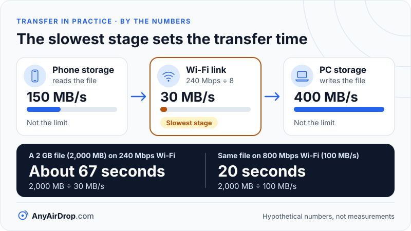

There is no single way to move files between a PC and a phone, because the two devices rarely share a vendor, an app or even an operating system. What exists instead is a handful of routes with different trade-offs: browser-based tools, ecosystem apps from Microsoft, Google and Apple, file-server apps on the phone, a USB cable, and cloud storage. Which one fits depends on your devices, how much you are moving, and how much setup you will accept.

**Short answer:** every method either sends the file across your local network, over a cable, or via the internet and back. Local network and cable routes depend on your own hardware and do not use your internet plan. Cloud storage uses the internet in both directions. Each method also has a limit on the devices it supports, so check the requirements for your phone and PC before choosing.

## The three routes a file can take

The diagram above shows the underlying choice. A file moves between a phone and a PC by one of three physical routes:

1. **Through your router on the same Wi-Fi.** The phone and PC are both on the same local network, and the data stays inside the building. Browser tools, ecosystem apps and file-server apps all work this way.
2. **Over a USB cable.** The phone appears to the PC as a device or drive. No network is involved at all.
3. **Through the internet.** The phone uploads the file to a server, and the PC downloads it from there. This is how cloud storage and "send by link" services work.

Everything else is about which software sits on top of one of those routes. [Local file-sharing protocols](/blog/local-file-sharing-protocols-smb-ftp-http-sftp/) covers the languages (SMB, FTP, HTTP) that the apps speak.

## The options, one at a time

### Browser-based tools

A browser-based tool needs no installation: you open a web page on each device, connect them, and send. Many use WebRTC so the file goes straight from one browser to the other ([how that works](/blog/webrtc-data-channels-explained/)). They suit one-off transfers, mixed devices (an Android phone and a Windows PC, or an iPhone and a Linux laptop) and borrowed computers where you cannot install anything.

Limits: the page itself usually has to load over the internet, and a web page has less access to the phone's storage than an installed app. Large-file handling depends on the browser. AnyAirDrop.com is our own tool in this category: it runs in the browser with no install or account, devices on the same Wi-Fi find each other or pair with a 6-digit or QR code, files go device to device and are not uploaded to the site's server, and the receiver must tap Accept.

### Ecosystem apps

Each platform maker offers its own route, usually between its own products.

- **Phone Link (Microsoft).** For supported Android phones, [Microsoft's support page](https://support.microsoft.com/en-us/windows/apps/phonelink/seamlessly-transfer-content-between-your-devices) describes a file drag-and-drop feature between a phone and a PC on the same Wi-Fi network. As Microsoft documents it, there are limits: up to 100 files at a time, no single file larger than 512 MB, and the feature works only with select models from a short list of manufacturers. Check the page, since the list changes.
- **Quick Share for Windows (Google).** [Google's help page](https://support.google.com/android/answer/13801258?hl=en) says it needs a 64-bit Windows 10 or later PC and an Android 6.0 or later phone, with Bluetooth on for both, both devices on the same network, and the devices within about 5 meters (16 feet). Our guide to [how Quick Share works](/blog/how-quick-share-works/) explains the discovery step.
- **Apple Devices app (Apple).** For an iPhone and a Windows PC, [Apple's guide](https://support.apple.com/guide/devices-windows/transfer-files-between-your-devices-mchl4bd77d3a/windows) describes dragging files into apps that support file sharing, over a USB cable or over Wi-Fi once Wi-Fi syncing has been set up. On a Mac, the Finder fills this role.

These tend to be smooth when your devices match, and unavailable when they do not. Features, supported models and names change across versions, so treat the descriptions here as a starting point.

### File-server apps on the phone

An app on the phone can turn it into a small file server, using a protocol such as FTP, SFTP, SMB or HTTP. The PC then connects with File Explorer or another client. This route is flexible, since a PC and phone of any brand can use it, and the transfer stays on your network. The costs are setup effort (server address, port, sometimes a username and password) and the fact that you need a trustworthy app to run the server. Because the phone is acting as a server, anyone on the same network who finds the address may try to connect, so use a password and stop the server when you are done.

### USB cable (MTP)

For an Android phone, [Google's instructions](https://support.google.com/android/answer/9064445) say to unlock the phone, connect the cable, tap the USB notification and choose "File Transfer." The phone then opens as a device in Windows File Explorer. This uses MTP (Media Transfer Protocol), which lets the PC browse the phone's storage. Google also notes that not all USB cables can transfer files, so a cable that only charges the phone will not work.

A cable needs no network and no accounts, so it works anywhere, even offline. The speed depends on the USB version supported by the phone and the cable, and many phones are limited by their own storage as well. For iPhone, the Apple Devices app is the cable route on Windows.

### Cloud storage

Services such as Google Drive, OneDrive, iCloud Drive or Dropbox sync files between devices through their servers. This is the right route when the devices are not near each other, when you want a backup copy, or when you want a link someone else can open. The cost is that every byte takes two trips over your internet connection, one up and one down. [Local transfer vs cloud upload](/blog/local-transfer-vs-cloud-upload/) works through the numbers.

## Comparison table

This table compares typical characteristics. "Speed class" describes what limits the speed, not a promised figure, because real results depend on your devices and network.

| Method | Setup effort | What limits speed | Install needed | Works without internet |
| --- | --- | --- | --- | --- |
| Browser-based tool | Low | Your Wi-Fi, if the tool sends locally | None (browser) | Usually needs internet to load the page and connect |
| Ecosystem apps | Medium: install, sign in, pair | Your Wi-Fi or Bluetooth link, and per-feature caps | App on the PC, sometimes the phone | Often, once set up, but check each app |
| Server app on the phone | Medium to high | Your Wi-Fi and the phone's storage | App on the phone | Yes, if both are on the same network |
| USB cable (MTP) | Low | The USB version, the cable and the phone's storage | None on Windows | Yes, no network needed |
| Cloud storage | Low to medium: account | Your internet upload, then download | App or browser, plus an account | No |

No row is better in general. A cable is simple but needs a cable and a free port. Ecosystem apps are convenient inside one ecosystem. Cloud storage is the only one that reaches a person in another city.

## What decides the speed: the slowest link in the chain

A transfer is only as fast as its slowest stage. The file is read from the sender's storage, sent over the link, and written to the receiver's storage, and the stage with the lowest throughput sets the pace.

Here is a worked example with **hypothetical** numbers, chosen only to show the arithmetic. They are not measurements of any device.

- A 2 GB file (2,000 megabytes).
- The phone reads storage at 150 MB/s.
- The Wi-Fi link delivers 240 Mbps of real throughput. Divide by 8 to convert bits to bytes: 240 ÷ 8 = 30 MB/s.
- The PC writes at 400 MB/s.

The slowest stage is the Wi-Fi at 30 MB/s, so the transfer takes about 2,000 ÷ 30 ≈ 67 seconds. Speeding up the phone's storage or the PC's disk changes nothing, since neither is the bottleneck. If instead the Wi-Fi delivered 800 Mbps (100 MB/s) in some better setup, the phone's 150 MB/s would still not be the limit, and the answer would be 2,000 ÷ 100 = 20 seconds.

*In this hypothetical example only a faster Wi-Fi link shortens the transfer, because neither storage stage is the bottleneck.*

The same logic applies to a cable: if a phone supports only USB 2.0 data speeds, that is the ceiling regardless of how fast the PC is. Why a Wi-Fi link rate and the real throughput differ is covered in [Wi-Fi link speed vs real speed](/blog/wifi-link-speed-vs-real-speed/).

## Three questions that pick the route for your phone and PC

A practical way to choose is to ask three questions.

1. **Are both devices in the same place?** If not, cloud storage is the realistic route. If yes, a local route will not touch your internet plan.
2. **Do you already own a matching ecosystem?** An Android phone with a Windows PC can use Quick Share or Phone Link, and an iPhone with a Mac can use the Finder. If your devices do not match, a browser-based tool or a cable avoids vendor limits.
3. **How much and how often?** For a few photos, anything works. For tens of gigabytes, a cable, or a PC wired to the router with the phone on a strong Wi-Fi signal, is less fragile than a long wireless transfer on a weak signal that must stay awake the whole time.

If your devices cannot find each other over Wi-Fi, the cause is usually the network rather than the app. Start with [why devices can't find each other](/blog/devices-cant-find-each-other-troubleshooting/). And if you have no Wi-Fi at all, the phone's own hotspot can create a network for the two devices; see [transferring files over a hotspot without internet](/blog/transfer-files-over-a-hotspot-without-internet/).

## Common questions

### What is the easiest way to transfer files from phone to PC?

The easiest is whichever needs the least setup for your pair of devices. For an Android phone, a USB cable and "File Transfer" mode is quick to set up and needs nothing installed on Windows. For mixed devices or no cable, a browser-based tool is usually the least work.

### Can I transfer files from an iPhone to a Windows PC?

Yes. Apple's Devices app for Windows can move files into and out of apps that support file sharing, over USB or over Wi-Fi after setup. Browser-based tools and cloud storage also work with iPhones. What you can reach depends on the iPhone's permissions and which apps expose files.

### Do I need internet to transfer files over Wi-Fi?

For the transfer itself, often no: a local route stays on your network. But some tools need the internet to load a web page, sign in or set up the connection. A cable and a phone-hosted server app do not need it.

### Why is my phone not showing up on my PC over USB?

A common cause is a cable that only charges, or a phone left in its charging mode. Google's support page suggests restarting the computer and the phone, updating Android, trying a different cable, and choosing "File Transfer" under the USB notification.

### Is a USB cable faster than Wi-Fi?

It depends on both. A cable is limited by the USB version of the phone and the cable, and Wi-Fi by the link quality. Either can be faster, so compare what your own devices support rather than assuming.

## Key takeaways

- Files travel by one of three routes: your local network, a cable, or the internet and back.
- Ecosystem apps (Phone Link, Quick Share, the Apple Devices app) work well within their supported devices and have their own requirements and limits.
- A USB cable needs no network, but depends on a data-capable cable and the phone's USB speed.
- Cloud storage is the only option that works across distance, at the cost of uploading and downloading.
- Speed is set by the slowest stage: sender storage, the link, or receiver storage.

## Sources

- Microsoft Support: [Seamlessly transfer content between your devices (Phone Link)](https://support.microsoft.com/en-us/windows/apps/phonelink/seamlessly-transfer-content-between-your-devices)
- Google: [Share files between Android and Windows with Quick Share](https://support.google.com/android/answer/13801258?hl=en)
- Google: [Transfer files between Android and a computer](https://support.google.com/android/answer/9064445)
- Apple Support: [Transfer files between your Windows device and iPhone, iPad or iPod touch](https://support.apple.com/guide/devices-windows/transfer-files-between-your-devices-mchl4bd77d3a/windows)
