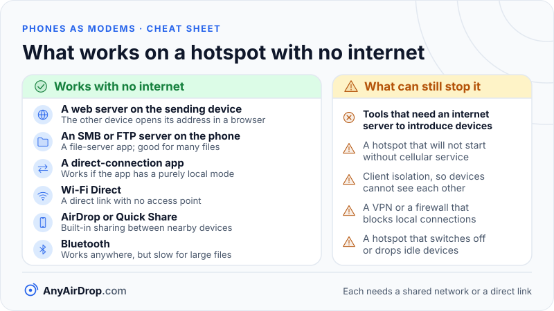

When two devices join the same phone hotspot, they form a small local network, and traffic between them does not need the internet. A laptop and a second phone on one hotspot can exchange files directly over Wi-Fi even if the hotspot phone has no mobile data at all, provided the hotspot will start in the first place and nothing blocks the devices from reaching each other. Several things can get in the way, and most of them are about software, not about radio.

**Short answer:** a hotspot is a Wi-Fi access point plus a DHCP server, and neither depends on the cellular modem. Files that travel from one client to another are forwarded inside the access point and never touch the modem, so they work offline. The caveats are that some phones refuse to start a hotspot without cellular service, some hotspots do not let clients see each other, and any tool that needs an internet server to introduce the two devices will not work.

## Why a hotspot is also a local network

[How a phone hotspot works](/blog/how-phone-hotspot-works/) describes the pieces: the Wi-Fi chip runs as an access point, and the operating system runs a DHCP server that gives each client a private address. The cellular modem is only the exit to the internet. If the modem has nothing to connect to, the access point and the DHCP server keep working.

There are three different paths through a hotspot phone, and only one of them uses the modem:

| Path | Example | Passes through the cellular modem? | Address translation (NAT)? |
| --- | --- | --- | --- |
| Client to the internet | Laptop loads a web page | Yes | Yes, on the phone |
| Client to the hotspot phone | Laptop opens a page served by the phone | No | No |
| Client to another client | Second phone sends a file to the laptop | No | No |

NAT, the address rewriting described in [how a router works](/blog/how-a-router-works-nat-dhcp-dns/), exists to let private addresses share one public address on the way out. Traffic between two devices that both have addresses in the hotspot's private range is not leaving the network, so there is nothing to translate. It is forwarded at the Wi-Fi level by the access point, the way two laptops on a home router talk to each other. [Private IP addresses and local networks](/blog/private-ip-addresses-and-local-networks/) covers why those ranges are reserved for exactly this.

## A trace of one offline transfer

Imagine phone A has Wi-Fi hotspot switched on and no working mobile data. A laptop and phone B join it. The addresses below are illustrative, since the real range depends on the phone and software.

1. Phone A's access point starts broadcasting. It does not check whether the internet is reachable first, because beacons and handshakes are purely Wi-Fi.
2. The laptop and phone B join and ask for addresses with DHCP. Phone A's DHCP server replies with, say, 192.168.49.20 for the laptop and 192.168.49.21 for phone B, with 192.168.49.1 as the gateway.
3. Phone B wants to send a file to 192.168.49.20. Because the destination is in the same subnet as its own address, it does not send the packet to the gateway. It asks, using ARP (Address Resolution Protocol), "who has 192.168.49.20?" and then addresses the Wi-Fi frame to the laptop's hardware address.
4. The frame goes over the air to the access point, which forwards it to the laptop. No router decision, no NAT and no modem.
5. The laptop replies the same way, and the transfer app on top (a web page, a file server, an app) carries on as usual.

The third step also answers a worry that many people have: phones flag a network without internet access as "no internet", and some then send app traffic over mobile data instead. A device decides whether a destination is local from its own address and subnet, so a system that handles the network normally sends local traffic over Wi-Fi. Android is the case to watch. A 2016 [Android Developers Blog post](https://android-developers.googleblog.com/2016/07/connecting-your-app-to-wi-fi-device.html) explains that on Android 5.0 and later, requests are not routed to a Wi-Fi network that lacks internet connectivity unless the app binds itself to that network. If a client phone has mobile data on and a local address will not open, turning mobile data off for the transfer is a common first test.

### What it does to speed

Both devices use the same Wi-Fi channel, and the frame crosses it twice, once from phone B to the access point and again from the access point to the laptop. A rough illustration: if the Wi-Fi link gave one device about 200 Mbps of real throughput, a transfer between two clients would manage roughly half of that, about 100 Mbps, because each frame uses airtime twice. A 1 gigabyte file is 8,000 megabits, so at 100 Mbps it would take around 80 seconds. These are illustrative numbers, not measurements, and real results depend on the band, distance and the phone. If one of the two endpoints is the hotspot phone itself, there is only one hop and the transfer is faster, as the wireless hop explanation in [how Wi-Fi works](/blog/how-wifi-works/) suggests.

## What can stop it

**The hotspot refuses to start.** Rules differ. On an iPhone, Apple's page ties Personal Hotspot to carrier support, and if the option is dimmed it says to check that Cellular Data is on. Google's help page warns that some carriers limit tethering or charge extra for it. Some Android phones will start a hotspot without a SIM or data and others will not. Android also has a "local-only hotspot" feature for apps. According to the [Android developer documentation](https://developer.android.com/develop/connectivity/wifi/localonlyhotspot), it lets applications on the connected devices communicate with each other, and the network it creates has no internet access. It is an interface for apps rather than a switch people flip by hand.

**Devices cannot see each other.** An access point can be set to block client-to-client traffic, a feature called client isolation, covered in [client isolation, guest networks and device visibility](/blog/client-isolation-guest-networks-and-device-visibility/). A hotspot is also built to share internet access, so reaching other devices on it is not something every phone promises; the iPhone's case is covered in [iPhone Personal Hotspot explained](/blog/iphone-personal-hotspot-explained/). If devices on your hotspot cannot find each other, one of these is a likely cause, and the fix is to use a method that does not rely on the hotspot, such as Wi-Fi Direct.

**Automatic discovery fails.** Many apps find nearby devices using multicast announcements, such as mDNS (multicast DNS, the technology behind Bonjour), described in [mDNS and Bonjour device discovery](/blog/mdns-bonjour-device-discovery/). Some access points handle multicast poorly. When discovery fails, typing the other device's IP address directly often works if the transfer method supports it.

**The hotspot switches itself off.** Android's hotspot settings include an automatic shutdown timeout. Google's help page mentions a setting that turns the hotspot off when no devices are connected. Apple's [platform support guide](https://support.apple.com/guide/platform-support/troubleshoot-personal-hotspot-connections-sup025284ac0/web) says third-party devices disconnect from an iPhone hotspot after 90 seconds without network traffic. A quiet moment while you pick a file can end the session.

**Device limits.** Google's help page says a Wi-Fi hotspot can share with up to 10 other devices, Apple says the count depends on carrier and iPhone model, and the [Android platform documentation](https://source.android.com/docs/core/connect/wifi-softap) says the maximum is the lower of the hardware limit and the carrier limit.

**A VPN or firewall on a client.** A VPN that sends all traffic through a tunnel can block access to local addresses, and a computer's firewall may treat the hotspot as a public network and block incoming connections. Turning off the VPN for the transfer, or marking the network as private, is the usual remedy, though the setting names differ by system.

**Tools that need an internet server.** Many modern file-transfer tools use a server on the internet to introduce two devices before they connect directly. Browser-based tools built on WebRTC, for example, need a signaling server to exchange connection details; [WebRTC data channels explained](/blog/webrtc-data-channels-explained/) and [STUN, TURN and ICE](/blog/stun-turn-ice-explained/) describe why. Without internet access on the hotspot, the introduction never happens. AnyAirDrop.com is our own tool, and it works this way: it needs an internet connection to introduce the two devices, so it does not work on a completely offline hotspot.

## Methods that work offline

None of the methods below needs an internet connection once the devices share a network or a direct link. The details of each live in other posts, so this table keeps to the idea.

| Method | How it works | Notes |
| --- | --- | --- |
| A web server on the sending device | An app on the phone serves files over HTTP; the other device opens the phone's address in a browser | Works on any device with a browser; you type or scan the address |
| An SMB or FTP server on the phone | A file-server app lets a computer map the phone as a network folder or FTP location | Good for many files; protocols are compared in [SMB, FTP, HTTP and SFTP](/blog/local-file-sharing-protocols-smb-ftp-http-sftp/) |
| A direct-connection app | Two copies of an app connect over the local network using addresses shown on screen or a code | Works if the app supports a purely local mode |
| Wi-Fi Direct | The two devices create a direct Wi-Fi link without an access point or internet | The [Wi-Fi Alliance](https://www.wi-fi.org/discover-wi-fi/wi-fi-direct) says it lets devices create their own Wi-Fi networks without an internet connection or an access point |
| AirDrop or Quick Share | Built-in nearby sharing between supported devices | Designed for nearby devices; see [how AirDrop works](/blog/how-airdrop-works/) and [how Quick Share works](/blog/how-quick-share-works/) |
| Bluetooth | Pair and send | Works anywhere, but slow for large files; see [Bluetooth file transfer explained](/blog/bluetooth-file-transfer-explained/) |

Wi-Fi Direct deserves its own mention, because it removes the hotspot altogether. Android's [Wi-Fi Direct guide](https://developer.android.com/develop/connectivity/wifi/wifip2p) describes how nearby devices connect directly over Wi-Fi without an access point and then exchange data over ordinary sockets. We explain the family in [Wi-Fi Direct, Wi-Fi Aware and AWDL](/blog/wifi-direct-wifi-aware-awdl-explained/).

*A tool that needs an internet server to introduce the devices is the one kind that fails on a fully offline hotspot.*

## A practical plan for moving files on an offline hotspot

Because the failure points are predictable, a short routine saves time:

1. **Make one of the endpoints the hotspot phone if you can.** One hop is faster than two, and the hotspot phone sits at the gateway address, which is easy to find. On an iPhone, Apple does not promise that apps on the hotspot network can reach apps on the phone itself, so test it before relying on it.
2. **Join both devices and wait for an address.** If a device says it is connected but has no address, DHCP did not finish; toggle its Wi-Fi.
3. **Find the receiving device's address** in its network details. Menu names vary by device and version, so look for the connected network's details or "IP address".
4. **Turn off VPNs** on both ends for the transfer.
5. **Use a method from the table that does not need the internet.** A tiny web server or file server app is the most universal; Wi-Fi Direct or built-in nearby sharing is simpler if both devices support it.
6. **Check for client isolation** if the devices cannot reach each other, and switch to Wi-Fi Direct if so.

The same steps apply when the hotspot is only your temporary network at a campsite, in a car or in a building with no working Wi-Fi. For the general topic of moving files between a computer and a phone, see [transferring files between PC and phone over Wi-Fi](/blog/transfer-files-between-pc-and-phone-over-wifi/).

## Common questions

### Can I transfer files over a hotspot with no mobile data?

Often yes. The hotspot's Wi-Fi and address-assignment parts do not need the cellular modem, so devices on it can exchange files directly. The conditions are that the phone allows the hotspot to start without data and that clients are allowed to reach each other.

### Does transferring files over a hotspot use my data plan?

A transfer between two devices on the same hotspot stays on the Wi-Fi network and does not use mobile data. Anything that goes to the internet does, including cloud uploads and updates running in the background, so watch for those while the hotspot has a data connection.

### Why does my phone say "no internet" on a hotspot with no data?

Phones test whether a network can reach the internet and flag it when it cannot. The warning is about the internet route only, and local traffic to other devices on the same network can still flow. Some phones, Android in particular, may send app traffic over mobile data instead of the "no internet" Wi-Fi network when mobile data is on, which can stop a local connection from opening until mobile data is switched off.

### Why can't my laptop see my other phone on the hotspot?

Likely causes are client isolation, a firewall on the laptop treating the network as public, a VPN, or multicast discovery not working. Try connecting by IP address, or use Wi-Fi Direct.

### Is a hotspot better than Wi-Fi Direct for transferring files?

Not necessarily. A hotspot is better when several devices must join and you want a familiar network. Wi-Fi Direct gives a direct link with one hop, which is usually simpler and faster for two devices. Which one you can use depends on what your devices and apps support.

## Key takeaways

- A phone hotspot is an access point plus a DHCP server, and neither needs the cellular modem, so devices on it can talk to each other with no mobile data.
- Client-to-client traffic is forwarded inside the access point, so NAT and the modem are not involved.
- Transfers between two clients cross the Wi-Fi channel twice, so expect roughly half the speed of a single-hop link.
- The main failure points are phones that refuse to start a hotspot without service, client isolation, VPNs and firewalls, and failed discovery.
- Tools that need an internet server to introduce the devices, including AnyAirDrop.com, will not work on a completely offline hotspot.
- Local web servers, SMB or FTP servers, Wi-Fi Direct and built-in nearby sharing all work without the internet.

## Sources

- Apple Support: [Personal Hotspot on iPhone and iPad](https://support.apple.com/en-us/111785)
- Apple Support: [Troubleshoot Personal Hotspot connections on iPhone and iPad](https://support.apple.com/guide/platform-support/troubleshoot-personal-hotspot-connections-sup025284ac0/web)
- Google Android Help: [Share a mobile connection by hotspot or tethering on Android](https://support.google.com/android/answer/9059108)
- Android Open Source Project: [Wi-Fi hotspot (Soft AP)](https://source.android.com/docs/core/connect/wifi-softap)
- Android Developers Blog: [Connecting your app to a Wi-Fi device](https://android-developers.googleblog.com/2016/07/connecting-your-app-to-wi-fi-device.html)
- Wi-Fi Alliance: [Wi-Fi Direct](https://www.wi-fi.org/discover-wi-fi/wi-fi-direct)
