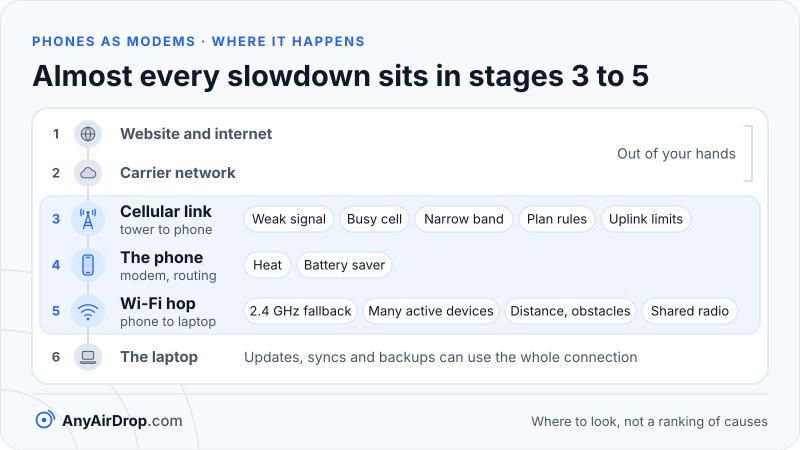

A phone hotspot feels slow when one link in a chain of several is weak, and the chain is longer than it looks. The data crosses the internet, the carrier's network, the radio link to the tower, the phone itself, and then a second radio link, Wi-Fi, to your laptop. Whichever of those is slowest sets the speed. The useful question is not "why is my hotspot slow" but "which link is slow", and you can answer that in about five minutes.

**Short answer:** in many cases the slow link is on the cellular side: weak signal, a busy tower, a narrow band or plan rules that lower your priority. The other suspects sit between phone and laptop: a 2.4 GHz connection, several active devices, a distant laptop, or a phone that is hot or in battery-saving mode. To separate them, run a speed test on the phone itself, then another on the laptop within the same minute. Do not run both at once, because they would share one cellular link. If the two results match, the problem is cellular. If the phone is much faster, the problem is the hotspot link.

## The chain behind every hotspot connection

When your laptop loads a page through a hotspot, the data passes through these stages, as traced in [how a phone hotspot works](/blog/how-phone-hotspot-works/):

1. The website's server and the internet path to your carrier.
2. The carrier's core network and the tower's own connection to it.
3. The radio link between the tower and your phone (cellular).
4. The phone's modem, processor and operating system, which do the routing and address translation.
5. The Wi-Fi link between the phone and the laptop.
6. The laptop itself.

Stages 1 and 2 are out of your hands. Stages 3 to 5 are where almost every hotspot problem lives: stages 3 and 4 are the cellular and phone side, and stage 5 is the Wi-Fi hop.

*Start your search at the cellular link, the phone or the Wi-Fi hop, because the slowest stage sets the speed of the whole chain.*

## Cellular causes

**Weak signal.** The tower and phone choose a modulation and code rate based on signal quality. A stronger, cleaner signal permits denser modulation and more data streams; a weak one forces the link to fall back to slower settings. The arithmetic in [LTE vs 5G explained](/blog/lte-vs-5g-explained/) shows how modulation and channel width set the peak rate. Signal bars are a coarse summary. Some phones also show a raw reading in dBm (decibels relative to a milliwatt) in a status or network information screen, whose location varies by phone. For LTE this is commonly the reference signal power (RSRP). Values closer to zero are stronger, so -85 is stronger than -110. One router maker's [LTE signal guide](https://wiki.teltonika-networks.com/view/Mobile_Signal_Strength_Recommendations) rates -80 dBm or better as excellent and anything below -100 dBm as poor. Other vendors draw the lines a little differently, and the numbers differ by technology and by phone, so treat them as a rough guide only. Android's [CellSignalStrengthLte](https://developer.android.com/reference/android/telephony/CellSignalStrengthLte) reference shows what apps can read, including signal power, quality and signal-to-noise.

Position matters more than people expect. Moving a phone to a window, a higher floor or a different room can change the reading a lot, because walls and metal-coated glass absorb cellular signals.

**A congested cell.** A tower shares its capacity among everyone using it. When many people are active at the same moment, as at an event, a station or a commuting hour, each gets a thinner slice, however many bars you show.

**The band and channel width in use.** A phone attached to a narrow low-band channel has a lower ceiling than one attached to a wide mid-band channel or to several aggregated carriers, as explained in [LTE vs 5G explained](/blog/lte-vs-5g-explained/). The "5G" icon alone does not tell you which one you have.

**Plan rules.** Carriers set their own rules for tethered data. Google's help page says some carriers limit or charge extra for tethering, and Apple's Personal Hotspot page says the feature depends on carrier support and may carry additional fees. In general terms, a plan may include a separate hotspot allowance, may give hotspot traffic lower priority when the network is busy, or may slow it after a threshold. These terms vary by carrier and plan and change over time, so the plan documents or the carrier's support pages are the place to confirm what yours does. If a slowdown is a plan rule, the honest remedies are a plan with a larger allowance or a different carrier, not a workaround.

**Uplink limits.** Uploads are the weaker direction of a cellular link: a phone's transmitter is far less powerful than a tower's, and many networks give the downlink more capacity. A laptop backing up photos or sending a video call stream through a hotspot hits this limit first.

## Hotspot-link causes

**A 2.4 GHz fallback.** If the hotspot runs on 2.4 GHz, its ceiling is much lower than on 5 GHz. On paper, a single-stream 20 MHz Wi-Fi 4 link tops out near 72 Mbps while a single-stream 80 MHz Wi-Fi 5 link reaches about 433 Mbps (the calculation is shown in [iPhone Personal Hotspot explained](/blog/iphone-personal-hotspot-explained/)). On iPhone, Apple says the Maximize Compatibility setting makes the hotspot use 2.4 GHz and may reduce performance. On Android the equivalent setting is usually a band or compatibility option in the hotspot menu, with wording that varies by maker. The 2.4 GHz band is also crowded in apartment buildings, which cuts speed further. See [Wi-Fi bands compared](/blog/wifi-bands-2-4-5-6-ghz/).

**Many active clients.** Every device on the hotspot shares the phone's single cellular link and its Wi-Fi airtime. A laptop, a tablet and a phone all updating at once each get a share. Google's help page says a hotspot can serve up to 10 devices, but ten devices competing for one radio link rarely feel fast.

**Distance and obstacles.** A phone's antennas are small and tucked into the case, often with a pocket or a bag around them. A laptop on the other side of a wall has a weaker Wi-Fi link, so the rate falls. Putting the phone and laptop in the same room, with a clear path, often helps more than any setting.

**Sharing one radio.** If the phone is also connected to a Wi-Fi network while running a hotspot, some chips time-share a single radio. Android's [Wi-Fi STA/AP concurrency](https://source.android.com/docs/core/connect/wifi-sta-ap-concurrency) page describes the case where the phone's client connection and its hotspot sit on the same band but different channels: on some chips the single radio then alternates between them, and the page says performance drops severely. Turning off the phone's own Wi-Fi connection is a quick test.

**Wireless itself.** Wi-Fi gives you a shared, half-duplex radio link with overhead for waiting and acknowledgements, as described in [how Wi-Fi works](/blog/how-wifi-works/). A wired USB connection avoids that, which is why USB tethering is often steadier; see [the tethering comparison](/blog/android-hotspot-usb-bluetooth-tethering-compared/).

## Phone-side causes

**Heat.** The modem, the Wi-Fi radio and the processor all run hard during a hotspot session, and a phone in the sun or in a case warms quickly. Phones reduce radio and processor performance to protect themselves when hot, which shows up as speed that is fine for a minute and then drops. Letting the phone cool, removing a thick case and keeping it out of direct sun are the usual fixes.

**Battery saver.** Power-saving modes can limit background activity and radio behavior. If the phone is low on battery and the hotspot slows, try turning battery saver off and plugging the phone in, which Google's help page also advises while tethering.

**Background traffic on the laptop.** An operating system update, a cloud sync or a backup can consume the whole connection without any visible window open. A hotspot has far less spare capacity than home broadband, so a single background job can make everything else look slow.

## Double NAT and DNS

Two other issues cause slow-feeling or oddly broken connections rather than low raw speed.

**Double NAT.** A hotspot already translates addresses once, on the phone. Many carriers translate addresses a second time inside their network, using a shared address block that RFC 6598 ([IANA-Reserved IPv4 Prefix for Shared Address Space](https://www.rfc-editor.org/rfc/rfc6598)) reserves as 100.64.0.0/10. Two layers of NAT do not usually reduce raw download speed, but they prevent incoming connections, which affects some games, voice chat and peer-to-peer tools. [How a router works](/blog/how-a-router-works-nat-dhcp-dns/) explains the first layer.

**DNS delays.** Before a page loads, your device looks up the site's name. If the phone forwards that request to a slow resolver, every new site starts with a pause, even though a speed test shows a healthy rate once the connection exists. The symptom is pages that hesitate before loading and then load quickly. Trying a different DNS server on the laptop, or a different site, shows whether name lookup is the issue.

## A simple method to separate cellular from hotspot

You need the phone, the laptop and a speed test that you trust and use in the same way on both.

1. **Test the phone alone.** Make sure the phone itself is using cellular data and not a Wi-Fi network, with the laptop idle. Run a speed test in its browser or an app and note the download, upload and latency (ping) values. Note the signal bars or the dBm value.
2. **Test the laptop immediately after.** With the laptop on the hotspot, run the same test, ideally within the same minute and never at the same time as the phone's test, since both would compete for one cellular link. Cellular speeds change from second to second, so a test run an hour later is not comparable.
3. **Compare the two.** The table shows how to read the result. The numbers are illustrative.

| Phone result | Laptop result | Likely cause |
| --- | --- | --- |
| 80 Mbps | 78 Mbps | The hotspot is fine; the cellular side is the limit (or nothing is wrong). |
| 8 Mbps | 7 Mbps | Cellular is the bottleneck: signal, congestion or plan rules. |
| 80 Mbps | 12 Mbps | The problem is between phone and laptop: band, distance, clients, heat or a shared radio. |
| 80 Mbps | 78 Mbps, but pages feel slow | Suspect DNS or latency rather than raw speed. |

4. **Narrow it down.** If the laptop is the slow one, move it next to the phone. Turn off other clients. Switch the hotspot to 5 GHz if that is an option. Try USB tethering. Let the phone cool. Each change tests one cause, so make one change at a time and repeat the laptop test.
5. **If the phone itself is slow,** change location, walk toward a window, or wait. Check your plan terms for hotspot rules.

A speed test uses real data, and on a fast connection a test can use a large amount, so keep an eye on your allowance. Run the test two or three times, since a single reading can be a fluke.

## Why a slow hotspot does not slow a transfer between two devices on it

The most useful takeaway for file transfer is that a slow hotspot does not slow a local transfer between two devices on that hotspot. When two devices that joined the same hotspot exchange a file directly, the data travels over Wi-Fi through the phone's access point and never uses the cellular link, so the cellular bottlenecks above do not apply. The Wi-Fi limits still do: both devices share the same airtime, and the path from one device to the phone and then to the other uses it twice, as described in [how Wi-Fi works](/blog/how-wifi-works/).

If you instead send the file through a cloud service over a slow hotspot, the file crosses the weak cellular uplink once and the downlink again, which is both slow and costs data. [Local transfer vs cloud upload](/blog/local-transfer-vs-cloud-upload/) compares the two approaches, and [transferring files over a hotspot without internet](/blog/transfer-files-over-a-hotspot-without-internet/) covers the case where the hotspot is the only network you have.

## Common questions

### Why is my hotspot slower than my phone's own internet?

Because the hotspot adds a Wi-Fi hop, plus the phone's routing work, and may be subject to separate plan rules. If the phone is also much faster on its own, the cause is usually the Wi-Fi link, the 2.4 GHz band, heat or distance, not the cellular signal.

### Why does my hotspot start fast and then slow down?

Common causes are heat, because the phone reduces performance when it warms up, and plan rules that lower hotspot speed or priority after some amount of use. A busy tower can also change during the day. The plan rule is confirmed in your carrier's documents; the heat cause shows up as the phone feeling warm.

### Does having more devices on the hotspot make it slower?

Yes. All devices share one cellular link and one Wi-Fi radio. Idle devices cost little, but several active ones, especially with updates or video, split the available speed.

### Is 5 GHz or 2.4 GHz better for a hotspot?

5 GHz usually gives more speed at short range, while 2.4 GHz carries farther and is the only choice for some older devices. Use 5 GHz when the laptop is close and supports it, and 2.4 GHz when a device cannot see the network or the distance is large.

### Will a faster phone fix a slow hotspot?

Only if the phone is the limit. A newer phone may support more bands, more carrier aggregation and a faster Wi-Fi standard, which helps when those are the bottleneck. If the limit is a congested tower or a plan rule, a new phone changes nothing.

## Key takeaways

- A hotspot is a chain: cellular, then the phone, then Wi-Fi. The slowest link sets the speed.
- Run a speed test on the phone, then on the laptop within the same minute, but not at the same time. Matching results point to cellular; a slower laptop points to the hotspot link.
- Weak signal, a busy tower and plan rules are the usual cellular causes; 2.4 GHz, many clients, distance, shared radios and heat are the usual hotspot causes.
- Double NAT limits incoming connections, not raw speed, and slow DNS shows up as pages that hesitate before loading.
- Carrier hotspot rules differ by plan, so confirm them in your plan documents.
- Local transfers between devices on the hotspot avoid the cellular link entirely.

## Sources

- Google Android Help: [Share a mobile connection by hotspot or tethering on Android](https://support.google.com/android/answer/9059108)
- Android Open Source Project: [Wi-Fi STA/AP concurrency](https://source.android.com/docs/core/connect/wifi-sta-ap-concurrency)
- Apple Support: [Troubleshoot Personal Hotspot connections on iPhone and iPad](https://support.apple.com/guide/platform-support/troubleshoot-personal-hotspot-connections-sup025284ac0/web)
- IETF: [RFC 6598, IANA-Reserved IPv4 Prefix for Shared Address Space](https://www.rfc-editor.org/rfc/rfc6598)
- Android Developers: [CellSignalStrengthLte](https://developer.android.com/reference/android/telephony/CellSignalStrengthLte)
- Teltonika Networks: [Mobile Signal Strength Recommendations](https://wiki.teltonika-networks.com/view/Mobile_Signal_Strength_Recommendations)
