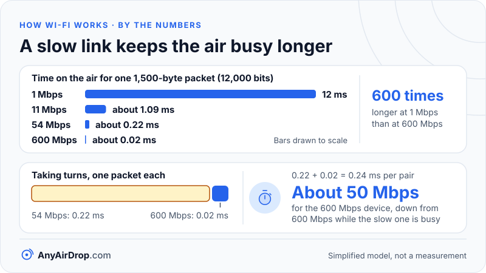

Wi-Fi standards are numbered revisions of one IEEE document, 802.11, and each revision raised speed or efficiency by changing the radio in a specific way: wider channels, denser modulation, more antennas, or smarter sharing of airtime. The letters you see on old routers (b, g, n, ac, ax) and the numbers on new ones (Wi-Fi 4, 5, 6, 7) name the same revisions.

**Short answer:** Wi-Fi 4 is 802.11n, Wi-Fi 5 is 802.11ac, Wi-Fi 6 is 802.11ax and Wi-Fi 7 is 802.11be. Newer generations are faster on paper and, from Wi-Fi 6 onward, better at serving many devices at once. Every generation still works with the older ones, but an older, slower device uses more of the channel's airtime per bit while it is transferring.

## Two names for the same thing

The standard itself is written by the IEEE 802.11 working group, which labels each amendment with letters in the order it was started: 802.11a, 802.11b, 802.11g, and so on. The letters say nothing about speed, which is why "ac" sounds newer than "n" only if you already know the order.

In October 2018 the [Wi-Fi Alliance](https://www.wi-fi.org/news-events/newsroom/wi-fi-alliance-introduces-wi-fi-6), the industry group that certifies products, introduced plain numbers: Wi-Fi 6 for 802.11ax, Wi-Fi 5 for 802.11ac and Wi-Fi 4 for 802.11n. The scheme starts at 4, and the older standards were not renumbered in that announcement. Some sources informally label 802.11b, a and g as Wi-Fi 1, 2 and 3, but those labels are not part of the Alliance's 2018 announcement.

Wi-Fi 6E is not a separate standard. It means a Wi-Fi 6 device that can also use the 6 GHz band, which the [Wi-Fi Alliance began certifying in January 2021](https://www.wi-fi.org/news-events/newsroom/wi-fi-alliance-delivers-wi-fi-6e-certification-program). Wi-Fi 7 is defined for 2.4, 5 and 6 GHz, and its widest channels exist only in 6 GHz.

## The generations side by side

| Wi-Fi name | Standard | Year | Bands | Max channel width | Top modulation | Headline rate |
| --- | --- | --- | --- | --- | --- | --- |
| (none) | 802.11b | 1999 | 2.4 GHz | 22 MHz | CCK | 11 Mbps |
| (none) | 802.11a | 1999 | 5 GHz | 20 MHz | 64-QAM | 54 Mbps |
| (none) | 802.11g | 2003 | 2.4 GHz | 20 MHz | 64-QAM | 54 Mbps |
| Wi-Fi 4 | 802.11n | 2009 | 2.4 and 5 GHz | 40 MHz | 64-QAM | 600 Mbps |
| Wi-Fi 5 | 802.11ac | 2013 | 5 GHz | 160 MHz | 256-QAM | about 6.9 Gbps |
| Wi-Fi 6 / 6E | 802.11ax | 2019 to 2021 | 2.4 and 5 GHz (6E adds 6 GHz) | 160 MHz | 1024-QAM | about 9.6 Gbps |
| Wi-Fi 7 | 802.11be | 2024 | 2.4, 5 and 6 GHz | 320 MHz | 4096-QAM | about 23 Gbps |

A few notes on reading it:

- **Year** is when the amendment or its first certified products appeared. Wi-Fi 6 products were certified from 2019 and the final IEEE text followed in 2021. For Wi-Fi 7, the Wi-Fi Alliance [announced certification on January 8, 2024](https://wi-fi.org/news-events/newsroom/wi-fi-alliance-introduces-wi-fi-certified-7), and the standard carries a 2024 date (802.11be-2024). IEEE's own page says it was [published on July 22, 2025](https://www.ieee802.org/11/).
- **Channel width** is 20 MHz for the OFDM generations. The older 802.11b spread-spectrum signal occupies 22 MHz.
- **QAM** (quadrature amplitude modulation) is how many bits one radio symbol carries: 64-QAM carries 6 bits, 256-QAM carries 8, 1024-QAM carries 10, 4096-QAM carries 12. [How Wi-Fi works](/blog/how-wifi-works/) explains the idea.
- **Headline rate** is the best case the standard allows: the widest channel, the most spatial streams (parallel data paths from multiple antennas), the densest modulation and the shortest guard interval. Those maximums assume up to 4 streams for Wi-Fi 4 and 8 for Wi-Fi 5, 6 and 7. No phone has that many antennas. Many articles still quote about 46 Gbps for Wi-Fi 7, a figure that came from an earlier plan for 16 streams. Test-equipment maker Keysight's [802.11be overview](https://helpfiles.keysight.com/csg/n7617/Content/Main/802.11be%20Introduction.htm) lists up to 8 spatial streams for the finished standard, and the same arithmetic (3,920 data subcarriers × 12 bits × 5/6 ÷ 13.6 µs × 8 streams) then gives about 23 Gbps.

### What a two-stream device gets on paper

Phones and laptops commonly have two antennas for Wi-Fi, though some have only one. For a two-stream device on a wide channel, the same standards give these theoretical link rates:

| Generation | Channel width | Two-stream link rate |
| --- | --- | --- |
| Wi-Fi 4 | 40 MHz | 300 Mbps |
| Wi-Fi 5 | 80 MHz | about 867 Mbps |
| Wi-Fi 6 | 80 MHz | about 1,201 Mbps |
| Wi-Fi 6 | 160 MHz | about 2,402 Mbps |
| Wi-Fi 7 | 320 MHz | about 5,765 Mbps |

These are still link rates, not file-copy speeds, and the gap between them is the subject of [Wi-Fi link speed vs real speed](/blog/wifi-link-speed-vs-real-speed/). They are also best cases: they need a strong signal, a clear channel, and a router and a device that both support the same width.

## What each generation fixed

Each step solved a problem the previous one exposed.

1. **802.11b (1999)** made wireless networking affordable. It used a spread-spectrum technique rather than OFDM (orthogonal frequency-division multiplexing, the many-small-signals scheme), topped out at 11 Mbps, and lived on the crowded 2.4 GHz band.
2. **802.11a (1999)** moved to the 5 GHz band, where there was far more room, and introduced OFDM, which handles echoes well. It was faster but short on range and expensive, so 2.4 GHz stayed dominant.
3. **802.11g (2003)** brought OFDM to 2.4 GHz, reaching 54 Mbps while staying compatible with the b devices people already owned.
4. **802.11n, Wi-Fi 4 (2009)** was the biggest single jump. It added MIMO (multiple antennas used to send parallel streams), optional 40 MHz channels, and frame aggregation, which packs many packets into one transmission to cut per-packet overhead. It also made dual-band routers normal.
5. **802.11ac, Wi-Fi 5 (2013)** widened channels to 80 and 160 MHz, moved to 256-QAM and added multi-user MIMO for sending to several devices at once, but only in the downstream direction. It was defined for 5 GHz only.
6. **802.11ax, Wi-Fi 6 (2019 to 2021)** targeted crowded places rather than raw peak speed. OFDMA splits a channel into slices shared by several devices in one transmission, MU-MIMO works in both directions, BSS coloring helps neighboring networks stop needlessly waiting for each other, and target wake time lets battery devices sleep longer. [MIMO, OFDMA and beamforming explained](/blog/mimo-ofdma-beamforming-explained/) covers each. The [Wi-Fi Alliance's feature page](https://www.wi-fi.org/wi-fi-macphy) lists OFDMA, MU-MIMO, target wake time and 1024-QAM among the Wi-Fi 6 features.
7. **802.11be, Wi-Fi 7 (2024)** doubled the widest channel to 320 MHz (available in 6 GHz), raised modulation to 4096-QAM for about 20 percent more bits per symbol than 1024-QAM, and added multi-link operation, in which a device uses more than one band or link at once. The same Wi-Fi Alliance page lists 320 MHz channels, multi-link operation and 4K QAM for Wi-Fi 7.

Notice the pattern: the first generations bought speed with new spectrum and modulation, the middle ones with antennas and wider channels, and Wi-Fi 6 onward put more weight on efficiency, meaning less waiting when many devices are active.

## Backward compatibility, and what an old device really costs

A Wi-Fi 6 router will talk to an 802.11g laptop. Compatibility is built into the radio signal. Every OFDM transmission since 802.11a begins with a short *preamble* in the original format that older OFDM devices can decode. It tells them how long the frame will last, so they stay quiet for that time even if they cannot understand the rest of it. This is why a mixed network works at all.

802.11b is the awkward case, because it does not use OFDM and cannot read those preambles. When a b device joins a 2.4 GHz network, the access point switches on *protection*: it sends a short announcement in the old format before each faster transmission, which costs extra airtime for everyone on that band. b devices are rare now, and 5 GHz and 6 GHz never had them.

### Why one old device does not slow everything down by itself

An idle old device costs almost nothing. It sends an occasional small frame and otherwise sits quiet. Your fast devices keep using their fast rates, and they do not downgrade to match it. A smart plug on 2.4 GHz does not drag your laptop on 5 GHz down.

### Where it does cost airtime

Airtime is the shared resource, and a slow link occupies more of it for the same data. Take one 1,500-byte packet, which is 12,000 bits:

| Link rate | Time on the air |
| --- | --- |
| 1 Mbps | 12 ms |
| 11 Mbps | about 1.09 ms |
| 54 Mbps | about 0.22 ms |
| 600 Mbps | about 0.02 ms |

If a 54 Mbps device and a 600 Mbps device take turns sending one packet each, a pair takes about 0.22 + 0.02 = 0.24 ms, so each device moves 12,000 bits per 0.24 ms, close to 50 Mbps. The fast device falls from 600 Mbps alone to roughly 50 Mbps while the slow one is busy. This is a simplified model that ignores overhead and aggregation, and some access points have airtime-fairness features that change the split. It shows the principle: a slow device hurts others only while it is actively transferring, and the damage is proportional to the airtime it uses.

*The same 12,000 bits cost 12 ms of airtime at 1 Mbps and about 0.02 ms at 600 Mbps, which is why a slow device hurts others only while it is transferring.*

## What Wi-Fi 8 is aiming at

The next IEEE amendment is 802.11bn, called *Ultra High Reliability*, and widely expected to be marketed as Wi-Fi 8. It is still in development. According to the [task group's own page](https://www.ieee802.org/11/Reports/tgbn_update.htm), the project was approved in 2023, the working group has taken drafts through ballots, and final IEEE approval is projected for 2028.

Its goals are about consistency rather than a bigger peak number. The task group lists targets, measured against Wi-Fi 7, that at least one mode of operation should cut 95th-percentile delay (the slow end of response times) by 25 percent, cut lost packets by 25 percent in a given scenario, especially when a device moves between access points, and raise throughput by 25 percent at some signal levels. It also lists a way to lower power use in access points and better device-to-device operation. The IEEE's [project listing](https://standards.ieee.org/ieee/802.11/11393/) says the amendment keeps backward compatibility and coexistence with legacy 802.11 devices. Those are design targets, not results. Names, feature lists and dates can still change, and Wi-Fi Alliance certification would follow the standard.

## Matching generations when two of your devices swap files

When two devices on the same router exchange a file, the data crosses the air twice: sender to router, then router to receiver. On the same channel, those hops share airtime, so the time per bit adds up. The combined rate is roughly 1 divided by (1/R1 + 1/R2), where R1 and R2 are the two link rates.

Suppose the sender is a Wi-Fi 6 laptop at 1,201 Mbps and the receiver is a one-stream Wi-Fi 5 phone at 433 Mbps, both on the same 5 GHz channel. Then 1 / (1/1,201 + 1/433) is about 318 Mbps, before overhead. The slower device matters more than the fast one, and upgrading only one side helps less than you would expect. If one device sits on a different band from the other, the access point can handle both hops at once and the slower link sets the pace instead.

This is also why an old 2.4 GHz-only phone is the weak link in a transfer even when your router is new. [Wi-Fi vs Ethernet for local transfers](/blog/wifi-vs-ethernet-for-local-transfers/) shows what happens if one end moves to a cable, and [transferring files between a PC and a phone over Wi-Fi](/blog/transfer-files-between-pc-and-phone-over-wifi/) covers the practical side. Direct links that skip the router, such as Wi-Fi Direct, have different limits; see [Wi-Fi Direct, Wi-Fi Aware and AWDL](/blog/wifi-direct-wifi-aware-awdl-explained/).

## Common questions

### Is Wi-Fi 6 the same as 802.11ax?

Yes. Wi-Fi 6 is the Wi-Fi Alliance's consumer name for products built to the 802.11ax amendment. Wi-Fi 6E is the same technology with 6 GHz added, so a Wi-Fi 6E device is also a Wi-Fi 6 device.

### Do I need a Wi-Fi 7 router if my phone is Wi-Fi 6?

The phone will connect and run at its own Wi-Fi 6 limits. A newer router can still help through better antennas, more capacity for other devices and cleaner spectrum, but features that need Wi-Fi 7 at both ends, such as 320 MHz channels, will not work with the phone.

### Will an old device slow down my whole Wi-Fi?

Not while it is idle. While it is transferring, it takes more airtime per bit than a fast device does, which reduces what others on the same channel can get. Putting old devices on 2.4 GHz and newer ones on 5 GHz or 6 GHz keeps that cost away from the fast band.

### What does the highest number in a router's name, like AX3000, mean?

Router names usually add up the headline rates of the radios, for example a 2.4 GHz rate plus a 5 GHz rate. No single device can use the total, and the figure assumes best-case conditions. It tells you roughly which generation the router is, not what you will get.

### What happened to Wi-Fi 1, 2 and 3?

The Alliance's 2018 numbering began at Wi-Fi 4. The older standards still exist, but no official numbers were assigned in that announcement.

## Key takeaways

- Wi-Fi 4, 5, 6 and 7 are the names for 802.11n, ac, ax and be, introduced by the Wi-Fi Alliance in 2018.
- Early generations gained speed from spectrum and modulation, middle ones from antennas and wider channels, and Wi-Fi 6 onward from sharing airtime more efficiently.
- Headline rates are best cases that need the maximum streams, widest channel and a perfect signal. A two-stream device sees much lower numbers.
- Old devices do not downgrade fast ones, but a slow device that is actively transferring uses more airtime per bit.
- Wi-Fi 8 (802.11bn) is still in development and targets reliability and consistency, not a bigger peak number.

## Sources

- Wi-Fi Alliance: [Wi-Fi Alliance introduces Wi-Fi 6 (October 2018 press release)](https://www.wi-fi.org/news-events/newsroom/wi-fi-alliance-introduces-wi-fi-6)
- Wi-Fi Alliance: [Wi-Fi Alliance delivers Wi-Fi 6E certification program](https://www.wi-fi.org/news-events/newsroom/wi-fi-alliance-delivers-wi-fi-6e-certification-program)
- Wi-Fi Alliance: [Wi-Fi (MAC/PHY) features](https://www.wi-fi.org/wi-fi-macphy)
- Wi-Fi Alliance: [Wi-Fi Alliance introduces Wi-Fi CERTIFIED 7 (January 2024)](https://wi-fi.org/news-events/newsroom/wi-fi-alliance-introduces-wi-fi-certified-7)
- IEEE 802.11 Working Group: [Project overview and publication notes](https://www.ieee802.org/11/)
- IEEE 802.11 Working Group: [Task Group BN (Ultra High Reliability) update](https://www.ieee802.org/11/Reports/tgbn_update.htm)
- IEEE Standards Association: [P802.11bn project listing](https://standards.ieee.org/ieee/802.11/11393/)
- Keysight: [802.11be introduction](https://helpfiles.keysight.com/csg/n7617/Content/Main/802.11be%20Introduction.htm)
