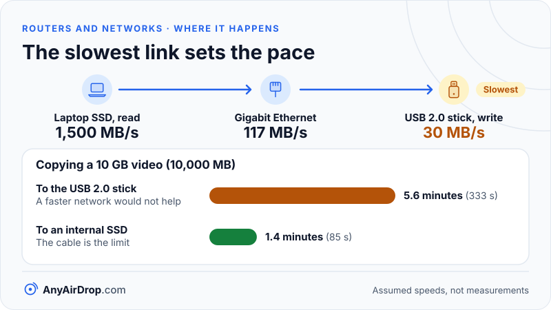

Gigabit Ethernet is rated at 1,000 megabits per second, but a file copy over it tops out near 941 megabits, about 117 megabytes per second, because every frame carries headers and gaps that are not your data. Wi-Fi has the same kinds of overhead plus the added cost of sharing the air, so for the same nominal speed it delivers less and varies more. And in many transfers neither network is the limit: the disk or USB stick at one end is.

**Short answer:** Ethernet is full duplex, almost immune to interference and predictable, with a ceiling you can calculate from the frame format. Wi-Fi is half duplex, shared and variable, and two Wi-Fi devices exchanging a file through one access point use the air twice. Ethernet is the better choice when you can run a cable, but check the cable, the adapter and the storage on both ends, because the slowest part of the chain sets the speed.

## Duplex: talking and listening at the same time

An Ethernet cable with a switch on the end is *full duplex*: each device can send and receive simultaneously, at full speed in both directions, because the switch gives each port its own private link. A big transfer in one direction does not slow the small acknowledgement packets flowing back.

Wi-Fi, as covered in [how Wi-Fi works](/blog/how-wifi-works/), is *half duplex*: on a channel only one device transmits at a time. Everything, including acknowledgements, shares the airtime with every other device on the channel, including your neighbors' networks if they use the same one. Newer standards are cleverer about how they divide the time, but they cannot make the air full duplex.

## Latency and interference

Two other differences matter for how a transfer feels.

**Latency** is the time a small message takes to cross the link and come back. On a wired local network it is typically well under a millisecond and very steady. On Wi-Fi it is typically a few milliseconds and can jump when the channel is busy, because a device must wait for a quiet moment and may have to retransmit. Large file transfers care less about this than video calls or games do, but variable latency still makes throughput wobble.

**Interference.** Wi-Fi shares its bands with neighboring networks, and the 2.4 GHz band with microwave ovens, Bluetooth and many other devices. Walls and distance weaken the signal, and when the signal drops, the link falls back to slower, more error-tolerant modulation (see [Wi-Fi link speed vs real speed](/blog/wifi-link-speed-vs-real-speed/)). Ethernet cable uses twisted pairs whose design cancels most outside noise, so its speed does not change with the microwave or the neighbors.

## Where the Ethernet ceiling comes from

A gigabit link carries 1,000,000,000 bits per second. Not all of those bits are your file. Here is what travels on the wire for one full-size frame carrying data over TCP, the usual protocol for file transfers:

| Item | Bytes |
| --- | --- |
| Preamble and start-of-frame marker | 8 |
| Ethernet header (addresses and type) | 14 |
| IP header | 20 |
| TCP header | 20 |
| TCP options (here, the timestamps option) | 12 |
| **Your file data (the payload)** | **1,448** |
| Frame check sequence (error check) | 4 |
| Mandatory idle gap before the next frame | 12 |
| **Total on the wire** | **1,538** |

The standard maximum IP packet is 1,500 bytes (the *MTU*, or maximum transmission unit). Inside it, 20 bytes of IP header, 20 bytes of TCP header and 12 bytes of TCP options leave 1,448 bytes for data. The 12 bytes of options are the TCP timestamps option, which takes 10 bytes plus 2 bytes of padding ([RFC 7323](https://www.rfc-editor.org/rfc/rfc7323)). The Ethernet header, error check, preamble and gap then add 38 more bytes outside the packet: 14 + 4 + 8 + 12 = 38. So 1,500 + 38 = 1,538, the same per-frame total that [RFC 6349](https://www.rfc-editor.org/rfc/rfc6349) uses for its TCP throughput calculations.

The efficiency is therefore 1,448 / 1,538 = 0.9415, or 94.15 percent. Applied to the link rate:

- 1,000 Mbps x 0.9415 = about **941 Mbps**
- 941.5 Mbps / 8 bits per byte = about **117.7 megabytes per second** (some tools that count in mebibytes of 1,048,576 bytes show about 112)

Without the 12-byte timestamp option, the payload would be 1,460 bytes, giving 1,460 / 1,538 = 94.9 percent, or about 949 Mbps and 118.6 MB/s. That is the figure RFC 6349 gives for gigabit Ethernet (949.2 Mbps), and the one often quoted for [goodput](https://en.wikipedia.org/wiki/Goodput). Which number you see depends on whether the connection uses TCP timestamps, which varies by operating system and settings. Either way, you cannot beat roughly 940 to 950 Mbps with ordinary frames, and the missing 6 percent is protocol overhead, not a fault.

The same math scales to other speeds, assuming the same frame sizes:

| Link | Nominal | Typical best-case file speed |
| --- | --- | --- |
| Fast Ethernet | 100 Mbps | about 94 Mbps, 11.8 MB/s |
| Gigabit | 1 Gbps | about 941 Mbps, 117.7 MB/s |
| 2.5 Gigabit | 2.5 Gbps | about 2.35 Gbps, 294 MB/s |
| 5 Gigabit | 5 Gbps | about 4.7 Gbps, 588 MB/s |
| 10 Gigabit | 10 Gbps | about 9.4 Gbps, 1,177 MB/s |

These are calculated ceilings. Real transfers add delays from TCP's behavior, the CPUs at each end and the storage.

## Wi-Fi's ceiling is less tidy

Wi-Fi also has headers, but in addition it has contention, waiting periods, acknowledgements for each frame, and a rate that changes with signal quality. A Wi-Fi 6 device with two spatial streams on an 80 MHz channel can advertise a link rate of up to 1,201 Mbps. That figure is the best-case speed of the radio link at one moment, not the speed of file copying. The usable share is a fraction of it and shrinks quickly with distance and walls, as explained in [Wi-Fi link speed vs real speed](/blog/wifi-link-speed-vs-real-speed/). It is common for the useful throughput to be well below the headline rate even in good conditions, so a gigabit-class Wi-Fi link often delivers less than a gigabit Ethernet cable does.

The structure of the transfer matters even more. If both devices are on Wi-Fi, a file goes from the sender to the access point and from the access point to the receiver, which puts the same data on the air twice. A PC on a cable and a phone on Wi-Fi cross the air only once. Moving one of the two devices to Ethernet is often the single best improvement you can make. Layouts with several access points add further hops, as covered in [mesh Wi-Fi vs extenders vs powerline](/blog/mesh-wifi-vs-extenders-vs-powerline/).

## Faster Ethernet: 2.5, 5 and 10 Gbps and the cable that carries them

Ordinary gigabit Ethernet (1000BASE-T) runs over Category 5e cable or better to 100 meters. Faster speeds over the same kind of copper cable are covered by the IEEE 802.3bz amendment (2016), which defines 2.5GBASE-T and 5GBASE-T. Both run over Cat 5e or Cat 6 cable to 100 meters (see the [802.3bz summary](https://en.wikipedia.org/wiki/2.5GBASE-T_and_5GBASE-T)), so many existing cable runs can be upgraded without re-cabling. 10GBASE-T needs Category 6A to reach the full 100 meters; ordinary Category 6 can carry it for shorter runs, up to about 55 meters under good conditions. The standards are maintained by the [IEEE 802.3 working group](https://www.ieee802.org/3/).

Two practical traps:

- **A damaged or poorly made cable can drop a link to 100 Mbps.** 1000BASE-T uses all four pairs of wires in the cable, while 100 Mbps Ethernet uses only two. A broken pair or a poorly made plug therefore causes the link to negotiate down to Fast Ethernet. At roughly 11.8 MB/s, you will notice. Look at the link speed shown in your operating system's network settings or on the port's lights.
- **Both ends and the switch in between must support the speed.** A 2.5 Gbps laptop adapter plugged into a gigabit switch still runs at 1 Gbps. Many routers have a single 2.5 Gbps or faster port while the rest are gigabit.

### USB and USB-C Ethernet adapters

Laptops and phones without an Ethernet socket use USB or USB-C adapters. The adapter is only as fast as the USB port behind it. USB 2.0 signals at 480 Mbit/s and, according to the [USB overview](https://en.wikipedia.org/wiki/USB), has a theoretical throughput of about 53 MB/s, so a "gigabit" adapter in a USB 2.0 port is capped far below gigabit. USB 3 ports signal at 5, 10 or 20 Gbit/s depending on the generation, which comfortably covers gigabit and 2.5 gigabit adapters. 10 gigabit adapters generally need a fast USB or Thunderbolt connection. Whether a phone or tablet supports a given adapter depends on the model and its software.

## When the disk is the real bottleneck

A file transfer is a chain: read from storage, send over the network, write to storage. Speed is set by the slowest link in it. Gigabit Ethernet moves about 117 MB/s, which several common storage devices cannot keep up with:

- **Spinning hard drives** read and write large files sequentially at some tens to roughly 200 MB/s depending on the model, and are much slower with many small files, because the head must move for each one.
- **USB flash drives and SD cards** vary enormously. A USB 2.0 stick tops out at tens of MB/s, and many cheap drives write much more slowly than they read.
- **SATA solid-state drives** are limited by the SATA III link: 6 Gbit/s with 8b/10b encoding carries 4.8 Gbit/s of data, or 600 MB/s. That is far above gigabit Ethernet.
- **NVMe drives and phone storage** are generally faster again.

Other limits are less obvious. Encryption and checksums use CPU time, which matters on older phones. Browsers and apps add their own overhead. And a transfer of thousands of small files is slower than one large file of the same total size, because each file needs setup work.

### A worked example

Say you send a 10 GB video, which is 10,000 MB, from a laptop with a fast internal drive to a USB 2.0 stick over gigabit Ethernet. The numbers below are assumptions to show the method, not measurements:

| Part of the chain | Assumed sustained speed |
| --- | --- |
| Laptop internal SSD (read) | 1,500 MB/s |
| Gigabit Ethernet | 117 MB/s |
| USB 2.0 stick (write) | 30 MB/s |

The slowest link is the stick, so the transfer runs at about 30 MB/s: 10,000 / 30 = 333 seconds, or about 5.6 minutes. Send the same file to an internal SSD at the other end and the cable becomes the limit: 10,000 / 117 = 85 seconds, about 1.4 minutes. Upgrading to a 10 Gbps network would change nothing in the first case. Time at other sustained speeds follows the same division: at 11.8 MB/s (Fast Ethernet) the file takes about 14 minutes, and at 40 MB/s (an assumed Wi-Fi figure) about 4 minutes.

*The same cable and the same file give very different times once the slowest link changes.*

The practical rule is to compare the numbers on both ends before spending money on the network.

## Which end limits a phone-to-PC transfer

For phone-to-phone and phone-to-PC transfers, the realistic picture is this. Phone storage is fast, so the Wi-Fi link is usually the limit. Adding a cable to one end, such as putting your PC on Ethernet, removes one of the two air hops and is often the biggest gain. If both devices must use Wi-Fi, sit close to the same access point, use the 5 GHz or 6 GHz band, and avoid a mesh arrangement where they land on different nodes.

When one end is a computer with a hard drive, a USB stick or an SD card, the storage is likely to be the limiting factor and a faster network will not help. Moving a very large file between two computers on a wired network is where Ethernet earns its place: the ceiling of about 117 MB/s is predictable, and nothing else on your network changes it much.

The same chain applies to any tool, including browser-based ones such as AnyAirDrop.com, our own: the network, the browser's handling of the file and the disk at each end all take part, so we make no speed promises for it. A local transfer will usually be faster than uploading and downloading through the internet because it is not limited by your plan's upload speed, as discussed in [local transfer vs cloud upload](/blog/local-transfer-vs-cloud-upload/). Setting up PC-to-PC sharing over a wired network is covered in [sharing files between Windows PCs over a LAN](/blog/share-files-between-windows-pcs-over-lan/).

## Common questions

### Is Ethernet always faster than Wi-Fi?

Not always at the link level, since a very good Wi-Fi 6 or Wi-Fi 7 connection can beat a 100 Mbps Ethernet port, and can exceed gigabit speeds on paper. But a gigabit cable is usually faster and far steadier than a typical Wi-Fi connection in a real home, and Ethernet has no interference or sharing.

### Why do I get 110 MB/s and not 125 MB/s on gigabit?

Because 1,000 Mbps divided by 8 gives 125 MB/s only if every bit were your data. Headers, gaps and acknowledgements take about 6 percent, so the ceiling is near 117 MB/s. Readings of roughly 110 to 117 MB/s indicate a healthy gigabit link, and tools that count in mebibytes show lower-looking numbers around 112.

### What cable do I need for gigabit Ethernet?

Category 5e or better, up to 100 meters, with all four pairs intact. For 2.5 or 5 gigabit, Cat 5e or Cat 6 can work. For 10 gigabit over longer runs, use Cat 6A.

### Does a better router make transfers between my devices faster?

It can, if the router's Wi-Fi is the limit, since a newer access point can offer faster and more efficient links. It will not help if the drive is the bottleneck. Ethernet ports on the router are rarely the limit unless they are only 100 Mbps.

### Will a USB-C Ethernet adapter reach gigabit speed?

Usually yes on a USB 3 or USB-C port, if the adapter itself is rated for gigabit. In a USB 2.0 port it cannot. Check the adapter's rating and the port's generation.

## Key takeaways

- Gigabit Ethernet's practical ceiling is about 941 Mbps or 117.7 MB/s, calculated as 1,448 data bytes out of 1,538 bytes on the wire for each full frame.
- Ethernet is full duplex and stable. Wi-Fi is half duplex, shared and variable, and two Wi-Fi devices exchanging a file use the air twice.
- A damaged cable can silently drop a gigabit link to 100 Mbps, and USB adapters are limited by the USB port generation they are plugged into.
- Cat 5e handles gigabit, 2.5 and 5 gigabit can use Cat 5e or Cat 6, and 10 gigabit over full distances needs Cat 6A.
- A hard drive, a USB 2.0 stick or a cheap card often caps the speed below the network, so check both ends of the chain.

## Sources

- IEEE 802.3 Working Group: [Ethernet standards](https://www.ieee802.org/3/)
- IETF: [RFC 6349, Framework for TCP Throughput Testing](https://www.rfc-editor.org/rfc/rfc6349)
- IETF: [RFC 7323, TCP Extensions for High Performance](https://www.rfc-editor.org/rfc/rfc7323)
- Wikipedia: [Goodput (gigabit Ethernet overhead example)](https://en.wikipedia.org/wiki/Goodput)
- Wikipedia: [2.5GBASE-T and 5GBASE-T (IEEE 802.3bz)](https://en.wikipedia.org/wiki/2.5GBASE-T_and_5GBASE-T)
- Wikipedia: [10 Gigabit Ethernet](https://en.wikipedia.org/wiki/10_Gigabit_Ethernet)
- Wikipedia: [USB](https://en.wikipedia.org/wiki/USB)
